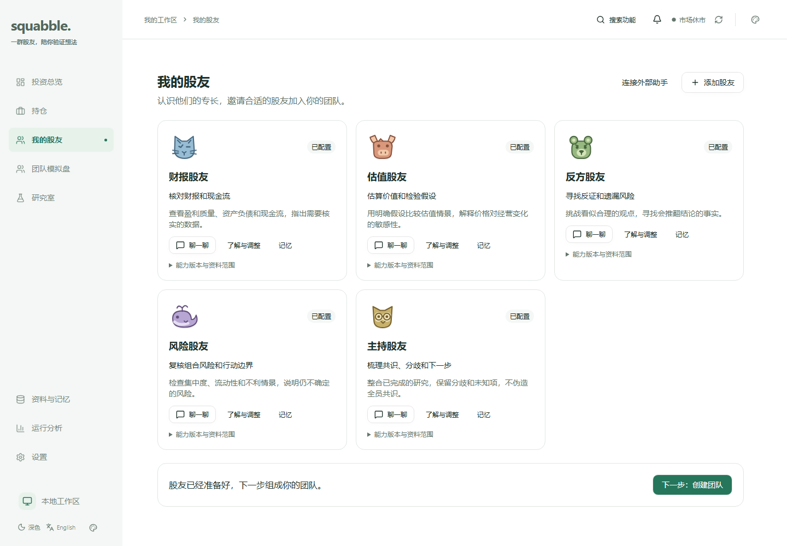
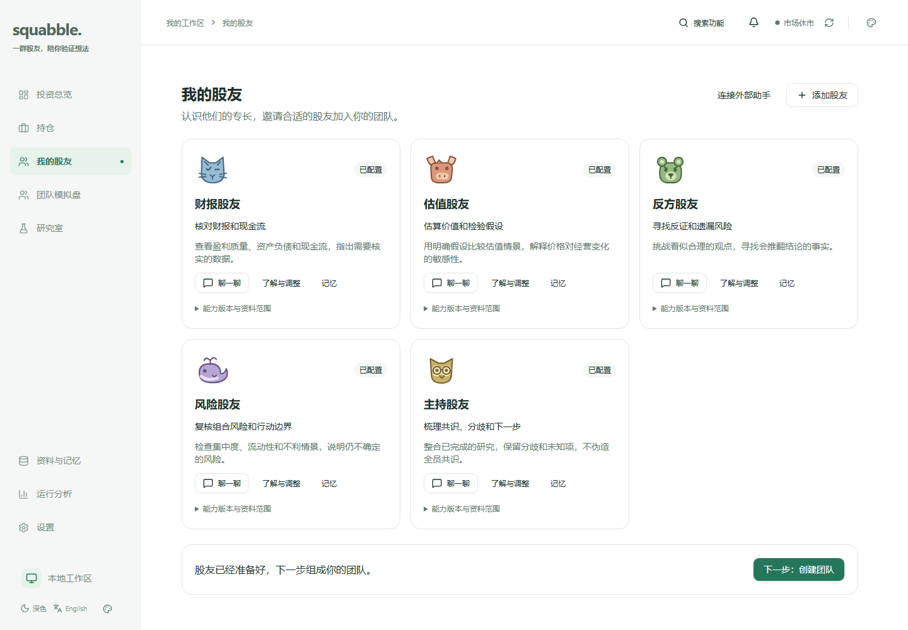
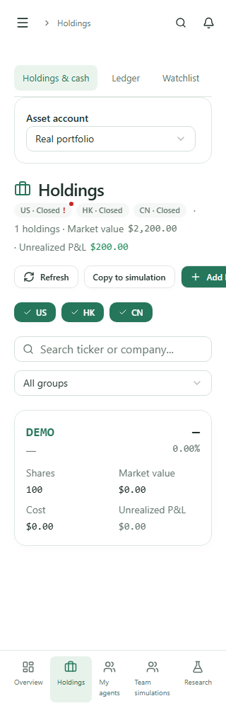
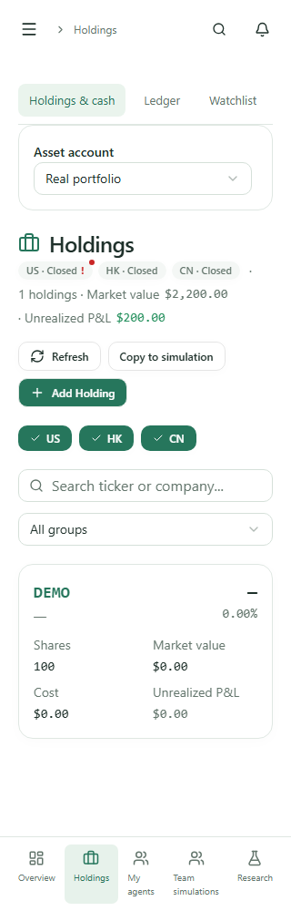
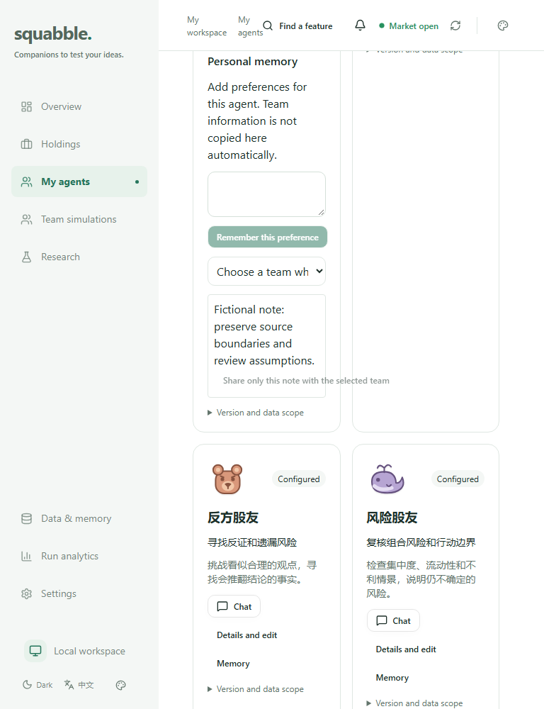
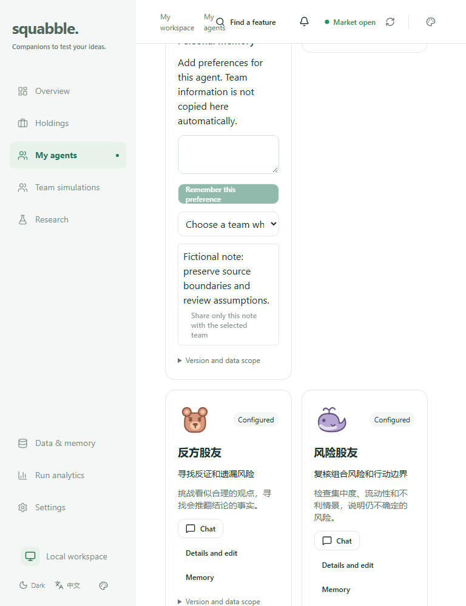

# Squabble UI 整改验收 · 2026-11-13

本轮保留当前设计语言，修复卡片对齐、窄屏内容边界和点击区域。相同探针下，112/112 场景均完整采集，命中数由 387 降至 0；无新增 P0/P1，净改善闸门通过。数字是跨路由、状态与宽度的重复命中数，不代表 387 个独立缺陷，也不代表所有页面都已经验证。

## 可观察的改动

| 范围 | 证据与结果 |
| --- | --- |
| 股友卡片 | 1440px 同行操作按钮从 y=433/433/413 变为 433/433/433；默认 footer 对齐，展开记忆或详情时邻卡保留自然高度。 |
| 个人记忆 | 768px 分享按钮从 260.77px 收到 148.5px，高度从 32px 自然增为 50px，文字完整显示在卡片内。 |
| 外部助手 | 窄卡中的刷新/停用按钮允许整项换行，消除 43.5px 越界。 |
| 持仓工具栏 | 320px 英文“Add Holding”从 x=255.52、右边界375.06，变为 x=20、右边界139.55。此项另有真实浏览器边界断言。 |
| 关闭、通知和上下文操作 | 保持图标视觉大小；弹窗关闭16px、通知17px、上下文移除22px的操作盒均扩为32×32px。 |
| 建队成员 | 整行成为可点击标签；复选框与40px头像对齐，实测整行点击只切换一次选择，不改变原保存/启动流程。 |
| 次要入口 | 股友/图表 summary、引导步骤、返回链接和记忆偏好标签使用现有间距刻度达到至少24px的有效点击高度。 |

## 前后截图

以下全部为同一客户端与虚构数据，不含个人账户或真实持仓。

| 场景 | 整改前 | 整改后 |
| --- | --- | --- |
| 股友卡片 · 1440px |  |  |
| 英文持仓 · 320px |  |  |
| 展开记忆 · 768px |  |  |

Agent 查看了以上截图及390×844研究室、持仓、股友和建队页面；研究输入框及底部导航保留在移动首屏可达范围内。截图检查不是人工批准记录。

## 确定性结果

| 规则 | before-v3 | after-v5 |
| --- | ---: | ---: |
| MISALIGN_TOP | 11 | 0 |
| MISALIGN_BOTTOM | 11 | 0 |
| H_OVERFLOW | 3 | 0 |
| TAP_TARGET | 362 | 0 |
| BTN_WRAP | 0 | 0 |
| 加权总分 | 1161 | 0 |

矩阵为10个路由入口、28种路由/状态组合、1440/768/390/320px四种宽度。包含中文、英文、混合长文本、股友编辑、展开记忆、外部连接详情和建队三步。另有390×844移动检查，以及整行选择/移除上下文的交互断言。

比较环境为 Windows x64、Playwright1.65.0、Chromium158.0.8127.18、Asia/Shanghai、固定时间、浅色、禁用截图动画。前后环境和字体检查一致。旧构建来自842dc5d，原始产物独立保留，未被新构建覆盖。

- matrix SHA256：`8fd6522f7f7be7362bde3c0422d5d6626b0a6e3552ce951d452aedf4ab0841d4`
- detector SHA256：`749aca7e7cbed933413046b435d8a4e83a2f860968acb0d3013cf95f69dbdb91`
- token SHA256：`c83cdf7904ce9fa834cd1edb2998209987cb99460fedc75c30ec270dd8924211`

完整JSON、逐屏截图、构建和测试日志保存在本地忽略目录 `output/playwright/ui-audit/`。前两次夹具契约不完整的采集已作废；没有将缺页、错误边界或部分场景算作通过。最终比较命令：

```sh
npm run ui:gate -- --vs output/playwright/ui-audit/before-v3/before.json --current output/playwright/ui-audit/after-v5/after.json
```

## 其他验证与工具

- 客户端完整测试636/636通过；后续点击区域类修改的目标测试28/28、图表测试5/5通过。
- 探针/夹具/gate测试23/23通过；覆盖缺失目标、折叠内容不可见、错误边界、响应契约、严重度升级、无效证据、环境变化和token/断点变化。
- 全量lint、前后端类型检查、stylelint、Web构建通过；后续类修改又通过对应ESLint、客户端类型检查与构建。
- contributor context测试15/15通过，check:context有效；独立只读审查没有未解决的P1/P2。
- 已安装并核验Vercel官方 `web-design-guidelines` 1.0.0。现有Playwright、computer-use、Figma覆盖本轮所需能力；没有重复安装设计风格包或额外视觉服务插件。
- CI增加 `test:ui-probe`；其余受保护检查保持。尚不把本地通过等同于GitHub CI、合并或部署通过。

## 范围与基线

金融计算、API载荷、研究授权、策略采纳/执行和持久化边界未变；没有数据库迁移、真实服务重启、模型调用或个人数据写入。五张架构图逐一核对后保留原结构，项目知识正本补充了UI验证入口。

本轮没有创建或批准 `baseline.json`，所有运行快照均为 `approvedBaseline:false`。没有新增夜间自动修复、自动合并或基线批准流程。仅在固定矩阵及已实现规则内得到零命中；对比度、遮挡、完整可访问性、其他主题、其他路由及人类审美判断不在这个结论内，详见[范围清单](KNOWN.md)。当前个人运行实例尚未切换到本分支。
