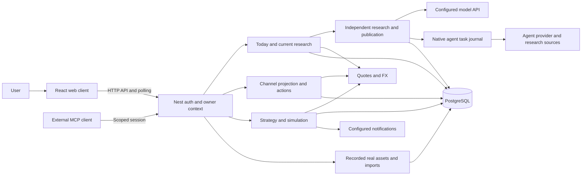
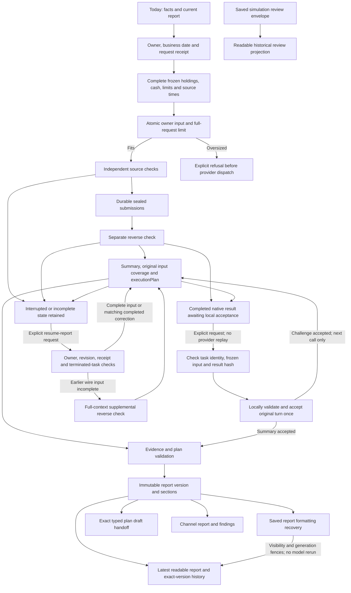
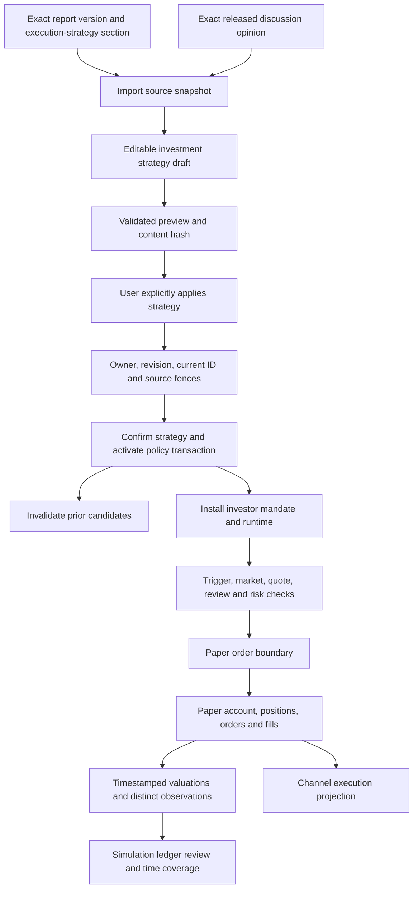
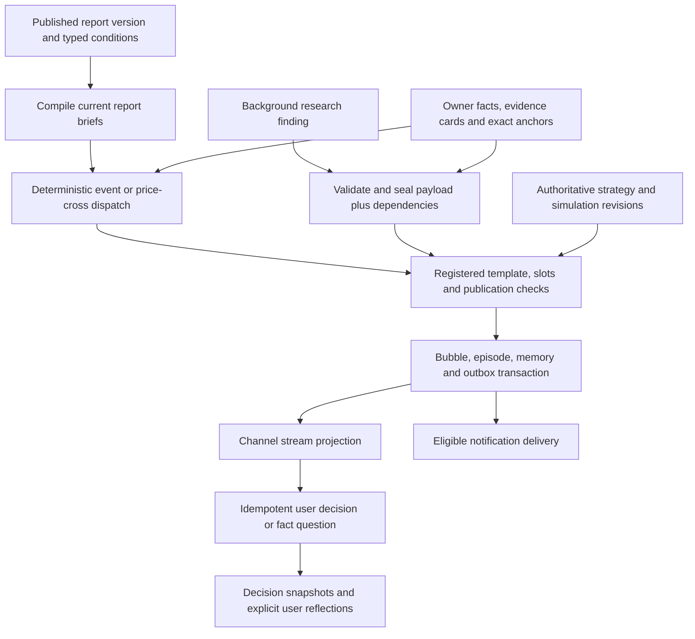
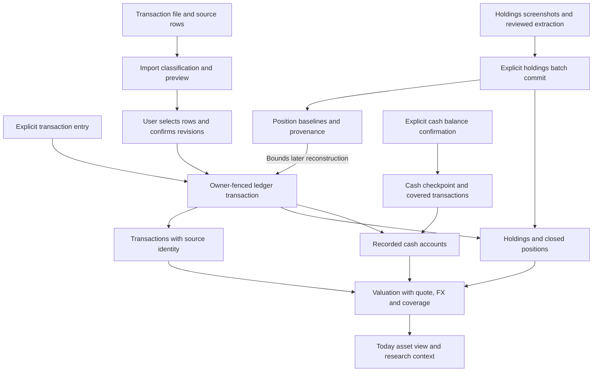

# Architecture

Squabble is a React client, a NestJS backend and PostgreSQL for personal portfolio records, research and simulated investing. The current experience starts in **Today**, produces a sealed independent daily research report and a proposed strategy, then requires explicit application before simulated execution. The channel presents sourced changes and user decisions alongside this workflow.

**Verification note — 2026-11-07:** the original five-flow review used baseline `7de30fb`. The complete-portfolio changes were reviewed against `65c388e` plus the current working-tree changes: diagrams 2 and 3 now include atomic owner input, explicit saved-research continuation and timestamp-based simulation coverage. Diagram 1's service/owner boundaries, diagram 4's publication/seal/outbox gates and diagram 5's real-ledger/import transactions remain unchanged; this change does not add a provider, publication authority or ledger write. These are reviewed source baselines, not a claim that uncommitted work has a release revision. The development phase is web-only, established at `fe9df6c`. Desktop code and manual recovery workflow are retained, with development/testing/packaging paused until explicitly resumed.

**Saved-result acceptance review — 2026-11-07, baseline `f0137167` plus working-tree changes:** diagram 2 distinguishes completed native output from locally accepted research and shows validation/reparse of a saved result before a new summary. The other four diagrams retain their structure: service/owner boundaries, simulation execution/observation semantics, channel publication gates and real-ledger writes are unchanged. The citation correction retains the existing sixty-record research evidence bound and does not grant new source or execution authority.

For setup see [self-hosting](self-hosting.md), for commands/tests see [development](development.md), and for focused code navigation see the repository-owned [contributor skill](../.agents/skills/squabble-contributor/SKILL.md).

## 1. System overview

- `client/src/app.tsx` routes `/` to `TodayPage`, `/analysis` to `SimpleAnalysisPage`, `/council` to `SimpleCouncilPage` (the channel), and `/paper` to `AiInvestmentPage` when the current experience is enabled. `ExperienceRoute` retains older pages when disabled. `/analysis/reports/:versionId` always identifies a specific report version. `/agent-builder` redirects to `/settings/agents` in the current experience.
- `server/app.module.ts` composes Nest modules; `ViewModule` stays last for the SPA fallback. Development runs Vite/Nest separately. The production web build serves the client through Nest. Clean Docker uses a separate PostgreSQL container; optional demo Compose uses fictional seed data.
- `server/common/platform/database.provider.ts` owns the direct postgres.js/Drizzle connection and registered startup migrations. This is a local compatibility layer, not a hosted aPaaS dependency. Fresh installations need `scripts/db/01_schema.sql`; startup additions do not initialize the base schema. Read the actual registration list, currently through `43_channel_workbench.sql` with noncontiguous numbering, rather than assuming every number exists.
- `server/modules/local-agents/` owns connections, pairing, research receipts and durable task identity. `server/local-agents/native.ts` executes supported provider CLIs with bounded output. Native execution can still contact external inference/research providers. Restart recovery does not replay unfinished native calls; completed artifacts remain available. Docker's retained companion path polls outbound from the host helper.
- `server/modules/quote/` and `server/modules/fx/` obtain external data; freshness/coverage remain explicit. Model API budgets and native provider billing are distinct. `agent/` is an optional Python CLI scaffold; it does not orchestrate built-in Nest research. `/mcp` is a separate scoped agent-session integration. The legacy agent gateway is disabled by default.

Protected controllers derive owner from `req.userContext.userId`; services scope reads/writes and joins by that owner. `AUTH_MODE=local` selects one local workspace identity and requires loopback binding with no proxy trust. Account mode uses first-party login and sessions. These are application ownership guarantees, not a blanket PostgreSQL RLS claim. Credentials are encrypted private settings; native task files and import images are private runtime artifacts, not fixture sources. See [privacy](privacy.md) and [local agents](local-agents.md).

## 2. Research and immutable reports

The route is `ExperienceController` → `CurrentResearchService` → `DailyChannelResearchService` → `SimpleCouncilService`/`CouncilService`. Source files are in `server/modules/experience/` and `server/modules/council/`. `ExperienceScheduler` reconciles persisted results, synchronizes publications and starts eligible automatic daily work under preferences/budget controls. A source inspection or status read does not authorize that work.

Independent submissions are persisted before subsequent shared inspection. `council.daily.ts` adds the daily `researchOnly` contract: a separate challenge records `reverseCheck`, then summary produces readable research and a separately marked strategy proposal. `no_counterevidence_found` is not proof; `unable_to_verify` remains a gap. Publication preserves disagreement, source identifiers, dates and coverage. Incomplete coverage or missing critical evidence cannot quietly become executable certainty.

`Frozen owner context` evidence is an atomic record: all holdings, every recorded cash currency including zero/unknown balances, confirmed investor limits, evidence IDs and capture/as-of times reach the model intact. `council.native.ts`, `council.context.ts` and `council.workflow-executor.ts` preserve it across native/API work and review packing while keeping other evidence excerpted. Full-request byte/token limits reject a request that cannot fit before provider dispatch; native oversized assignments are rejected before staging. Stored marks do not establish fresh market prices. Challenge and summary prompts require whole-portfolio concentration, a concise judgment/basis/next check for each holding, separate cash coverage and the consequences of actual data gaps.

`POST /api/research-conversations/:id/resume-report` is an explicit saved-research recovery command, separate from local formatting recovery. It first handles completed results locally; only necessary new checks or summaries use AI. `CouncilReportResumeService` checks owner, expected revision, request receipt, pinned references and the original native journal's definitive terminal state; new provider continuation requires a confirmed failure/cancellation. Running or ambiguous upstream work cannot be replayed. It compares the actual retained opening assignment with the complete frozen owner record, appends a supplemental reverse check when the earlier wire input was incomplete, then appends the summary. An unchanged successful correction can be reused for a later summary retry. Sealed openings, old checks and failed tasks retain their identity; call/budget accounting continues. `coverage.inputCorrection` records the original incomplete input and the correction's context/task/revision/turn identity. The published report keeps `coverage.complete: false` for those original openings; `independentDeliveriesComplete` separately records whether every member delivered. A successfully corrected summary has an input-supplementation explanation and a distinct UI label, preserving both facts. Summary preparation and publication select that same correction-bound reverse check.

Provider completion and local acceptance are separate states. When a native task has completed but its challenge/summary was rejected locally, the same explicit recovery request validates/reparses the saved result before requesting new work. Task/message/owner/session/cycle/member/turn/revision identity, frozen input, result hash, citations and pinned references must still match. Acceptance records the original turn once, retaining its output, usage and original coverage; it neither replays the provider nor counts the old call again. An accepted challenge proceeds to a needed summary; an accepted summary proceeds to publication. Invalid or mismatched saved results remain paused. Reverse-check citations share the existing sixty-record evidence bound: valid references within it are retained, while unknown references or sixty-one entries fail. The current-report projection follows only the exact owner/session receipt, preserving generation and prior readable material until the new archive is ready.

`server/modules/paper-trading/report-execution-plan.ts` validates `schemaVersion: 1`, `parameterOrigin: 'ai_proposed'`, evidence IDs, entries, validity and risk limits. It derives `ready`, `needs_info` or `no_trade`, and renders the exact `execution-strategy` section. AI parameter proposals are distinct from market observations and investor authority. Invalid/missing plans remain explicit; prose-only archives do not acquire invented actions.

`server/modules/research-documents/research-documents.service.ts` publishes immutable content/sections/snapshots and maintains mutable document pointers and revocation state separately. `research-documents.rules.ts` hashes recursively canonicalized payloads; exact versions and section references survive later revisions. `CurrentResearchService.getDailyReports` separates the initial daily report from later discussion reports. A newer discussion does not overwrite what the initial report said. Availability time, data-as-of time and provenance are retained.

**Report-reading update checked against `f0fb2a0` (PR #80):** `CurrentResearchService.reformat` and `reconcile` recover saved daily-research and legacy portfolio results, including older formatting receipts that stored a session ID. This reuses saved source material without another model call, and preserves owner, visibility, revocation and generation fences. `returnedDocumentId` exposes the exact returned archive while the last complete current report remains visible. Recovery writes current-view/task receipts; it is not a read-only diagnostic.

`client/src/pages/Analysis/SimpleReportReader.tsx` uses `shared/simulation-review-reading.ts` to project valid saved simulation-review envelopes into readable historical sections. It does not rewrite archived reports, fill unknown values with zero or present a missing execution plan as a review failure. Report history filters/labels daily research, stock research and simulation ledger reviews; a ledger review points back to holdings research. Archived reviews without observation timestamps retain an explicit unknown-coverage warning. The research/report diagram includes these reading and recovery paths; the other four flows were unchanged by PR #80.

The older `server/modules/multi-agent/pipeline.service.ts` bull/bear/critic/risk pipeline and `portfolio-analysis.service.ts` remain for retained runs, APIs and fallback paths. Their reports stay readable; they are not the current default Today research sequence. Likewise, retained Council discussion and revision workflows coexist with the channel UI. Do not remove legacy readers simply because the current navigation changed.

## 3. Proposed strategy to simulated execution

Current UI entrypoints are `client/src/components/ReportExecutionPlan.tsx` and `client/src/pages/Today/InvestmentStrategySourceDialog.tsx`, `InvestmentStrategyEditor.tsx`, `InvestmentStrategySection.tsx`. `POST /api/investment-strategies/import-source` resolves the exact source via `UserInvestmentStrategyService`; importing a typed report section preserves proposed entries/periods/limits, while other prose is observation material. The daily publication handoff can create/reuse a draft. Neither path activates a policy.

Application is **`POST /api/ai-investment/apply-strategy`**, handled by `server/modules/paper-trading/investment-policy.controller.ts` and `InvestmentPolicyService.applyStrategy`. It calls `UserInvestmentStrategyService.confirmInTransaction` with `strategyId`, `expectedRevision`, `previewHash`, `expectedCurrentId` and `requestKey`. Within the owner-fenced transaction it validates current pointer, exact draft/preview, source availability/revocation and unresolved conflicts, cancels prior candidates, confirms the immutable strategy, activates policy and installs its runtime. Preparation has its own durable single-model-request receipt; polling its status does not retry it.

Three hashes must not be confused: report payload hash uses canonical JSON; a strategy source snapshot hashes exact content text; `strategyContentHash` hashes `JSON.stringify({ content, sources })`. Import derives preview from returned persisted JSONB, keeping confirmation consistent with stored key order. The client submits the saved preview's `contentHash`, not a fresh hash of visible prose.

`user-strategy-runtime.ts` maps confirmed directives to investor mandate rules. `strategy.service.ts` and `strategy.scheduler.ts` evaluate them; `paper-trading.service.ts` owns the final paper-order boundary. Before fills, exact strategy/policy revisions, mandate, source dependencies, validity, quote, market session, sizing and risk/review gates still apply. `ResearchDocumentsService.assertExecutionSourcesInTransaction` recursively checks frozen report dependencies, availability and future-data fences. A stale candidate cannot execute just because its earlier research succeeded.

Configured, effective, monitoring, review-pending and filled are different states. Pausing stops all automated actions, including protective exits. `strategy-monitor.service.ts` records monitoring gaps instead of reconstructing fictional downtime fills. Simulation updates paper tables, not recorded real holdings or brokerage orders.

`SimulationExperimentsService.review` counts distinct valuation timestamps, not baseline/snapshot rows: the opening baseline and its same-instant snapshot are one observation. `valuationCoverage` distinguishes `initial_only`, `observed_period`, `unknown_timestamp` and `incomplete_period`, with `openingValuedAt`/`endingValuedAt` exposing the observed interval. Initialization alone cannot supply period returns or drawdown; equal NAV at a genuinely later time can supply a zero change. Missing strategy-boundary valuations still leave attributed returns unknown. General `modelNotes` appear once, separately from period-specific `gaps`. A zero-fill or unchanged ledger does not validate an investment judgment, and an observed interval does not prove full-calendar-day coverage. These review changes leave the strategy confirmation and final order boundaries unchanged.

## 4. Channel publication and delivery

`client/src/pages/Council/SimpleCouncilPage.tsx` reads `server/modules/channel/channel.controller.ts` at `/api/channel`. The channel is not the research transcript. `ChannelBriefsService` compiles published report artifacts once and dispatches templates without a model call; report freshness/revocation, current strategy, expiry and sourced condition/ticker checks can invalidate a brief.

Background findings use `ChannelService.ingestFinding` and `channel-contract.ts`: valid owner/episode/anchor, material semantic delta and evidence card are required. The server seal binds finding payload, compiler version, exact template hash/revision, slots, fact/report revisions and runtime dependencies. A boolean approval in generated text cannot replace it. No counterevidence is not a finding; inability to verify publishes only as a new material gap. Corrected/stale evidence or changed dependencies invalidate the seal.

`publishTemplate` and sealed findings converge on `canPublish` and `commitBubble`. Publication validates templates and authoritative slots, deduplicates semantic deltas and persists bubble/episode state plus `channel_outbox` in one transaction. `poke` queues stream and notification; other weights queue stream. This provides durable application delivery, not guaranteed exactly-once receipt by an external provider.

`channel-runtime.ts` and `channel-executions.ts` project authoritative strategy status and actual paper fills. Channel actions do not bypass explicit strategy application. Fact questions use a bounded single-tool check with deferred questions and durable recovery, not a hidden full research cycle. `channel-memory.service.ts` distinguishes exact saved user quotes, system decision snapshots, unrecorded adoption reasons and later user reflections; the system does not invent the user's motive.

## 5. Recorded real assets and provenance

The real ledger is owned by `server/modules/transactions/transactions.service.ts`, `server/modules/holdings/holdings.service.ts` and `server/modules/cash-accounts/cash-accounts.service.ts`. Holdings, transactions, closed positions and cash are separate from paper-trading tables. `server/database/asset-ledger.schema.ts` adds position baselines and cash-confirmation receipts; `transaction-imports.schema.ts` and `import-batches.schema.ts` store distinct batch types.

`server/modules/import/transaction-imports.service.ts` classifies exact source identities/fingerprints, previews selected effects and rechecks batch/ledger revisions at commit. It calls `TransactionsService.createInTransaction` under the same owner fence, retains source batch/raw-row provenance and does not invent deposits. Screenshot batches in `import-batches.service.ts` record reviewed holdings snapshots/baselines rather than pretending OCR observations are trade history. Import analysis handoff freezes a research request; it does not grant trading authority.

Cash confirmation is an explicit request with expected timestamps and an idempotency key. Its receipt records covered transactions; subsequent edits to checkpoint-covered history require reconciliation. Position reconstruction respects baseline coverage. The retained paired cash-top-up endpoint is a separate explicit action; it must not become an implicit fallback for normal imports or transactions.

`server/modules/experience/portfolio-metrics.service.ts` combines recorded holdings/cash, quote/FX data and value points. UI coverage and dates matter: recorded balances are not broker synchronization, quote retrieval does not establish exchange-live execution, and missing data is not zero. Preserve these distinctions when changing Today totals or returns.

## Maintaining this architecture

A change to an entrypoint, owner/source contract, persistent state, publication gate or execution boundary reviews the corresponding diagram and the contributor skill references in the same PR. If structure is unchanged, record the reviewed scope and a concrete no-impact reason. Verify source paths and Mermaid syntax; do not edit diagrams merely to update a timestamp. Changes to desktop recovery do not by themselves resume desktop development.

Schema changes keep Drizzle definitions, fresh-install SQL and registered additive migrations aligned; see [development](development.md). Test new/upgraded disposable databases and relevant owner, revision, revocation, replay and ledger boundaries. Documentation validation must not run personal research, apply strategies or alter an existing installation.
