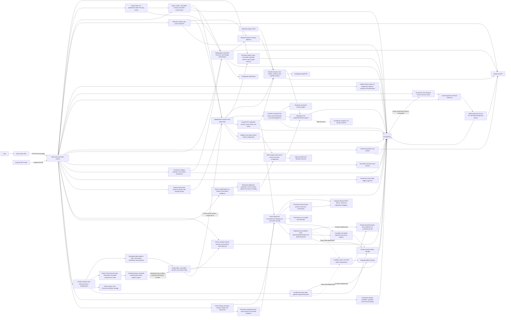
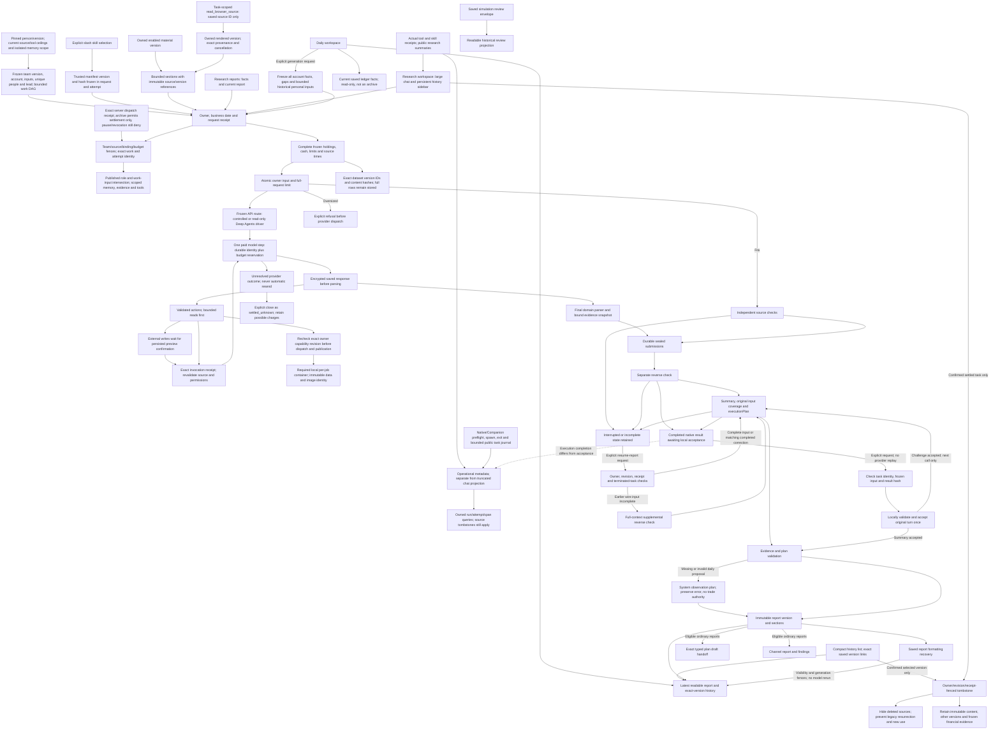
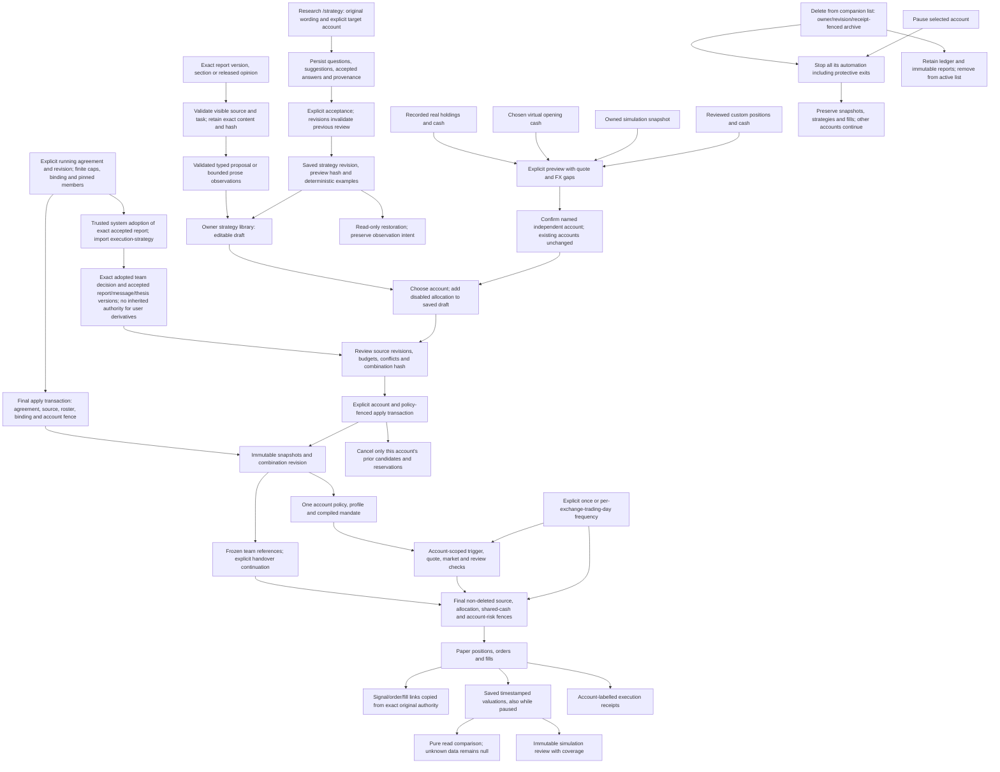
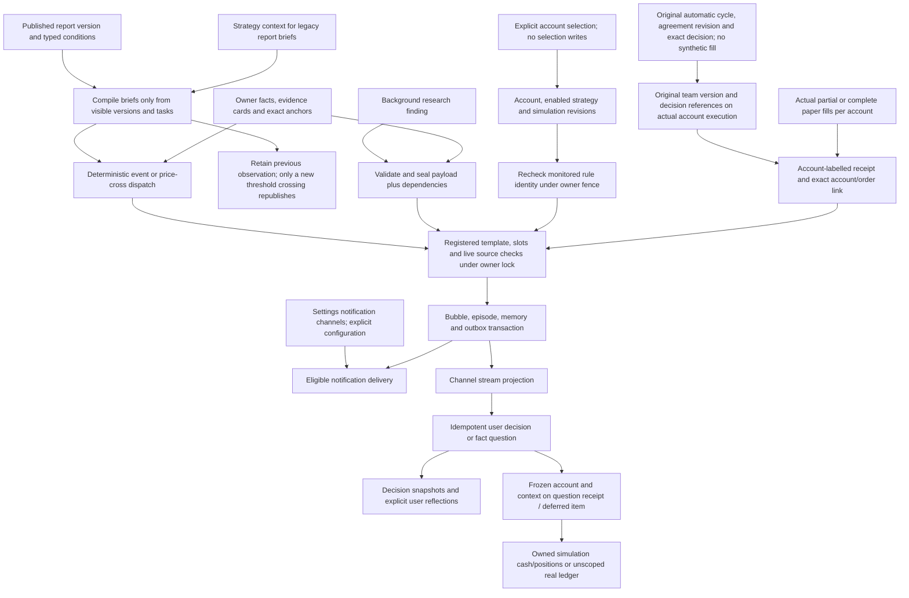
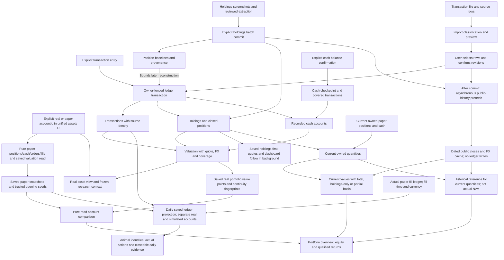

# Architecture

Squabble is a React client, a NestJS backend and PostgreSQL for an intelligent investing assistant: portfolio-aware research, coordinated agents, readable reports, a stock-friend channel and explicitly applied simulated strategies.

**Structural review — 2026-11-11:** inspected `f077b3e` plus the agent-tooling working tree. All five diagrams were checked. Flows1–2 add a durable model/tool runtime, owner-approved outbound connectors, immutable datasets/private artifacts, local document services, anonymous browser research and isolated computation. Flows3–5 retain explicit strategy application, source-aware channel publication and real-ledger writers: tool approval authorizes one external action, never an investment-policy application or a financial fill. This is a source review, not a deployed-instance certification.

**Source-host recovery review:** checked merged `0d88fc4` and the recovery changes. Flow1 adds an optional fixed-destination loopback relay for native Web servers while Docling and broker remain on the internal-only tools network. Flow2 retains its dispatch identity, budget and publication boundaries; cancelled HTTP bodies now require explicit stream cleanup. Flows3–5 retain their investment, channel and ledger authority. Actual platform and process-stability results are recorded separately from this source review.

The development phase is Web-only. Desktop code remains for manual recovery; ordinary development does not require packaging it. Start with the [Chinese code-reading tour](code-reading.zh-CN.md), [development commands](development.md) or the repository-owned [contributor skill](../.agents/skills/squabble-contributor/SKILL.md).

**UI alignment audit — 2026-11-13:** reviewed all five flows against `842dc5d` and the alignment patch. Card footers, wrapping controls, dialog hit areas and labeled team selections retain the existing routes, API payloads, source authorization and explicit financial writers. The new `scripts/ui-probe/` tool renders the compiled client against a fictional loopback HTTP fixture; it has no database or upstream transport and cannot start research or trading. No diagram edge, migration, persistence boundary or runtime service changes. See the [audit design](ui-alignment-audit-design.zh-CN.md) and [probe contract](../.ui/README.md).

**Local diagnostic review — 2026-11-11:** inspected `b9f1feb` plus this diagnostic change. Flows1–2 add owner/source-validated diagnostic snapshots of retained native/Companion task evidence, public activity and separate application acceptance. Actual process launch is distinct from runtime handoff; missing observations stay unknown. Recovery links retain the original research controls. Flows3–5 keep the same strategy, channel and real-ledger writers; diagnostic reads cannot authorize execution or recreate a deleted source.

**Team workspace review — 2026-11-12:** reviewed `3a561b1` plus the team workspace change. All five flows include the team additions: independent organization/display/layout revisions, immutable team versions, one active account binding, durable manual commissions through the existing Council workflow, exact decision/strategy/execution links and pure account asset reads. Team permissions and transitive sources are checked at dispatch, result acceptance, final publication, memory write and strategy application; research completion never applies a strategy. Validation is recorded in [team workspace validation](team-workspace-validation.md).

**Independent-agent review — 2026-11-12:** reviewed `74f3744` plus this working tree across all five flows. Stable roster identity/version and scoped memories are separate from executor connections and account display metadata. A2A uses durable encrypted task receipts and exact connection fingerprints; unknown dispatch is not replayed. An explicit, revisioned team run agreement authorizes a bounded system actor to adopt an exact accepted report and apply a simulated combination. The final transaction checks agreement, source, roster, binding and account authority. Pause blocks new work, publication/application and all automatic paper orders, including protective orders. The real ledger remains read-only to this workflow; only its confirmed snapshot seeds a new independent paper account. Actual verification and unperformed novice testing are recorded separately in [validation](independent-agents-validation.md).

**UI repair review — 2026-11-13:** inspected `261f07c` plus the UI repair working tree across all five flows. Flow1 retains module ownership and adds Holdings as a primary navigation destination. Migration66 stores animal appearance on stable roster profiles; identity-only edits do not change capability versions. Flow2 freezes appearance/name in new conversation and commission snapshots and shares saved instructions/preferences between personal and team work. Flow3 retains owner-scoped guided tab drafts and exact pending request payloads without changing server startup/apply authority. Flows4–5 retain source-sealed channel publication and explicit real-ledger writers; import completion adds navigation, not research dispatch or a fill. Existing diagram edges remain accurate; these identity and client-recovery details are described beside them. Measured checks and pending browser/CI/deployment gates are in [UI repair validation](ui-regression-repair-validation.md).

## Module ownership

| Boundary | Responsibility | Dependency direction |
|---|---|---|
| `research-core` | Model calls, financial evidence/source adapters and portfolio context | Shared infrastructure; never imports current or retained orchestration |
| `research-routing` | Select a usable configured research executor | Uses research-core and local-agent readiness; starts no task itself |
| `research-runtime` | Durable single-step model loop, dispatch receipts, recovery, capability probes and selectable controlled/Deep Agents drivers | Uses research-core's model step; orchestration supplies owner/source and final-parser ports |
| `tool-connections`, `tool-actions` | Outbound MCP/provider catalogs, encrypted credentials, tool budgets and persistent external-write previews | Never import Council; runtime dispatch rechecks exact catalog, source and approval revisions |
| `research-artifacts`, `research-compute` | Immutable dataset rows, private hashed files and isolated analytics | Compute consumes complete owned dataset versions; neither module creates portfolio trades |
| `tool-capabilities` | Reviewed packs, cached deployment readiness and owner activation revisions | Health checks never invoke business tools; feature dispatch and publication recheck grants |
| `workers/sandbox` | Restricted deployment broker and per-job Linux container lifecycle | Only the broker controls Docker; jobs have no network, host paths or application credentials |
| `data-library` | Owned materials, encrypted subscriptions, version extraction, retrieval and financial-provider queries | Uses existing financial/settings adapters; never creates research tasks or ledger entries |
| `agent-roster` | Stable owned people, immutable capability versions and explicitly scoped/provenance-preserving memories | Neutral transaction helpers enforce pinned and current source/tool ceilings |
| `a2a-agents` | Constrained Agent Card discovery, encrypted credentials and durable v1 send/poll/cancel receipts | Uses budget/telemetry infrastructure; Council retains domain acceptance and publication |
| `team-runs` | Explicit immutable startup agreements, finite recurring cycles and trusted system adoption/application | Consumes Teams and paper-trading APIs; final authority lives in neutral DB guards |
| `teams` | Organization drafts, versions, account responsibility, finite commissions, source grants and decisions | Consumes Council, paper trading and memory; infrastructure receives neutral DB scope helpers |
| `council`, `experience` | Research workflow, current-report projection and scheduling | Consume shared research services and retained history where required |
| `portfolio-history` | Current marks and current-position historical references with public price/FX cache | Reads owned ledger inputs; writes only market-data caches; never imports research orchestration |
| `paper-trading` | Account combinations, simulated policy/runtime, ledger and saved comparison projection | Uses research-routing; never imports experience |
| `channel` | Source-based conversation, decisions and execution receipts | Projects authoritative research and simulated results |
| `telemetry` | Owner-scoped operational projections, metadata capture, feedback and opt-in Langfuse export | Reads source tables with deletion fences; capture cannot change research or ledger outcomes |
| Client `features/investment-strategies` | Strategy import, editing, review and management | Composed by pages; never imports pages |

`multi-agent/` still owns retained pipeline APIs and historical reading; it is not dead code. Its shared infrastructure has moved to research-core. Settings keeps its pre-existing local LLM provider; consolidating global Settings initialization is a separate change. LLM native dispatch retains lazy ModuleRef lookup to avoid a research-core/local-agent/research-tools module cycle.

Static dependency directions are checked by ESLint and `npm run test:architecture`. `npm run test:wiring` checks compiled Nest provider resolution against a disposable database without bootstrapping jobs. User workflows still require behavioral/integration checks.

## 1. System overview

**Compact UI and team removal review — 2026-11-13:** reviewed7672831 plus this patch against all five flows. Desktop density and the research pane keep the same page structure and financial/data contracts. Existing team archive preview/confirm now seals the standing agreement snapshot and atomically pauses that agreement, records its revision and cancels undispatched reserved cycles; the new list/detail removal entry fixes `pause_all` and retains account, trade, report and version history. Pausing or reconciling an old agreement first checks the current binding, so a successor team is unaffected. Dispatched/unknown external work retains its original receipt and cost fences; team archive does not inherit the friend-only settlement exception. Flows1–2 retain module/provider ownership, flow3 tightens synchronous revocation within the existing transaction, and flows4–5 retain publication/source and real-ledger writers. No route, API endpoint, schema or diagram edge was added. See [implementation and validation](compact-ui-team-removal.md).

- `client/src/app.tsx` routes `/` to `PortfolioOverviewPage`, `/analysis` to `ReportHistoryPage`, `/research/portfolio` to `SimpleAnalysisPage`, `/council` to `SimpleCouncilPage`, and `/paper` to `SimulationAccountsPage` in the current experience. `/paper/:accountId` opens one simulation and `/paper/:accountId/strategies` edits its combination. `ExperienceRoute` retains older index/analysis/paper/council pages when disabled. `/analysis/reports/:versionId` always identifies an exact report version. `/agent-builder` redirects to `/settings/agents` in the current experience. Old report/strategy/order query links are resolved to the relevant current destination without changing execution authority.
- `server/app.module.ts` composes Nest modules; `ViewModule` stays last for the SPA fallback. Development runs Vite/Nest separately. The production web build serves the client through Nest. Clean Docker uses a separate PostgreSQL container; optional demo Compose uses fictional seed data.
- `server/common/platform/database.provider.ts` owns the direct postgres.js/Drizzle connection and registered startup migrations. This is a local compatibility layer, not a hosted aPaaS dependency. Fresh installations need `scripts/db/01_schema.sql`; startup additions do not initialize the base schema. Read the actual registration list rather than assuming every migration number exists.
- `server/modules/local-agents/` owns connections, pairing, research receipts and durable task identity. `server/local-agents/native.ts` executes supported provider CLIs with bounded output. Native execution can still contact external inference/research providers. Restart recovery does not replay unfinished native calls; completed artifacts remain available. Docker's retained companion path polls outbound from the host helper.

- `server/modules/quote/` and `server/modules/fx/` obtain external data; freshness/coverage remain explicit. Model API budgets and native provider billing are distinct. `agent/` is an optional Python CLI scaffold; it does not orchestrate built-in Nest research. `/mcp` is a separate scoped agent-session integration. The legacy agent gateway is disabled by default.

Protected controllers derive owner from `req.userContext.userId`; services scope reads/writes and joins by that owner. `AUTH_MODE=local` selects one local workspace identity and requires loopback binding with no proxy trust. Account mode uses first-party login and sessions. These are application ownership guarantees, not a blanket PostgreSQL RLS claim. Credentials are encrypted private settings; native task files and import images are private runtime artifacts, not fixture sources. See [privacy](privacy.md) and [local agents](local-agents.md).

The guided navigation has five daily destinations (investment overview, holdings, persistent agents, teams and research) plus data/memory, telemetry and settings. Daily, paper-account and memory URLs remain compatible secondary routes. `/holdings?accountId=real|id` retains explicit ledger identity; `/paper` is labelled Simulation accounts. Companion metadata is not an agent roster. `features/navigation/workspace-navigation.ts` owns route/parent classification, destination search and safe internal return paths, including friends and telemetry; `use-workspace-navigation.ts` records React Router history and restores content scroll or direct hash targets. Existing URLs remain compatible, including `/paper#notifications` to the Settings integration. `features/strategy-interview/` owns authoring UI, `features/companions/` owns display preferences and shared `components/AnimalAvatar.tsx` preserves the original SVGs. `shared/animal-avatar.ts` owns stable appearance IDs; `features/agent-roster/AgentEditorDialog.tsx` and `AgentIdentity.tsx` edit and render roster identity. Feature code does not import pages. Search is a destination catalog, not an implicit AI action.

The retained V5 research/data surfaces integrate with this guided navigation. `/research` owns chat history and the strategy sidebar; `/strategy` in its composer opens the persisted interview in place. Existing `/strategies` links belong to Research. `/data` contains material previews, website subscriptions and inline financial-provider configuration; `/settings/data` redirects there. `/memory?tab=sources` shares the source inventory and version controls. Material pages, slides and images are research evidence, not account imports or endorsed investment claims. See [the data and research workspace guide](research-data-workspace.md).

`GET /api/daily-workspace?date=` reads personal saved facts, all owned simulation facts and exact research versions using a repeatable-read, read-only transaction. This projection is not itself a frozen published report. `GET /api/research-memory/inventory` is an owner-only paginated source inventory; existing thesis lifecycle/version controls retain their authority. Provider configuration, import receipts, notification channels and scoped MCP sessions are composed into explicit workspaces without claiming new connection health or model adoption metrics.

`/settings/tools` shows bundled capability preparation and owner grants, with optional outbound connections and advanced model-tool settings. `/settings/mcp` retains the separate inbound scoped-session integration. Exact catalog/schema/effect and data-class permissions remain authoritative. Local private endpoints come from the reviewed deployment registry. API tool calling is enabled only after an explicit charged compatibility probe; reading settings never probes a model. Unchanged discovery preserves permission revisions; changed metadata becomes a candidate requiring review. See [tool operations](agent-tooling.md).

## 2. Research and immutable reports

The route is `ExperienceController` → `CurrentResearchService` → `DailyChannelResearchService` → `SimpleCouncilService`/`CouncilService`. Source files are in `server/modules/experience/` and `server/modules/council/`. `ExperienceScheduler` reconciles persisted results, synchronizes publications and starts eligible automatic daily work under preferences/budget controls. A source inspection or status read does not authorize that work.

Roster names and animals are profile metadata, while instructions, preferences and permission ceilings are immutable capability configuration. `shared/agent-working-instructions.ts` combines the saved instructions and preferences for both personal and team work. New Council members and `TeamMemberSnapshot` freeze name/avatar at creation; later appearance edits do not rewrite history or alter dispatch proofs. Legacy snapshots without appearance retain their role fallback. Conversation empty states use actual selected participants, not a default imaginary roster. These additions do not change report acceptance, source fences or immutable publication.

Independent submissions are persisted before subsequent shared inspection. `council.daily.ts` adds the daily `researchOnly` contract: a separate challenge records `reverseCheck`, then summary produces readable research and a separately marked strategy proposal. `no_counterevidence_found` is not proof; `unable_to_verify` remains a gap. Publication preserves disagreement, source identifiers, dates and coverage. Incomplete coverage or missing critical evidence cannot quietly become executable certainty.

`council-tool-runtime.service.ts` binds the new API route to the original owner/session/cycle/member/turn/attempt and private evidence boundary. `research-core/model-step.service.ts` performs one AI SDK generation with SDK retries/execution/approval disabled. The runtime intercepts writes before dispatch, persists receipts and applies the same model and tool budgets to both drivers. Model-step reservations and tool-invocation reservations are distinct; available budget is limit minus settled usage minus all in-flight reservations. Unknown usage is not zero and an unknown reservation is retained until provider facts settle it. Editing an action invalidates its old preview hash without rerunning the model. Reparse uses the saved response and evidence snapshot; no paid repair is hidden in parsing.

Runs freeze complete owner facts plus exact dataset version IDs/content hashes, not only security symbols. Calculations read full stored rows rather than a model's preview sample. Source disabling, deletion and current license/egress policy are rechecked before new calls and final publication. Late results cannot reopen cancelled/settled runs or restore revoked inputs. Deep Agents is an alternate read-only loop using the same ports; filesystem, delegated subagents, automatic summaries and external framework tracing are disabled.

`Frozen owner context` evidence is an atomic record: all holdings, every recorded cash currency including zero/unknown balances, confirmed investor limits, evidence IDs and capture/as-of times reach the model intact. `council.native.ts`, `council.context.ts` and `council.workflow-executor.ts` preserve it across native/API work and review packing while keeping other evidence excerpted. Full-request byte/token limits reject a request that cannot fit before provider dispatch; native oversized assignments are rejected before staging. Stored marks do not establish fresh market prices. Challenge and summary prompts require whole-portfolio concentration, a concise judgment/basis/next check for each holding, separate cash coverage and the consequences of actual data gaps.

`POST /api/research-conversations/:id/resume-report` is an explicit saved-research recovery command, separate from local formatting recovery. It first handles completed results locally; only necessary new checks or summaries use AI. `CouncilReportResumeService` checks owner, expected revision, request receipt, pinned references and the original native journal's definitive terminal state; new provider continuation requires a confirmed failure/cancellation. Running or ambiguous upstream work cannot be replayed. It compares the actual retained opening assignment with the complete frozen owner record, appends a supplemental reverse check when the earlier wire input was incomplete, then appends the summary. An unchanged successful correction can be reused for a later summary retry. Sealed openings, old checks and failed tasks retain their identity; call/budget accounting continues. `coverage.inputCorrection` records the original incomplete input and the correction's context/task/revision/turn identity. The published report keeps `coverage.complete: false` for those original openings; `independentDeliveriesComplete` separately records whether every member delivered. A successfully corrected summary has an input-supplementation explanation and a distinct UI label, preserving both facts. Summary preparation and publication select that same correction-bound reverse check.

Provider completion and local acceptance are separate states. When a native task has completed but its challenge/summary was rejected locally, the same explicit recovery request validates/reparses the saved result before requesting new work. Task/message/owner/session/cycle/member/turn/revision identity, frozen input, result hash, citations and pinned references must still match. Acceptance records the original turn once, retaining its output, usage and original coverage; it neither replays the provider nor counts the old call again. An accepted challenge proceeds to a needed summary; an accepted summary proceeds to publication. Invalid or mismatched saved results remain paused. Reverse-check citations share the existing sixty-record evidence bound: valid references within it are retained, while unknown references or sixty-one entries fail. The current-report projection follows only the exact owner/session receipt, preserving generation and prior readable material until the new archive is ready.

`server/modules/paper-trading/report-execution-plan.ts` validates `schemaVersion: 1`, `parameterOrigin: 'ai_proposed'` (or the constrained `system_observation` fallback), evidence IDs, entries, validity and risk limits. It derives `ready`, `needs_info` or `no_trade`, and renders the exact `execution-strategy` section. AI parameter proposals are distinct from market observations and investor authority. Missing/invalid daily proposals keep their error and receive a system-authored observation plan, with no directives, mandate rules or risk limits. Provider output cannot claim this origin. Existing archives remain immutable; they may be copied as research observations without inventing actions.

`server/modules/research-documents/research-documents.service.ts` publishes immutable content/sections/snapshots and maintains mutable document pointers and revocation state separately. `research-documents.rules.ts` hashes recursively canonicalized payloads; exact versions and section references survive later revisions. `CurrentResearchService.getDailyReports` separates the initial daily report from later discussion reports. A newer discussion does not overwrite what the initial report said. Availability time, data-as-of time and provenance are retained.

V4 `DailyWorkspaceResearchService` adds an explicit `POST /api/daily-workspace/research` with `{date, requestKey}` and a read-only GET for status/history. It supplies frozen `OverallDailyEvidence` internally after the existing durable request lookup; clients cannot provide owner or facts. The evidence contains every owned account's dated saved fills, pending/failed/unexecuted orders and gaps, personal saved-ledger facts, and at most five available historical personal-portfolio inputs with exact version IDs. Today's stored holdings/cash are labelled read-time records; historical dates exclude current holdings. This is a current reading of saved historical records, not an exchange-close reconstruction. Missing history remains explicit.

The entire evidence is one mandatory frozen owner-context item through independent submissions, reverse check and summary. API/native budget gates may reject oversized context; they cannot silently clip account facts. `overallDaily` in the checkpoint and immutable report snapshot records the Shanghai date, read time and facts hash. Overall reports remain separate from ordinary initial/discussion reports and automatic channel/strategy handoff. Publication creates neither a strategy nor a fill. Browsing the page or replaying a create receipt never starts research.

Explicit recovery preserves the original cycle, frozen facts and remaining budget. It can start an idle receipt interrupted before dispatch, release the original independent barrier after failed members were recovered, or retry a failed API summary without repeating completed openings. Native saved-result recovery keeps its task, revision, result and uncertain-provider fences. Independent results publish once and native usage is not counted twice. Generic rerun, message and fork operations cannot convert a completed overall report into another ordinary cycle; a new overall run requires its dedicated explicit request.

**Report-reading update checked against `f0fb2a0` (PR #80):** `CurrentResearchService.reformat` and `reconcile` recover saved daily-research and legacy portfolio results, including older formatting receipts that stored a session ID. This reuses saved source material without another model call, and preserves owner, visibility, revocation and generation fences. `returnedDocumentId` exposes the exact returned archive while the last complete current report remains visible. Recovery writes current-view/task receipts; it is not a read-only diagnostic.

`client/src/pages/Analysis/SimpleReportReader.tsx` uses `shared/simulation-review-reading.ts` to project valid saved simulation-review envelopes into readable historical sections. It does not rewrite archived reports, fill unknown values with zero or present a missing execution plan as a review failure. Report history filters/labels daily research, stock research and simulation ledger reviews; a ledger review points back to holdings research. Archived reviews without observation timestamps retain an explicit unknown-coverage warning. The research/report diagram includes these reading and recovery paths; the other four flows were unchanged by PR #80.

The older `server/modules/multi-agent/pipeline.service.ts` bull/bear/critic/risk pipeline and `portfolio-analysis.service.ts` remain for retained runs, APIs and fallback paths. Their reports stay readable; they are not the current default Today research sequence. Likewise, retained Council discussion and revision workflows coexist with the channel UI. Do not remove legacy readers simply because the current navigation changed.

## 3. Account strategy combinations and simulated execution

`PortfolioWorkspaceService` and `portfolio-workspace.controller.ts` in `server/modules/paper-trading/` own `/api/ai-investment/accounts`: list/create, account detail/rename, pause/resume/archive, and `:accountId/strategies` draft/preview/apply. Contracts live in `shared/portfolio-workspace.interface.ts`. The client composes `SimulationAccountsPage`, `SimulationAccountPage` and `features/investment-strategies/AccountStrategyCombinationPage`; queries and writes carry account identity. Viewing or selecting an account does not select a global trading account. New accounts use the existing opening preview but do not stop other accounts. Archived accounts remain read-only.

Guided startup uses `features/teams/guided-team-storage.ts` for owner-partitioned tab drafts and retained progress. A decoded account subject only selects a private cache partition; server APIs remain the authority. Legacy unscoped records are exposed only after each exact referenced resource passes owner-scoped reads. `guided-team-create.ts` persists the exact payload before each operation and retries an unknown result with its original key. Only resolved obsolete progress can end while retaining its resources and receipts. Client restoration cannot create authorization, silently change a pending request or bypass fresh agreement review.

`ReportExecutionPlan` and `ReportStrategyTarget` import an exact saved report into the strategy library and stage it as a **disabled** allocation in a chosen account draft. Import/navigation does not apply it. `shared/strategy-source-reading.ts` excludes missing-plan placeholders and metadata, retains public links and caps raw/readable source text at 200000 characters. Ordinary research splits losslessly into observation entries of at most 12000 characters; the existing twenty-source/twenty-entry strategy limits remain. Typed proposals retain periods, limits and evidence. Source import does not invoke AI or infer an executable rule from prose.

A combination contains at most thirty distinct strategy assignments. Enabled budgets must be positive and total at most 100%; disabled assignments do not consume that total. Cross-strategy overlapping opposite directions or incompatible share/target-position instructions fail review. Enabled strategies support at most 100 distinct execution symbols; the preview and runtime compiler share this bound. This is separate from the retained AI daily discussion cap of twenty securities **per market**. Already reviewed `fixed_rules` combinations do not enter that daily discussion cap; the AI gate remains in place for non-fixed plans.

`PortfolioWorkspaceService.preview/apply` uses `UserInvestmentStrategyService.accountSnapshot` to recheck owner, stored revision/preview and exact source availability/revocation. The saved combination preview expires after fifteen minutes. `combinationHash` binds account, policy revision, enabled flags, budgets, persisted contents/sources and compiled authority, excluding volatile rendering/confirmation timestamps. Apply rechecks the hash and source fences inside the owner/account/policy transaction, confirms drafts, records immutable combination history, increments policy revision and invalidates only that account's pending work. Request receipts bind account, operation and complete payload. Saving an account draft does not change its installed combination. Confirmed strategy history cannot be deleted; draft deletion retains its tombstone and receipts.

`StrategyInterviewService` freezes owner/account at creation and persists exact user messages, suggestions, accepted values and source-message identities in migration 46. Answer mutation, acceptance and preview use expected revisions and idempotent receipts. Conservative parsing cannot silently complete ambiguous intent. Only explicit acceptance becomes a confirmed answer; changed premises invalidate dependent answers and the saved review. Preview materializes an existing user-strategy draft and binds interview revision, strategy revision and preview content hash. `GET /api/strategy-interviews/:id/review` restores that exact review and deterministic boundary examples without creating a draft or changing observation intent. Later edits of a confirmed strategy retain immutable history and establish parent lineage. The client stages a disabled replacement in that account's combination draft, preserving other entries and any existing budget, and refuses to silently rebase a stale combination draft.

Strict `price_lt`/`price_gt` remain distinct from inclusive thresholds through preview, trigger and final slippage-adjusted fill checks. Explicit `executionFrequency` is either once or at most once per verified exchange trading day; missing legacy frequency remains once. Candidate claim and final order checks share the account execution lock and inspect both prior fills and pending reservations. Daily repetition uses the immutable daily plan's `marketDate` and verified market calendar, not the server's UTC day. Rebuilding a runtime does not reset execution history, and model preparation cannot invent repeated-execution permission.

Companion selection uses separate display metadata, revision and receipts in migration 47; it does not change the investment policy or ledger. Starting-state previews support recorded real holdings, cash, an owned simulation and custom holdings. Seed provenance distinguishes `real_holdings`, `cash`, `simulation_account` and `custom_holdings`. Only real-holdings previews compare the current source real ledger at confirmation; simulation copies/custom inputs freeze their own source rather than accidentally comparing to real holdings. Quotes, FX, missing-data guards and explicit confirmation still establish the opening. No synthetic fill or historical return is created.

`user-strategy-runtime.ts::installInvestorCombinationMandate` compiles enabled snapshots into one account-bound profile and published mandate. Rules retain original strategy/revision/entry identity under collision-free runtime identifiers. `isSameInvestorEntry` recognizes historical and current identifiers, so rebuilding or re-enabling a combination cannot replay a completed entry. Account caps intersect with the tightest enabled strategy caps; combination changes cannot loosen base account limits. In `strategy-allocation.ts`, allocation is a cap on attributed exposure after the cash floor, including existing attributed fills and pending reservations. It is not an automatic rebalance or a separate cash ledger. `strategy-reservation.ts`, `strategy-portfolio-risk.ts` and final `strategy-mandate.fence.ts` checks still share the locked account cash/positions and all pending risk.

`StrategyScheduler` iterates explicit account IDs, and `StrategyService` resolves that account's exact profile/mandate. Owner/account locks and policy revisions fence candidate claim and final `PaperTradingService.placeOrder`. The final `investmentExecutionFence` verifies enabled strategy membership, original directive, validity, fresh quotes, market session, review and source dependencies. `ResearchDocumentsService.assertExecutionSourcesInTransaction` retains transitive report/revocation/future-data checks. Pausing a selected account stops buys, sells and protective exits; other accounts continue. Resume requires fresh source validation and evaluation. No paper fill submits a broker order or changes recorded real holdings.

Old single-account APIs and `user_investment_strategy_current` remain compatibility surfaces, not combination authority. Ambiguous unscoped operations fail with `ACCOUNT_SELECTION_REQUIRED`; old Builder/experiment paths cannot edit managed accounts. Historical unmapped/null-account profiles remain supported only when account identity is unambiguous. The old quick-apply endpoint also refuses a multi-account ambiguity; the current report UI stages a selected account draft instead.

Migration `45_portfolio_workspace.sql` adds assignments, combination drafts/previews/revisions and profile account binding. It maps only unambiguous current-version published profiles, preserves archived accounts, and backfills existing live confirmed policies without replacing installed combinations on later boots. Startup replays historical SQL: migration 45 retains the old index names with account-scoped definitions so migrations 03/28 cannot recreate owner singletons; migration 42 now recognizes `base_config.portfolio` and does not pause confirmed combinations during a restart. The registered list and consolidated fresh schema must stay synchronized. Test upgrade **and a complete second startup after creating multiple running accounts**.

`PortfolioComparisonService.read` serves `/api/ai-investment/comparison?period=1M&accountIds=real,...` using a repeatable-read, read-only transaction over saved real value points, simulation snapshots and trusted openings. It makes no quote request, establishes no baseline, dispatches no research and writes no selection. Periods are `1D`, `1W`, `1M`, `3M`, `YTD`, `ALL`; day/week/month windows are rolling UTC day counts and YTD starts at UTC January 1. One-day output keeps observations; longer ranges retain daily samples and the actual return origin. Missing dates insert a null separator, not an interpolated observation. `saved_valuations_no_external_flows` reports a return only after two trusted observations with unchanged flow/checkpoint identity; cash-flow/baseline changes or unknown continuity leave subsequent returns null. Each series exposes its own `returnFrom` and valuation time; accounts with different observation origins are not falsely aligned to one inception.

Valuation is separate from execution: while the scheduler is enabled, it attempts each non-archived account's daily snapshot at most every fifteen minutes even when trading is paused. These are daily rows updated with actual timestamps, not invented intraday history. Global `PAPER_TRADING_ENABLED=false` also disables this scheduler. `SimulationExperimentsService.review` retains distinct timestamp coverage (`initial_only`, `observed_period`, `unknown_timestamp`, `incomplete_period`), missing strategy-boundary valuation gaps and separate `modelNotes`. Equal NAV at a later observation can be a measured zero; initialization alone cannot. Shared-ledger strategy allocations do not create an independently measured per-strategy return.

Report payload hashes, exact source-text hashes, strategy preview `strategyContentHash`, combination hashes and action receipts remain separate contracts. Do not substitute a hash of displayed prose or change archived research to match a later strategy.

## 4. Channel publication and delivery

`client/src/pages/Council/SimpleCouncilPage.tsx` reads `server/modules/channel/channel.controller.ts` at `/api/channel?accountId=...`. A multi-account owner without a selection receives `ACCOUNT_SELECTION_REQUIRED` runtime context instead of an arbitrary current account. This projection reads preferences without creating them or recovering jobs; shared research bubbles remain visible, while account bubbles, pending items and notifications are filtered to the selected account. The channel is not the research transcript. `ChannelBriefsService` compiles published report artifacts per report and strategy context and dispatches templates without a model call. A strategy switch recompiles eligible monitors while preserving prior observation state; only a new clear-to-met crossing can alert again. Report freshness/revocation, expiry and sourced condition/ticker checks can invalidate a brief, and previously invalidated briefs stay invalid.

Background findings use `ChannelService.ingestFinding` and `channel-contract.ts`: valid owner/episode/anchor, material semantic delta and evidence card are required. The server seal binds finding payload, compiler version, exact template hash/revision, slots, fact/report revisions and runtime dependencies. A boolean approval in generated text cannot replace it. No counterevidence is not a finding; inability to verify publishes only as a new material gap. Corrected/stale evidence or changed dependencies invalidate the seal.

Question receipts and deferred questions freeze their account and research context. A selected simulation's cash/position question reads that account's ledger; an unscoped question keeps recorded real-ledger semantics. An uncertain retry cannot silently move to another account. Pending items and query cache keys follow the selected account; the drawer excludes the already pinned item. Reports and public research logs retain owner-wide scope, and old home report links resolve to the exact immutable version reader.

`publishTemplate` and sealed findings converge on `canPublish` and `commitBubble`. Publication validates templates and authoritative slots, deduplicates semantic deltas and persists bubble/episode state plus `channel_outbox` in one transaction. `poke` queues stream and notification; other weights queue stream. This provides durable application delivery, not guaranteed exactly-once receipt by an external provider.

`channel-runtime.ts` and `channel-executions.ts` project the selected account, all enabled assignments and actual paper fills. `monitorOwner` iterates active accounts; monitor entity keys include account/strategy/revision/entry, and `publishTemplate` rechecks that exact effective rule under the owner fence before publication. Fill receipts include account identity, source entry and `/paper/:accountId?orderId=...` links. The same strategy installed in two accounts produces separate factual events, not duplicate global authority. Channel actions do not bypass explicit strategy application. Fact questions use a bounded single-tool check with deferred questions and durable recovery, not a hidden full research cycle. `channel-memory.service.ts` distinguishes exact saved user quotes, system decision snapshots, unrecorded adoption reasons and later user reflections; the system does not invent the user's motive.

## 5. Recorded real assets and provenance

The real ledger is owned by `server/modules/transactions/transactions.service.ts`, `server/modules/holdings/holdings.service.ts` and `server/modules/cash-accounts/cash-accounts.service.ts`. Holdings, transactions, closed positions and cash are separate from paper-trading tables. `server/database/asset-ledger.schema.ts` adds position baselines and cash-confirmation receipts; `transaction-imports.schema.ts` and `import-batches.schema.ts` store distinct batch types.

Import UI makes saving the reviewed holdings the primary action. `pages/Import/ImportSavedNextSteps.tsx` offers navigation to persistent agents after a confirmed save. Research remains a separate explicit handoff to an existing route. These continuation links do not change the import transaction, account seed confirmation, channel publication or ledger writers.

`server/modules/import/transaction-imports.service.ts` classifies exact source identities/fingerprints, previews selected effects and rechecks batch/ledger revisions at commit. It calls `TransactionsService.createInTransaction` under the same owner fence, retains source batch/raw-row provenance and does not invent deposits. Screenshot batches in `import-batches.service.ts` record reviewed holdings snapshots/baselines rather than pretending OCR observations are trade history. Import analysis handoff freezes a research request; it does not grant trading authority.

Cash confirmation is an explicit request with expected timestamps and an idempotency key. Its receipt records covered transactions; subsequent edits to checkpoint-covered history require reconciliation. Position reconstruction respects baseline coverage. The retained paired cash-top-up endpoint is a separate explicit action; it must not become an implicit fallback for normal imports or transactions.

`server/modules/experience/portfolio-metrics.service.ts` combines recorded holdings/cash, quote/FX data and value points. UI coverage and dates matter: recorded balances are not broker synchronization, quote retrieval does not establish exchange-live execution, and missing data is not zero. Preserve these distinctions when changing asset totals or returns. The actual-NAV comparison reader consumes saved value points and their flow/cash/position fingerprints without calling the valuation writer. Separate current marks and historical references can populate only public market-data caches, never NAV, holdings, cash or trade rows. Flow or baseline changes can preserve visible equity while invalidating a comparable return.

## Maintaining this architecture

Bundled capability review against e18b5fe plus this working tree checked all five flows. Flows1–2 add deployment readiness, persistent owner grants, candidate catalogs and the private per-job Docker broker. Flows3–5 retain explicit strategy application, source-sealed channel publication and real ledger writers: a local backtest or exploratory output is a research artifact, and activating a capability creates no investment execution authority. Old E2B jobs keep their original provider for cleanup; local failure never reroutes to cloud. Platform/container acceptance is recorded separately in the bundle validation record.

The tooling review also checked flows3–5: fixed-template backtests produce hypothetical artifacts only; app-write confirmation does not activate a strategy; channel publication still requires its original source seal; real holdings, cash and transaction writers remain the existing explicit import/ledger services. These boundaries are unchanged by migrations53–58.

A change to an entrypoint, owner/source contract, persistent state, publication gate or execution boundary reviews the corresponding diagram and the contributor skill references in the same PR. If structure is unchanged, record the reviewed scope and a concrete no-impact reason. Verify source paths and Mermaid syntax; do not edit diagrams merely to update a timestamp. Changes to desktop recovery do not by themselves resume desktop development.

Schema changes keep Drizzle definitions, fresh-install SQL and registered additive migrations aligned; see [development](development.md). Test new/upgraded disposable databases and relevant owner, revision, revocation, replay and ledger boundaries. Documentation validation must not run personal research, apply strategies or alter an existing installation.

## Imported positions and responsive reading

`HoldingsPage` publishes saved holdings independently of the slower dashboard/quote/FX work and keeps visible rows during refresh or auxiliary failure. Older responses cannot overwrite a later request. `/daily` reads the current daily content without a history panel. `/analysis` is a compact historical list linking exact immutable versions; `/research/portfolio` retains explicit current research, and report readers preserve their originating list filters and date. No model work is added to historical list rendering.

`PortfolioHistoryModule` is consumed by imports and account comparison. Completed import transactions enqueue `PortfolioHistoryService.prefetch` asynchronously; opening an existing portfolio also schedules missing public data. Additive migration48 stores shared dated public closes, historical FX and per-resource leases/backoff. Current marks expose total-assets, holdings-only or partially-known-assets coverage. A known null cannot fall back to an older NAV value or date.

The independent lookback uses current quantities and dated closes/FX, excluding cash, trades and dividends. It never writes or extends actual historical NAV or return chains. The client automatically uses this explicitly labelled reference when there are not enough saved observations; it replaces whole series, keeps missing data as gaps, and always permits returning to actual account records even if history fails. Reference dates use UTC calendar-day labels, not fabricated observation times; the table retains exact provider price and FX source dates. See [historical reference contracts](portfolio-history-reference.md).

All five diagrams were rechecked for this refinement: system/cache and ledger-reading flows change; strategy gains explicit archive/stop authority; historical-list consumers change the report reading flow without changing sealed research, saved-result recovery or publication; channel publication/source fences remain unchanged when an account is archived.

## Agent telemetry review · 2026-11-11

Reviewed b57461a plus the telemetry working tree. Flows1–2 add owner-scoped run analysis, metadata capture and opt-in Langfuse export. `/telemetry` is a ninth workspace destination; research remains the owner of conversations and reports. Flows3–5 retain explicit strategy application, source-fenced channel publication and real-ledger writers; telemetry adds no execution authority. Missing identity and usage remain unknown. Export excludes prompts, completions, holdings and tool arguments. Source deletion hides operational detail and feedback; remote exported records have separate retention. See [Agent telemetry](agent-telemetry.md) for setup and verification.
