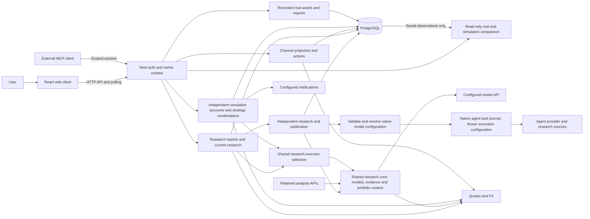
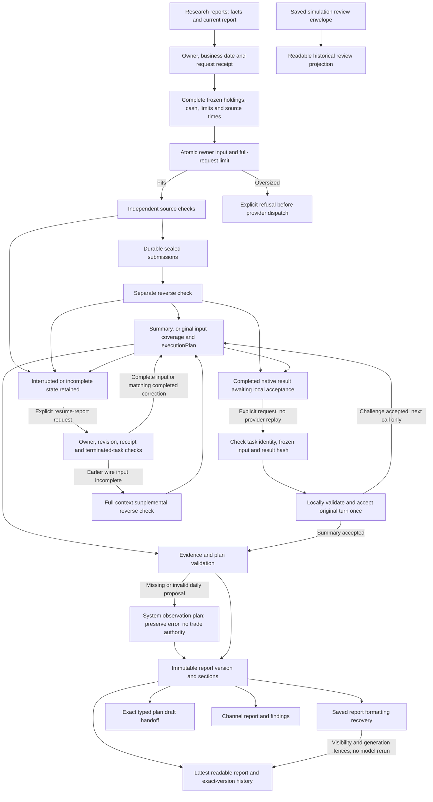
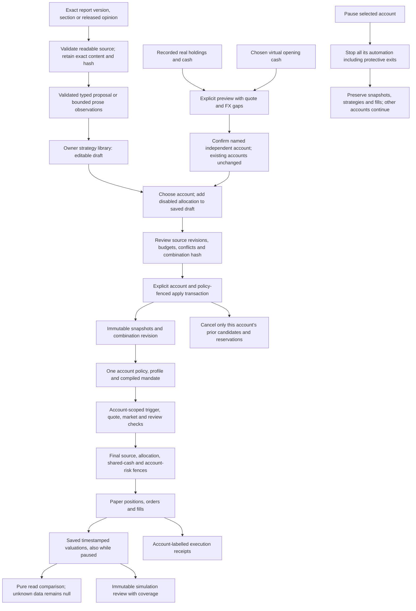
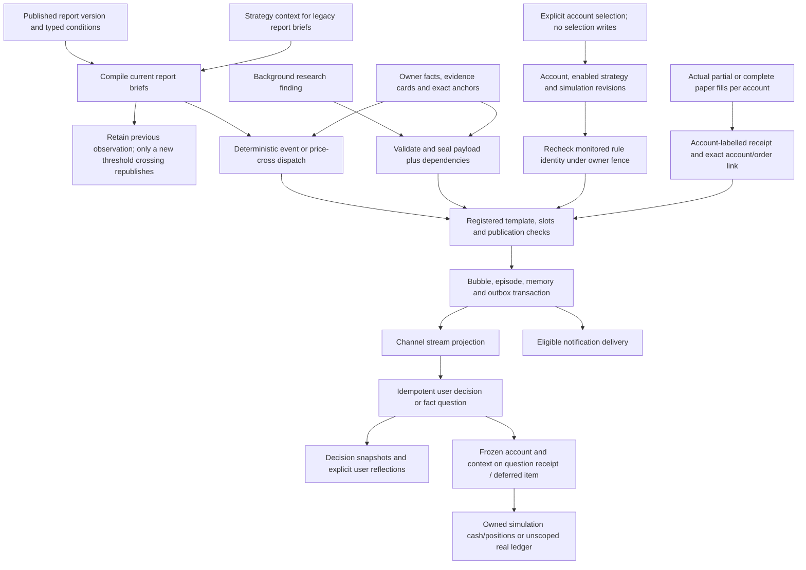
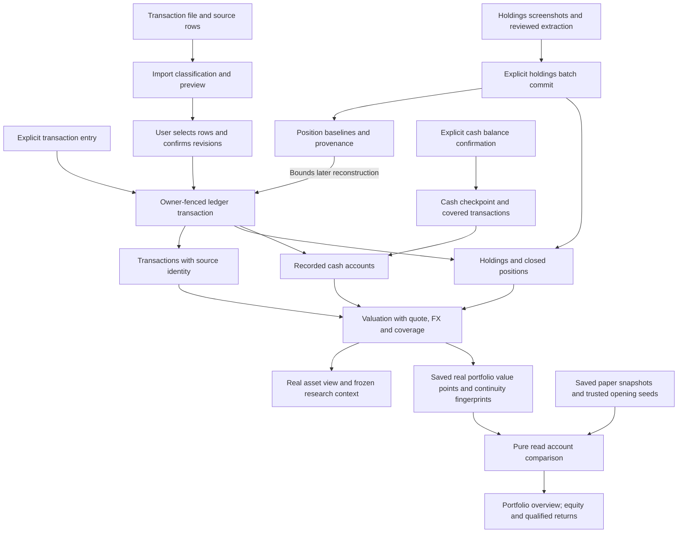

# Architecture

Squabble is a React client, a NestJS backend and PostgreSQL for an intelligent investing assistant: portfolio-aware research, coordinated agents, readable reports, a stock-friend channel and explicitly applied simulated strategies.

**Structural review — 2026-11-09:** inspected `9e2d83a` plus the portfolio-workspace working tree. All five diagrams were checked: system routes/read projections, account strategy combinations and channel account identity changed; the real-ledger diagram adds its saved-observation reader. The research diagram changes its page entry only: independent submissions, saved-result recovery and immutable publication retain their authority boundaries. This is a source review, not a release or deployed-instance certification.

The development phase is Web-only. Desktop code remains for manual recovery; ordinary development does not require packaging it. Start with the [Chinese code-reading tour](code-reading.zh-CN.md), [development commands](development.md) or the repository-owned [contributor skill](../.agents/skills/squabble-contributor/SKILL.md).

## Module ownership

| Boundary | Responsibility | Dependency direction |
|---|---|---|
| `research-core` | Model calls, financial evidence/source adapters and portfolio context | Shared infrastructure; never imports current or retained orchestration |
| `research-routing` | Select a usable configured research executor | Uses research-core and local-agent readiness; starts no task itself |
| `council`, `experience` | Research workflow, current-report projection and scheduling | Consume shared research services and retained history where required |
| `paper-trading` | Account combinations, simulated policy/runtime, ledger and saved comparison projection | Uses research-routing; never imports experience |
| `channel` | Source-based conversation, decisions and execution receipts | Projects authoritative research and simulated results |
| Client `features/investment-strategies` | Strategy import, editing, review and management | Composed by pages; never imports pages |

`multi-agent/` still owns retained pipeline APIs and historical reading; it is not dead code. Its shared infrastructure has moved to research-core. Settings keeps its pre-existing local LLM provider; consolidating global Settings initialization is a separate change. LLM native dispatch retains lazy ModuleRef lookup to avoid a research-core/local-agent/research-tools module cycle.

Static dependency directions are checked by ESLint and `npm run test:architecture`. `npm run test:wiring` checks compiled Nest provider resolution against a disposable database without bootstrapping jobs. User workflows still require behavioral/integration checks.

## 1. System overview

- `client/src/app.tsx` routes `/` to `PortfolioOverviewPage`, `/analysis` to `SimpleAnalysisPage`, `/council` to `SimpleCouncilPage`, and `/paper` to `SimulationAccountsPage` in the current experience. `/paper/:accountId` opens one simulation and `/paper/:accountId/strategies` edits its combination. `ExperienceRoute` retains older index/analysis/paper/council pages when disabled. `/analysis/reports/:versionId` always identifies an exact report version. `/agent-builder` redirects to `/settings/agents` in the current experience. Old report/strategy/order query links are resolved to the relevant current destination without changing execution authority.
- `server/app.module.ts` composes Nest modules; `ViewModule` stays last for the SPA fallback. Development runs Vite/Nest separately. The production web build serves the client through Nest. Clean Docker uses a separate PostgreSQL container; optional demo Compose uses fictional seed data.
- `server/common/platform/database.provider.ts` owns the direct postgres.js/Drizzle connection and registered startup migrations. This is a local compatibility layer, not a hosted aPaaS dependency. Fresh installations need `scripts/db/01_schema.sql`; startup additions do not initialize the base schema. Read the actual registration list rather than assuming every migration number exists.
- `server/modules/local-agents/` owns connections, pairing, research receipts and durable task identity. `server/local-agents/native.ts` executes supported provider CLIs with bounded output. Native execution can still contact external inference/research providers. Restart recovery does not replay unfinished native calls; completed artifacts remain available. Docker's retained companion path polls outbound from the host helper.

- `server/modules/quote/` and `server/modules/fx/` obtain external data; freshness/coverage remain explicit. Model API budgets and native provider billing are distinct. `agent/` is an optional Python CLI scaffold; it does not orchestrate built-in Nest research. `/mcp` is a separate scoped agent-session integration. The legacy agent gateway is disabled by default.

Protected controllers derive owner from `req.userContext.userId`; services scope reads/writes and joins by that owner. `AUTH_MODE=local` selects one local workspace identity and requires loopback binding with no proxy trust. Account mode uses first-party login and sessions. These are application ownership guarantees, not a blanket PostgreSQL RLS claim. Credentials are encrypted private settings; native task files and import images are private runtime artifacts, not fixture sources. See [privacy](privacy.md) and [local agents](local-agents.md).

## 2. Research and immutable reports

The route is `ExperienceController` → `CurrentResearchService` → `DailyChannelResearchService` → `SimpleCouncilService`/`CouncilService`. Source files are in `server/modules/experience/` and `server/modules/council/`. `ExperienceScheduler` reconciles persisted results, synchronizes publications and starts eligible automatic daily work under preferences/budget controls. A source inspection or status read does not authorize that work.

Independent submissions are persisted before subsequent shared inspection. `council.daily.ts` adds the daily `researchOnly` contract: a separate challenge records `reverseCheck`, then summary produces readable research and a separately marked strategy proposal. `no_counterevidence_found` is not proof; `unable_to_verify` remains a gap. Publication preserves disagreement, source identifiers, dates and coverage. Incomplete coverage or missing critical evidence cannot quietly become executable certainty.

`Frozen owner context` evidence is an atomic record: all holdings, every recorded cash currency including zero/unknown balances, confirmed investor limits, evidence IDs and capture/as-of times reach the model intact. `council.native.ts`, `council.context.ts` and `council.workflow-executor.ts` preserve it across native/API work and review packing while keeping other evidence excerpted. Full-request byte/token limits reject a request that cannot fit before provider dispatch; native oversized assignments are rejected before staging. Stored marks do not establish fresh market prices. Challenge and summary prompts require whole-portfolio concentration, a concise judgment/basis/next check for each holding, separate cash coverage and the consequences of actual data gaps.

`POST /api/research-conversations/:id/resume-report` is an explicit saved-research recovery command, separate from local formatting recovery. It first handles completed results locally; only necessary new checks or summaries use AI. `CouncilReportResumeService` checks owner, expected revision, request receipt, pinned references and the original native journal's definitive terminal state; new provider continuation requires a confirmed failure/cancellation. Running or ambiguous upstream work cannot be replayed. It compares the actual retained opening assignment with the complete frozen owner record, appends a supplemental reverse check when the earlier wire input was incomplete, then appends the summary. An unchanged successful correction can be reused for a later summary retry. Sealed openings, old checks and failed tasks retain their identity; call/budget accounting continues. `coverage.inputCorrection` records the original incomplete input and the correction's context/task/revision/turn identity. The published report keeps `coverage.complete: false` for those original openings; `independentDeliveriesComplete` separately records whether every member delivered. A successfully corrected summary has an input-supplementation explanation and a distinct UI label, preserving both facts. Summary preparation and publication select that same correction-bound reverse check.

Provider completion and local acceptance are separate states. When a native task has completed but its challenge/summary was rejected locally, the same explicit recovery request validates/reparses the saved result before requesting new work. Task/message/owner/session/cycle/member/turn/revision identity, frozen input, result hash, citations and pinned references must still match. Acceptance records the original turn once, retaining its output, usage and original coverage; it neither replays the provider nor counts the old call again. An accepted challenge proceeds to a needed summary; an accepted summary proceeds to publication. Invalid or mismatched saved results remain paused. Reverse-check citations share the existing sixty-record evidence bound: valid references within it are retained, while unknown references or sixty-one entries fail. The current-report projection follows only the exact owner/session receipt, preserving generation and prior readable material until the new archive is ready.

`server/modules/paper-trading/report-execution-plan.ts` validates `schemaVersion: 1`, `parameterOrigin: 'ai_proposed'` (or the constrained `system_observation` fallback), evidence IDs, entries, validity and risk limits. It derives `ready`, `needs_info` or `no_trade`, and renders the exact `execution-strategy` section. AI parameter proposals are distinct from market observations and investor authority. Missing/invalid daily proposals keep their error and receive a system-authored observation plan, with no directives, mandate rules or risk limits. Provider output cannot claim this origin. Existing archives remain immutable; they may be copied as research observations without inventing actions.

`server/modules/research-documents/research-documents.service.ts` publishes immutable content/sections/snapshots and maintains mutable document pointers and revocation state separately. `research-documents.rules.ts` hashes recursively canonicalized payloads; exact versions and section references survive later revisions. `CurrentResearchService.getDailyReports` separates the initial daily report from later discussion reports. A newer discussion does not overwrite what the initial report said. Availability time, data-as-of time and provenance are retained.

**Report-reading update checked against `f0fb2a0` (PR #80):** `CurrentResearchService.reformat` and `reconcile` recover saved daily-research and legacy portfolio results, including older formatting receipts that stored a session ID. This reuses saved source material without another model call, and preserves owner, visibility, revocation and generation fences. `returnedDocumentId` exposes the exact returned archive while the last complete current report remains visible. Recovery writes current-view/task receipts; it is not a read-only diagnostic.

`client/src/pages/Analysis/SimpleReportReader.tsx` uses `shared/simulation-review-reading.ts` to project valid saved simulation-review envelopes into readable historical sections. It does not rewrite archived reports, fill unknown values with zero or present a missing execution plan as a review failure. Report history filters/labels daily research, stock research and simulation ledger reviews; a ledger review points back to holdings research. Archived reviews without observation timestamps retain an explicit unknown-coverage warning. The research/report diagram includes these reading and recovery paths; the other four flows were unchanged by PR #80.

The older `server/modules/multi-agent/pipeline.service.ts` bull/bear/critic/risk pipeline and `portfolio-analysis.service.ts` remain for retained runs, APIs and fallback paths. Their reports stay readable; they are not the current default Today research sequence. Likewise, retained Council discussion and revision workflows coexist with the channel UI. Do not remove legacy readers simply because the current navigation changed.

## 3. Account strategy combinations and simulated execution

`PortfolioWorkspaceService` and `portfolio-workspace.controller.ts` in `server/modules/paper-trading/` own `/api/ai-investment/accounts`: list/create, account detail/rename, pause/resume, and `:accountId/strategies` draft/preview/apply. Contracts live in `shared/portfolio-workspace.interface.ts`. The client composes `SimulationAccountsPage`, `SimulationAccountPage` and `features/investment-strategies/AccountStrategyCombinationPage`; queries and writes carry account identity. Viewing or selecting an account does not select a global trading account. New accounts use the existing opening preview but do not stop other accounts. Archived accounts remain read-only.

`ReportExecutionPlan` and `ReportStrategyTarget` import an exact saved report into the strategy library and stage it as a **disabled** allocation in a chosen account draft. Import/navigation does not apply it. `shared/strategy-source-reading.ts` excludes missing-plan placeholders and metadata, retains public links and caps raw/readable source text at 200000 characters. Ordinary research splits losslessly into observation entries of at most 12000 characters; the existing twenty-source/twenty-entry strategy limits remain. Typed proposals retain periods, limits and evidence. Source import does not invoke AI or infer an executable rule from prose.

A combination contains at most thirty distinct strategy assignments. Enabled budgets must be positive and total at most 100%; disabled assignments do not consume that total. Cross-strategy overlapping opposite directions or incompatible share/target-position instructions fail review. Enabled strategies support at most 100 distinct execution symbols; the preview and runtime compiler share this bound. This is separate from the retained AI daily discussion cap of twenty securities **per market**. Already reviewed `fixed_rules` combinations do not enter that daily discussion cap; the AI gate remains in place for non-fixed plans.

`PortfolioWorkspaceService.preview/apply` uses `UserInvestmentStrategyService.accountSnapshot` to recheck owner, stored revision/preview and exact source availability/revocation. The saved combination preview expires after fifteen minutes. `combinationHash` binds account, policy revision, enabled flags, budgets, persisted contents/sources and compiled authority, excluding volatile rendering/confirmation timestamps. Apply rechecks the hash and source fences inside the owner/account/policy transaction, confirms drafts, records immutable combination history, increments policy revision and invalidates only that account's pending work. Request receipts bind account, operation and complete payload. Saving an account draft does not change its installed combination. Confirmed strategy history cannot be deleted; draft deletion retains its tombstone and receipts.

`user-strategy-runtime.ts::installInvestorCombinationMandate` compiles enabled snapshots into one account-bound profile and published mandate. Rules retain original strategy/revision/entry identity under collision-free runtime identifiers. `isSameInvestorEntry` recognizes historical and current identifiers, so rebuilding or re-enabling a combination cannot replay a completed entry. Account caps intersect with the tightest enabled strategy caps; combination changes cannot loosen base account limits. In `strategy-allocation.ts`, allocation is a cap on attributed exposure after the cash floor, including existing attributed fills and pending reservations. It is not an automatic rebalance or a separate cash ledger. `strategy-reservation.ts`, `strategy-portfolio-risk.ts` and final `strategy-mandate.fence.ts` checks still share the locked account cash/positions and all pending risk.

`StrategyScheduler` iterates explicit account IDs, and `StrategyService` resolves that account's exact profile/mandate. Owner/account locks and policy revisions fence candidate claim and final `PaperTradingService.placeOrder`. The final `investmentExecutionFence` verifies enabled strategy membership, original directive, validity, fresh quotes, market session, review and source dependencies. `ResearchDocumentsService.assertExecutionSourcesInTransaction` retains transitive report/revocation/future-data checks. Pausing a selected account stops buys, sells and protective exits; other accounts continue. Resume requires fresh source validation and evaluation. No paper fill submits a broker order or changes recorded real holdings.

Old single-account APIs and `user_investment_strategy_current` remain compatibility surfaces, not combination authority. Ambiguous unscoped operations fail with `ACCOUNT_SELECTION_REQUIRED`; old Builder/experiment paths cannot edit managed accounts. Historical unmapped/null-account profiles remain supported only when account identity is unambiguous. The old quick-apply endpoint also refuses a multi-account ambiguity; the current report UI stages a selected account draft instead.

Migration `45_portfolio_workspace.sql` adds assignments, combination drafts/previews/revisions and profile account binding. It maps only unambiguous current-version published profiles, preserves archived accounts, and backfills existing live confirmed policies without replacing installed combinations on later boots. Startup replays historical SQL: migration 45 retains the old index names with account-scoped definitions so migrations 03/28 cannot recreate owner singletons; migration 42 now recognizes `base_config.portfolio` and does not pause confirmed combinations during a restart. The registered list and consolidated fresh schema must stay synchronized. Test upgrade **and a complete second startup after creating multiple running accounts**.

`PortfolioComparisonService.read` serves `/api/ai-investment/comparison?period=1M&accountIds=real,...` using a repeatable-read, read-only transaction over saved real value points, simulation snapshots and trusted openings. It makes no quote request, establishes no baseline, dispatches no research and writes no selection. Periods are `1D`, `1W`, `1M`, `3M`, `YTD`, `ALL`; day/week/month windows are rolling UTC day counts and YTD starts at UTC January 1. One-day output keeps observations; longer ranges retain daily samples and the actual return origin. Missing dates insert a null separator, not an interpolated observation. `saved_valuations_no_external_flows` reports a return only after two trusted observations with unchanged flow/checkpoint identity; cash-flow/baseline changes or unknown continuity leave subsequent returns null. Each series exposes its own `returnFrom` and valuation time; accounts with different observation origins are not falsely aligned to one inception.

Valuation is separate from execution: while the scheduler is enabled, it attempts each non-archived account's daily snapshot at most every fifteen minutes even when trading is paused. These are daily rows updated with actual timestamps, not invented intraday history. Global `PAPER_TRADING_ENABLED=false` also disables this scheduler. `SimulationExperimentsService.review` retains distinct timestamp coverage (`initial_only`, `observed_period`, `unknown_timestamp`, `incomplete_period`), missing strategy-boundary valuation gaps and separate `modelNotes`. Equal NAV at a later observation can be a measured zero; initialization alone cannot. Shared-ledger strategy allocations do not create an independently measured per-strategy return.

Report payload hashes, exact source-text hashes, strategy preview `strategyContentHash`, combination hashes and action receipts remain separate contracts. Do not substitute a hash of displayed prose or change archived research to match a later strategy.

## 4. Channel publication and delivery

`client/src/pages/Council/SimpleCouncilPage.tsx` reads `server/modules/channel/channel.controller.ts` at `/api/channel?accountId=...`. A multi-account owner without a selection receives `ACCOUNT_SELECTION_REQUIRED` runtime context instead of an arbitrary current account. This projection reads preferences without creating them or recovering jobs; shared research bubbles remain visible, while account bubbles, pending items and notifications are filtered to the selected account. The channel is not the research transcript. `ChannelBriefsService` compiles published report artifacts per report and strategy context and dispatches templates without a model call. A strategy switch recompiles eligible monitors while preserving prior observation state; only a new clear-to-met crossing can alert again. Report freshness/revocation, expiry and sourced condition/ticker checks can invalidate a brief, and previously invalidated briefs stay invalid.

Background findings use `ChannelService.ingestFinding` and `channel-contract.ts`: valid owner/episode/anchor, material semantic delta and evidence card are required. The server seal binds finding payload, compiler version, exact template hash/revision, slots, fact/report revisions and runtime dependencies. A boolean approval in generated text cannot replace it. No counterevidence is not a finding; inability to verify publishes only as a new material gap. Corrected/stale evidence or changed dependencies invalidate the seal.

Question receipts and deferred questions freeze their account and research context. A selected simulation's cash/position question reads that account's ledger; an unscoped question keeps recorded real-ledger semantics. An uncertain retry cannot silently move to another account. Pending items and query cache keys follow the selected account; the drawer excludes the already pinned item. Reports and public research logs retain owner-wide scope, and old home report links resolve to the exact immutable version reader.

`publishTemplate` and sealed findings converge on `canPublish` and `commitBubble`. Publication validates templates and authoritative slots, deduplicates semantic deltas and persists bubble/episode state plus `channel_outbox` in one transaction. `poke` queues stream and notification; other weights queue stream. This provides durable application delivery, not guaranteed exactly-once receipt by an external provider.

`channel-runtime.ts` and `channel-executions.ts` project the selected account, all enabled assignments and actual paper fills. `monitorOwner` iterates active accounts; monitor entity keys include account/strategy/revision/entry, and `publishTemplate` rechecks that exact effective rule under the owner fence before publication. Fill receipts include account identity, source entry and `/paper/:accountId?orderId=...` links. The same strategy installed in two accounts produces separate factual events, not duplicate global authority. Channel actions do not bypass explicit strategy application. Fact questions use a bounded single-tool check with deferred questions and durable recovery, not a hidden full research cycle. `channel-memory.service.ts` distinguishes exact saved user quotes, system decision snapshots, unrecorded adoption reasons and later user reflections; the system does not invent the user's motive.

## 5. Recorded real assets and provenance

The real ledger is owned by `server/modules/transactions/transactions.service.ts`, `server/modules/holdings/holdings.service.ts` and `server/modules/cash-accounts/cash-accounts.service.ts`. Holdings, transactions, closed positions and cash are separate from paper-trading tables. `server/database/asset-ledger.schema.ts` adds position baselines and cash-confirmation receipts; `transaction-imports.schema.ts` and `import-batches.schema.ts` store distinct batch types.

`server/modules/import/transaction-imports.service.ts` classifies exact source identities/fingerprints, previews selected effects and rechecks batch/ledger revisions at commit. It calls `TransactionsService.createInTransaction` under the same owner fence, retains source batch/raw-row provenance and does not invent deposits. Screenshot batches in `import-batches.service.ts` record reviewed holdings snapshots/baselines rather than pretending OCR observations are trade history. Import analysis handoff freezes a research request; it does not grant trading authority.

Cash confirmation is an explicit request with expected timestamps and an idempotency key. Its receipt records covered transactions; subsequent edits to checkpoint-covered history require reconciliation. Position reconstruction respects baseline coverage. The retained paired cash-top-up endpoint is a separate explicit action; it must not become an implicit fallback for normal imports or transactions.

`server/modules/experience/portfolio-metrics.service.ts` combines recorded holdings/cash, quote/FX data and value points. UI coverage and dates matter: recorded balances are not broker synchronization, quote retrieval does not establish exchange-live execution, and missing data is not zero. Preserve these distinctions when changing asset totals or returns. The new comparison reader consumes saved value points and their flow/cash/position fingerprints; it does not call the valuation writer or mutate this ledger. Flow or baseline changes can preserve visible equity while invalidating a comparable return.

## Maintaining this architecture

A change to an entrypoint, owner/source contract, persistent state, publication gate or execution boundary reviews the corresponding diagram and the contributor skill references in the same PR. If structure is unchanged, record the reviewed scope and a concrete no-impact reason. Verify source paths and Mermaid syntax; do not edit diagrams merely to update a timestamp. Changes to desktop recovery do not by themselves resume desktop development.

Schema changes keep Drizzle definitions, fresh-install SQL and registered additive migrations aligned; see [development](development.md). Test new/upgraded disposable databases and relevant owner, revision, revocation, replay and ledger boundaries. Documentation validation must not run personal research, apply strategies or alter an existing installation.
