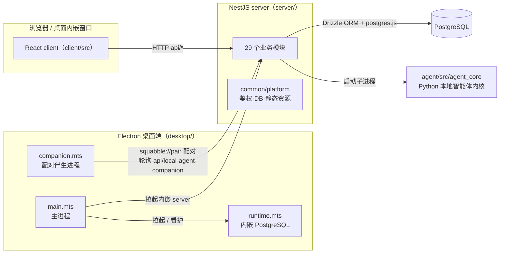
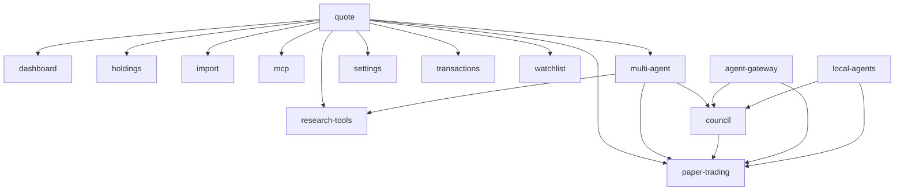

# 架构总览（中文）

> 本文面向**代码阅读者**：讲清仓库的代码结构、模块边界与交互方式。
> 产品视角的架构说明见 [architecture.md](architecture.md)，部署见 [self-hosting.zh-CN.md](self-hosting.zh-CN.md)。

## 1. 总览：一仓三端一库



- **client**：React + TypeScript + Vite + React Query；页面 15 组，`components/ui/` 为 shadcn vendored、`api/gen/` 为生成代码（两者不手改）。
- **server**：NestJS，`server/` 下无 `src/` 一级目录——`app.module.ts`、`main.ts`、`modules/`（29 个模块）、`database/`（Drizzle schema）、`common/`（平台层与工具）直接平铺。
- **desktop**：Electron 主进程 `main.mts` 负责拉起内嵌 PostgreSQL 与内嵌 server；`companion.mts` 是本地伴生进程，通过 `squabble://pair` 深链 + 48 位 hex 配对码与主程序配对后轮询 `api/local-agent-companion`。
- **数据库**：PostgreSQL，全部访问走 Drizzle ORM + postgres.js 驱动；desktop 模式下数据文件与机密以 0600 权限存放在应用数据目录（见 `desktop/runtime.mts`）。
- **agent/**：可选的 Python 本地智能体内核（`agent/src/agent_core`），由 server 的 local-agents 模块以子进程方式驱动。

## 2. 仓库目录地图

```
squabble/
├─ server/                 # NestJS 后端
│  ├─ main.ts / app.module.ts
│  ├─ modules/             # 29 个业务模块（每个 = module/controller/service[/types]）
│  ├─ database/            # Drizzle schema（表定义唯一权威）
│  ├─ common/
│  │  ├─ platform/         # 本地兼容平台层：auth.guard / database.provider / static-assets.middleware / need-login.decorator
│  │  └─ …                 # 常量、过滤器、i18n、market-clock 等
│  ├─ local-agents/        # 本地智能体宿主侧桥接（进程/工具桥/工作区/登入）
│  └─ test/                # 服务端测试
├─ client/src/
│  ├─ api/                 # 纯请求层（http.ts 拦截器 + index.ts 20 个业务域 + 各域文件）
│  ├─ hooks/               # 数据获取与调度（use-market-quotes 轮询调度器等）
│  ├─ pages/               # 15 组页面
│  ├─ components/          # 跨页面组件（ui/ 为 vendored）
│  ├─ utils/ types/ i18n/
│  └─ app.tsx / index.tsx
├─ desktop/                # Electron（*.mts）
├─ shared/                 # 前后端共享类型与常量（api.interface.ts 按业务域分节）
├─ scripts/                # dev / lint / precommit 等工程脚本
└─ agent/                  # Python 本地智能体内核（可选）
```

## 3. server：启动链与平台层

**启动链**：`main.ts` bootstrap → `app.module.ts` 装配全部模块。模块注册顺序有一条硬约束：**view 模块（SPA 回退）必须最后注册**——它用通配路由把非 API 路径回退到 `client/dist` 的静态页面，注册早了会吞掉 API 路由。

**平台层 `server/common/platform/`** 是整套鉴权与数据链路的核心：

| 文件 | 职责 |
| --- | --- |
| `database.provider.ts` | postgres.js + Drizzle 实例化，全部模块共享 |
| `auth.guard.ts` | JWT 会话校验，注入 `req.userContext`（业务服务据此做按用户隔离） |
| `need-login.decorator.ts` | 控制器级"免登录"标注（如 health、登录本身） |
| `static-assets.middleware.ts` | 静态资源与 SPA 回退的路径处理 |

**29 个模块的路由前缀**（控制器内 `@Controller` 前缀，全表）：

| 前缀 | 模块 | 说明 |
| --- | --- | --- |
| `api/auth` | auth | 登录/注册/恢复码，JWT 签发 |
| `api/portfolio/holdings · watchlist · groups · transactions · closed · journal · snapshots · analysis · dashboard · alpha-picks` | holdings 等 10 个 | 组合域全家桶 |
| `api/paper` | paper-trading | 模拟盘 |
| `api/agent-builder` | agent-builder | 策略向导与规则 |
| `api/council/sessions` | council | 投资理事会 |
| `api/multi-agent` | multi-agent | 多智能体分析管线 |
| `api/agent` | agent | 智能体运行记录 |
| `openapi/agent-gateway` | agent-gateway | MCP 风格对外网关 |
| `api/settings/local-agents` + `api/local-agent-companion` | local-agents | 本地智能体管理 + 伴生进程通道 |
| `api/settings/integrations` + `api/settings/model-connections` | settings | 集成与模型连接 |
| `api/quote` / `api/fx` | quote / fx | 行情与汇率 |
| `api/cash` | cash-accounts | 现金账户 |
| `api/import` | import | CSV/OCR 导入 |
| `api/llm-budget` | llm-budget | LLM 预算与限流 |
| `api/notifications` | notifications | 通知渠道 |
| `mcp` | mcp | MCP 客户端会话 |
| `api/system/update` | system-update | 备份与升级 |
| `api/health` | health | 健康检查 |
| （通配回退） | view | SPA 回退，**必须最后注册** |

**模块依赖方向**（下游 → 上游消费）：



`quote` 是被消费最多的基础模块（10 个模块依赖）；`multi-agent` 是分析能力的中枢，council / paper-trading / research-tools 都会调用它。

## 4. 核心业务流

### 4.1 multi-agent 分析管线（`server/modules/multi-agent/pipeline.service.ts`）

一次多智能体分析按 6 个阶段推进，阶段间检查 `isCancelled`，随时可中断：

| 阶段 | 名称 | 做什么 | 失败语义 |
| --- | --- | --- | --- |
| 0 | fetching | 拉取标的与组合上下文 | 必需，失败即终止 |
| 1 | evidence | EvidenceService 采集行情 + 持仓行，落 `agent_evidence` 表；三路来源 `allSettled`，单路失败降级为 `dataGap` 标记 | 降级不致命 |
| 2 | debate | 多空辩论：bull + bear 并行开局，再并行反驳 | 二轮失败不致命 |
| 3 | critique | critic（chatSlow 通道）点评辩论内容 | 非致命 |
| 4 | risk gate | 风控闸：纯规则（无 LLM）对评级做硬性封顶 | 恒成功 |
| 5 | rating | 评级聚合：解析 JSON + 两道硬性覆写兜底 | 兜底保证输出 |

管线的最终态是 `awaiting_human`：**评级结果等人工批准后才生效**，这是整个产品的安全边界之一。批量分析由 BatchService 调度，并发槽 full 模式 ≤3、summary 模式 ≤5；每次调用的 tokensUsed 累计写回预算系统。

### 4.2 行情获取（`server/modules/quote/quote.service.ts`）

- 按市场走不同的公开源回退链：腾讯 → 新浪 → Yahoo；超时 8000ms（Yahoo 5000ms）。
- 进程内缓存 `CACHE_TTL_MS = 60_000`；批量请求上限 `MAX_BATCH_SIZE = 30`。
- 腾讯/新浪响应可能为 GBK 编码，解码失败降级处理。
- 汇率（fx 模块）带节流：失败 5 分钟、成功后 60 分钟内不重复拉取。
- 已知既有行为：`fetchHkQuote` 在新浪源裸调用失败后的二次回退会让整次请求 reject（重构时如实注释，未改行为）。

### 4.3 理事会（council）与模拟盘（paper-trading）

- **council**：按模板（7 类成员角色 + 3 套团队预设）组建"投资理事会"，manager 调度成员依次发言，支持本地智能体（native）与模型连接（model）两种执行模式；会话快照可复用。
- **paper-trading**：模拟盘独立账户（`ensurePaperAccount` 确保存在），行情价格解析 `resolvePrice` 的实际回退链只查 holdings/watchlist 存储价（JSDoc 曾声称包含 paperPositions.avgCost，与实现不一致，已加"待确认"注释）；`closed` 模块记录平仓历史。

### 4.4 本地智能体链路

```
server/modules/local-agents ──管理──> server/local-agents（宿主侧桥接）
        │                                    │ 子进程
        ▼                                    ▼
client 设置页（配对/状态）          agent/src/agent_core（Python 内核）
```

- 宿主侧轮询节奏 300ms、任务超时 600s、心跳 30s；工具桥（tool-bridge）把 server 的行情/组合工具暴露给 Python 内核。
- LLM 预算（llm-budget 模块）在每次调用前做五项检查链；publish 通道的 tokensUsed 上限为 2_147_483_647（int4 上界）。
- MCP 模块仅开放 6 个工具的白名单，单日限额 500 USD 等值预算。
- 桌面伴生进程（companion）通过 `squabble://pair` 深链 + 48 位 hex 码完成一次性配对，之后出站轮询 `api/local-agent-companion`；烟测开关为环境变量 `SQUABBLE_DESKTOP_SMOKE=1`。

## 5. client：分层与路由

**三层结构**：`api/`（纯请求函数，`http.ts` 拦截器处理 401 刷新重放）→ `hooks/`（React Query 封装与调度，如 `use-market-quotes.ts` 的 QuoteScheduler 管理行情轮询节奏）→ `pages/`（页面组件）。`shared/api.interface.ts` 是前后端契约的唯一权威（按业务域分节）。

**页面路由**（`client/src/app.tsx`）：

- 独立壳（不套 Layout）：`/login`、`/register`、`/recover`、`/privacy`
- Layout 内：`index`=Dashboard、`holdings`、`import`、`watchlist`、`analysis`、`paper`、`agent-builder`、`council`、`analysis/deep-report/:runId`、`journal`、`transactions`、`settings/*`，其余 `*`=NotFound

**页面间协作**通过自定义事件（如 `portfolio-updated`）而非全局 store；跨页面组件集中在 `components/`（MultiAgent 子目录承载深度报告与运行卡片）。

## 6. 数据层

- **schema 唯一权威**：`server/database/*.schema.ts`（含 `schema.ts` 汇总），列定义由 Drizzle 管理迁移，`db/` 目录只是快照。
- **按用户隔离**：受保护控制器的业务查询一律带 `req.userContext` 的用户条件，服务层不自行信任 id。
- **桌面模式**：PostgreSQL 由 `desktop/runtime.mts` 内嵌拉起，数据目录与机密文件 0600 权限；主进程负责生命周期与退出清理。

## 7. 工程化

- **格式**：Prettier 统一（`.prettierrc`：printWidth 100、单引号、尾逗号 all）；`.prettierignore` 排除 vendored UI、生成代码、i18n JSON 与 spec/test。
- **lint**：`npm run lint` = ESLint + 双 tsconfig type:check + stylelint；precommit 钩子（`scripts/hooks/run-precommit.js` → `lint.js`）强制提交前全绿。`lint.js` 内含对 CVE-2024-27980（Windows bat 参数注入）的规避说明。
- **测试矩阵**（重构后基线）：

| 命令 | 规模 |
| --- | --- |
| `test:server` | 271 tests / 228 pass / 43 skip / 0 fail |
| `test:client` | 78 / 78 / 0 / 0 |
| `test:desktop` | 44 / 44 / 0 / 0（烟测需 `SQUABBLE_DESKTOP_SMOKE=1`） |
| `test:dev` | 8 pass / 1 skip / 0 |
| `test:local-agents` | 102 / 101 / 1 skip / 0 |

## 8. 阅读路线建议

1. 先读 `server/app.module.ts`（模块地图）+ `server/common/platform/`（鉴权与数据链路）。
2. 再按业务兴趣读：分析管线 `modules/multi-agent/pipeline.service.ts`、行情 `modules/quote/quote.service.ts`、理事会 `modules/council/council.service.ts`。
3. client 侧从 `client/src/app.tsx`（路由）→ `api/index.ts`（20 个业务域横幅）→ 对应页面。
4. 想跑起来：`docs/self-hosting.zh-CN.md`；想改代码：`docs/development.md`。
