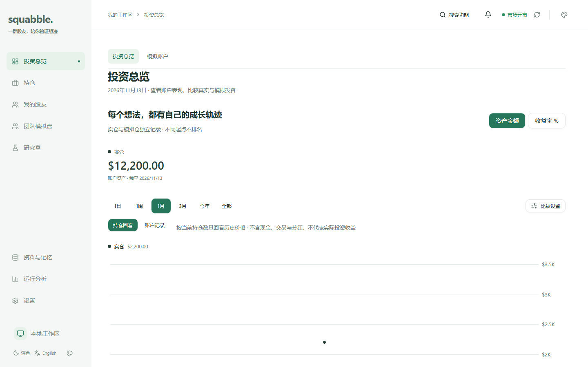
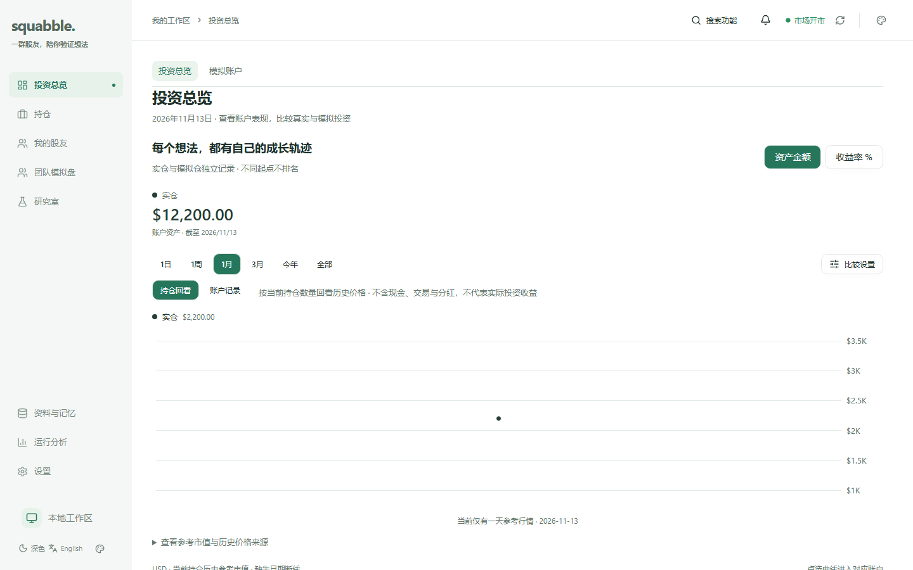
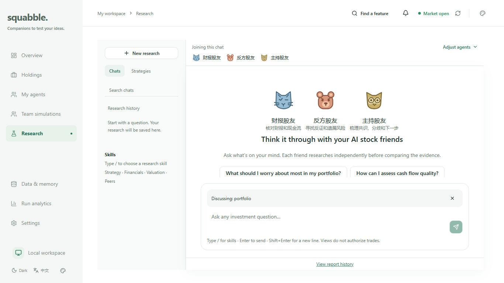
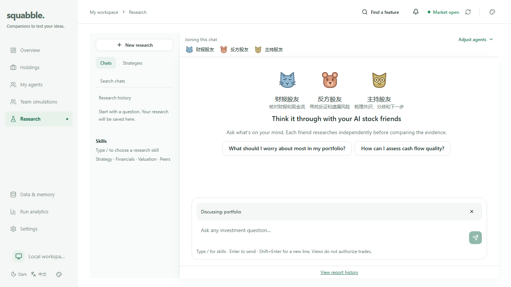
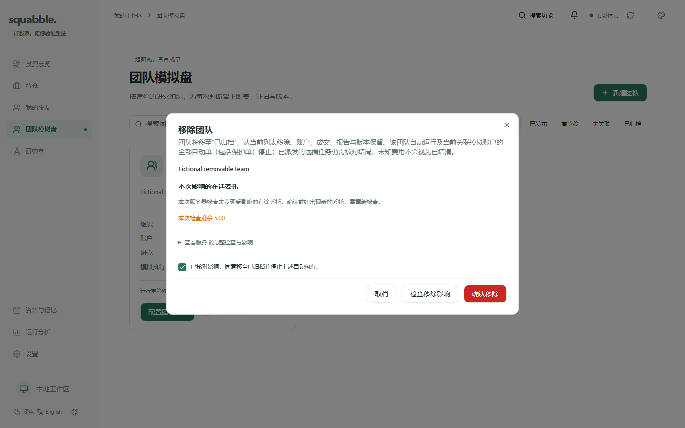
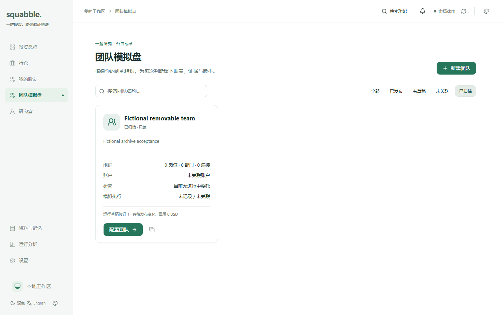

# 桌面比例收紧与团队移除

本轮按用户要求保留现有布局、配色、字体与组件设计，只调整尺寸、留白及区域高度；同时支持从团队模拟盘列表和详情移除团队。工作基于已合并的7672831，上一轮PR101已通过所有保护检查后合入main。

## 实现边界

桌面密度目标约为原来的90%，不使用transform/zoom缩小命中区域，不覆盖用户浏览器缩放。主机屏幕为1440×900，同时核验1366×768、1440×780、1920×1080及移动端。投资总览的同一信息区域应更完整；研究室空对话不应产生多余滚动，长对话保留消息区滚动，输入框始终可达。新手引导未完成时保留正常页面滚动，不裁切内容来伪装首屏完整。

团队移除复用归档预览与确认，界面明确历史仍可在“已归档”查看，账户、成交和报告保留。新入口固定pause_all；归档事务同时暂停团队运行协议、记录不可变修订、取消尚未派发周期，并复核预览时协议身份/修订。旧协议的延迟暂停和reconcile不能误停已交给其他团队的账户。远端未确认任务保留未知事实，不伪称取消或自动重发。原高级归档的显式保留规则选项兼容，但团队自动研究协议同样停止。

## 分工与计划

- [x] 核对当前main、现有归档/自动运行契约及UI高度链。
- [x] 捕获比例调整前的首屏、滚动和图表边界证据。
- [x] 独立CSS文件收紧桌面尺寸；研究室使用现有空间填充并保留消息滚动。
- [x] 列表/详情增加移除确认，补原子暂停、旧绑定保护和幂等/过期/owner测试。
- [x] 假数据浏览器验证中英文、长对话、桌面和移动场景；不调用个人研究。
- [x] 执行相关客户端、真实隔离数据库、lint/build/context/架构检查，独立评审并修正问题。
- [ ] PR通过必需CI后合并main，同步项目skill，备份/隔离恢复验证后本地部署。

## 验证口径

比例检查比较同一数据和100%缩放下的区域矩形、可见比例、消息区与外层滚动高度、控制区命中范围；不把原始像素差异当设计回归。团队测试使用单独创建的测试数据库和虚构执行器。个人服务只在合并与部署阶段操作，不用真实团队删除或付费研究作验收。

## 已完成的验证

`npm run ui:density`使用真实编译客户端、回环虚构HTTP数据和Chromium，覆盖中英文、九组视口共18个场景。当前版本全部通过；同一断言在原版编译产物上会因总览图表超出首屏而失败。长历史用虚构DOM内容测试滚动容器，不代表验证模型或真实对话协议。

| 视口 | 调整前主图可见比例 | 调整后 |
|---|---:|---:|
| 1366×768 | 32.4% | 100% |
| 1440×780 | 35.3% | 100% |
| 1440×900 | 63.9% | 100% |
| 1920×1080 | 100% | 100% |

桌面空研究室（含1024×768英文）的消息区额外滚动为0，外层无第二根滚动条；长历史只在消息区滚动，输入区保持可见。移动端保留原有响应式布局，较窄英文空白提示可在消息区正常滚动。不同账户数量、未完成引导和后续附加内容仍可使总览整页滚动，本轮不裁切这些内容。

- 全客户端测试638/638；真实PostgreSQL隔离库的团队归档与运行集成测试16/16，均无跳过。
- 本机原生Agent测试202通过，唯一POSIX进程组信号案例因Windows平台跳过，Linux必需CI继续覆盖。
- `npm run lint`、`npm run build:web`、架构检查、context测试与校验、UI探针单元测试通过。
- 原有112个几何场景零发现，品牌token锁保持一致。
- 真实浏览器验证桌面中文/移动英文的影响预览、复核勾选、首次确认503、同一key与payload重试、已归档查看及无乐观删除。
- 独立评审修正了探针浏览器启动失败时的监听器清理，未发现其余P1/P2。新断言加入现有必需CI，不替代完整服务端与原生Agent检查。

以下截图均为虚构数据，前后保持同一视口与内容：

| 区域 | 调整前 | 调整后 |
|---|---|---|
| 投资总览1440×900 |  |  |
| 研究室1366×768 |  |  |

## 架构与发行

已核对五张架构图：没有新路由、端点、表或迁移，结构与连接保持准确；现有归档内部增加协议原子暂停与旧绑定保护，相关契约和测试入口已同步到仓库skill。本地最终切换必须使用保护检查通过并合入main的完整前后端版本，不能只替换前端来遗漏停止自动运行的服务端修复。合并与实例切换结果由交付记录另行报告，不把本地检查当作已完成发布。
