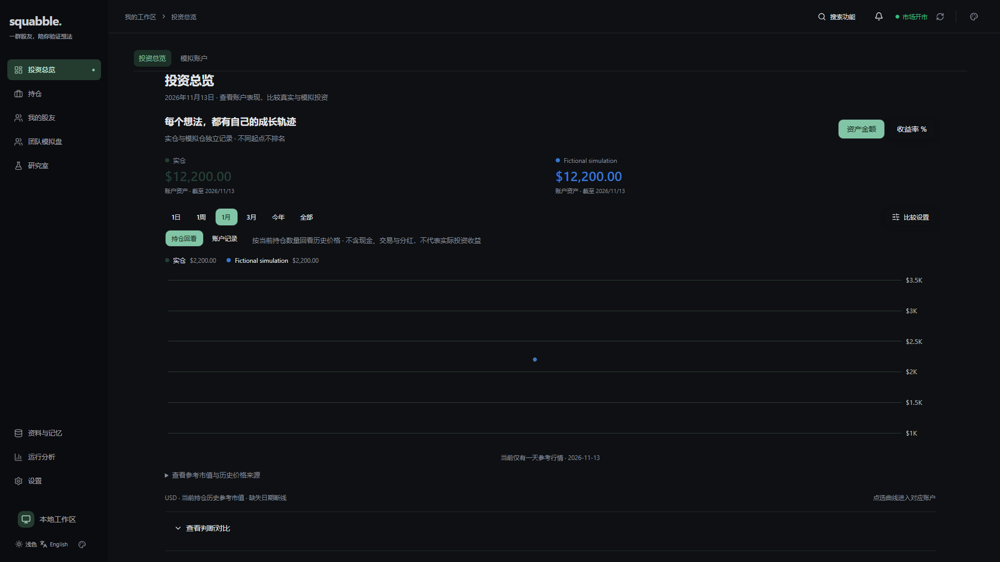
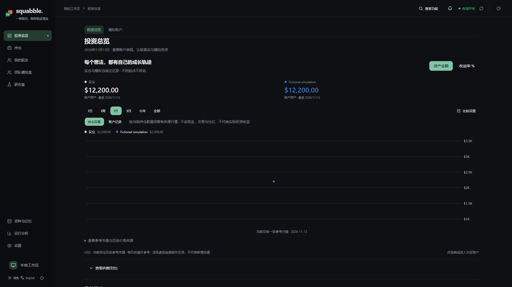
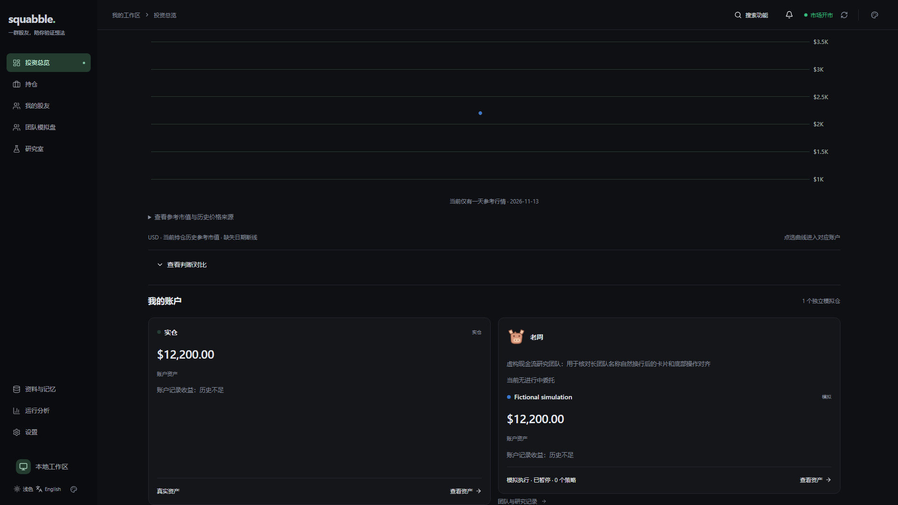
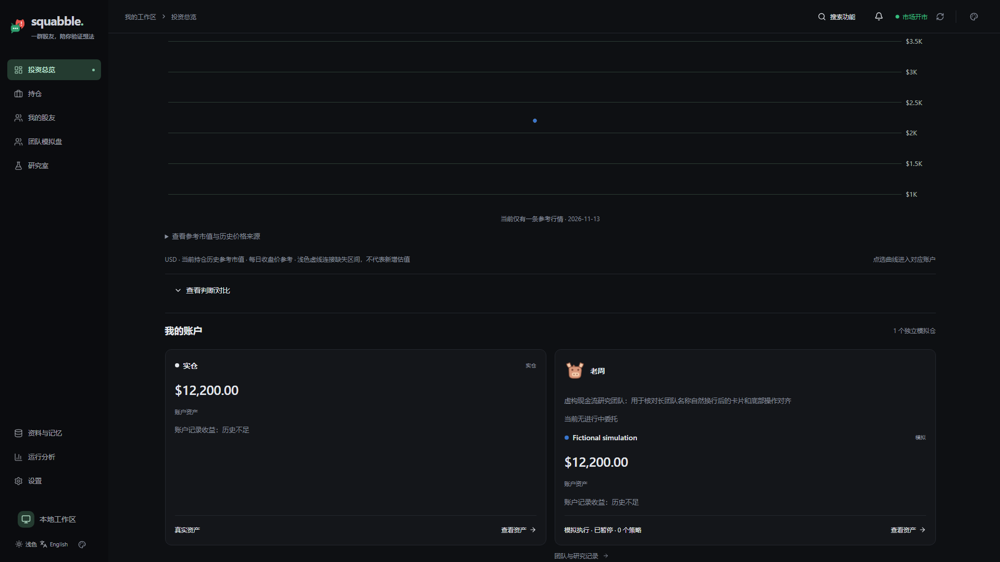

# 总览对齐与高频估值实施记录

> For agentic workers: use subagent-driven development; finish each task with its relevant checks before integration.

**Goal:** 修复用户截图红框中的边界、卡片与控件间距，恢复左上角品牌图标，并持续保留真实盘中估值，使短周期曲线更细密。

**Architecture:** 保留既有页面层级、品牌和交易执行。独立估值采集器仅调用现有行情/估值路径；实盘沿用带资金流和检查点指纹的记录，模拟盘新增盘中持久记录并兼容每日快照。读图接口保持owner/account隔离；展示连接线不生成价格、净值或收益。

**Tech stack:** React、现有CSS与ECharts、NestJS、PostgreSQL16、Drizzle、Playwright虚构HTTP数据。

## 已核对的原因和取舍

基于main77d7357。1920px宽度下导航页签最大1600px而正文1480px，左右各错60px。团队CTA在卡片外增加24px，同行两卡底部因此错开；下排卡片与上排间距为0。仓库已有logo.svg与logo-pixel.svg，不需要生成新品牌。

账户记录除1日外原本只取每日末次记录；按相邻日历日插入空点会把周末也当缺口。实盘估值只随日报读取记录，15分钟一个slot；模拟盘虽然定时估值，但每日唯一快照覆盖了盘中点。仅改变图表刻度、平滑或轮询不会增加实际数据。

采用5分钟真实采集（美股常规390分钟约78个潜在采样时段，实际数量取决于有效行情与运行时段）。1日/1周保留观测，1月按小时代表点，更长按日；来源未知、估值不完整和资金流变化不变成确定收益。历史只有日线时保持原始粒度，不伪造过去盘中点。

缺失区间用单独虚线层连接相邻真实资产点，tooltip仅列实际数据并说明连接用途；真实收益连续性失效不通过视觉连接抹去。参考曲线中拆股/除权待核实或价格口径变化的区间使用醒目的警示连接，原始估值仍为空，提示保留待核实原因；实际NAV及收益率不借此跨越财务边界。图表优先可读时间轴和明确来源，不以插值冒充采集。

交互参考官方资料：[Robinhood图表周期与5/10分钟间隔](https://robinhood.com/us/en/support/articles/using-advanced-charts/)、[富途资产分析中的总资产与收益走势](https://www.futuhk.com/cn/manual/topic11_85)、[TradingView对数据缺口原因的区分](https://www.tradingview.com/charting-library-docs/latest/connecting_data/Datafeed-Issues/)。这些资料只提供产品参考，不代表本项目已接入这些公司的行情源。

## 并行任务与验收

- [x] 定向核对仓库skill、数据契约与截图根因，创建独立分支。
- [x] UI：统一页签/正文宽度，修复账户卡片/CTA行、下排间距，复用现有logo；1440/1920/2560/390中英文暗亮及3840×1958中文暗色验收。
- [x] Chart：控件、说明、legend对齐；虚线缺口层、收益孤点、按实际粒度显示时间；真实点值和时间保持不变。
- [x] Capture：迁移67新增模拟盘盘中观察与持久幂等边界；5分钟独立采集实盘和有效模拟盘，暂停仍可估值、归档停止；不启动研究/订单。
- [x] Projection：日/周观测与月小时聚合，保留原始收益起点和窗口内失效事实；真实PostgreSQL隔离库验证owner、账户和并发边界。
- [x] 新回归先证明旧实现失败，再验证修复；运行完整客户端、相关服务端、lint/build、context及架构检查。
- [ ] 核对五张架构图和skill受影响契约，独立审查；保护CI通过后合并，按既有部署授权完成匹配备份、恢复演练和本地切换。

本轮浏览器使用虚构团队与组合；不会通过删除个人记录、确认策略或付费研究来验收。数据库、密钥、原生任务和产物按仓库部署手册保存；旧安装和匹配备份保留。

## 本地验证记录

- UI断言先在旧产物17组全部失败，再在新产物17组通过；包含团队长名称、多语言、亮暗主题、移动导航和3840宽屏。
- 原18个密度断言在最终编译产物通过；英文说明的整项换行回归以自然换行和8px图例留白修正。品牌token审查确认变量/字体完全相同；锁文件唯一结构增量为账户subgrid使用的布局`@media (width >= 768px)`条件，已明确复核更新指纹，不视为设计基线批准。
- 新图表定向行为与浏览器验收覆盖实际端点虚线连接、收益不连接、孤点可见、同日多quote精确时间、日线无伪时间、暗色前景色。独立浏览器12组通过；完整客户端652/652通过，无跳过。
- 采集相关旧回归26/26，最终竞争数据库测试8/8，收尾source/scheduler/foreground10/10。历史/quote相关33/33；各套件均无跳过，不将重复案例相加成总覆盖数量。
- 数据库屏障实际卡在最终检查后的INSERT窗口：持仓create/update/remove和现金初始化均遵循同owner fence；过期租约不能用事务开始时间继续写。相同行情、反序库存及无关展示字段变化不制造新市场点。
- 截图对应缓存的严格只读元数据核对发现11月5日是`PRICE_DISCONTINUITY_UNVERIFIED`，并非普通缺采样。因此参考图增加独立警示连接，而非修改原始价格、清除gap或生成该日估值；核对没有发出供应商请求、修改记录或输出持仓数量/价格/标的。
- 该实际形态的虚构复现已完成22/22图表定向测试及6组真实SVG/hover/click浏览器验收：警示线只连真实端点、11月5日提示为`—`及待核实，原表100/—/120保留，点击警示线不导航；切到实际NAV或收益率均不生成该警示连接。
- 独立复核修正了闭市旧盘中quote复活、重复事实掩盖价格突变、slot内来源/coverage边界被聚合隐藏的问题。真实收盘/收盘后1秒仍保留真实时间；非USD盘中汇率仅取前日数据。
- 实际公共源复核发现部分US报价头时间已到盘后，而分钟序列仍提供常规收盘事实。采集专用适配器仅在日期、纽约时区和官方收盘分钟一致时，整对使用该分钟的真实价格和时间；不把盘后价格配到收盘时刻。夏令时、提前收盘、错误日期/身份/未来时间及无效分钟值均有回归，相关23/23通过，无跳过。
- 编译provider装配通过且未启动后台任务；全量lint、构建、架构10、context15及UI探针单元23通过。完整服务端、最终视口复验和保护CI继续作为交付门槛，以实际完成结果为准。
- 全量本机服务端发现的唯一失败已定位为既有策略确认时间戳两次取时相差1ms；持久化改为复用确认瞬间，确定性递增时钟回归先红后绿，相关七组访谈/策略/账户/运行时38/38通过，原断言保留。A2A测试环境变量名称补齐后11/11通过且无跳过；原生Agent串行202通过、1个POSIX案例仅Windows跳过，LinuxCI继续覆盖。

截图、指标和运行日志在忽略的`output/playwright/overview-chart/`、`overview-polish/`与`chart-polish-proof/`；仓库只收录虚构界面的选定截图。新增布局断言进入必需CI，与原18个密度/消息滚动场景一起运行，不降低旧断言。

当前真实盘中数据从部署后逐步积累；闭市相同报价不反复变成新行情点。公共源缺失或公司行动无法核验时完整NAV仍为未知，可用真实报价子集供明确标识的持仓参考。历史日线不会因此变成已观测的历史分时净值。已验证的交易日历目前只覆盖2026；后续年份须先核验日历。

## 虚构界面对照

| 区域 | 调整前 | 调整后 |
|---|---|---|
| 页签、标题和logo |  |  |
| 账户卡片与底部操作 |  |  |
