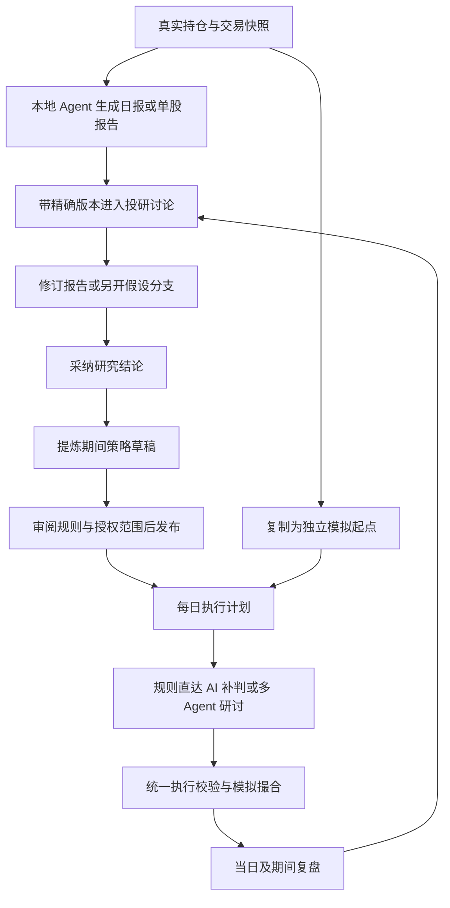
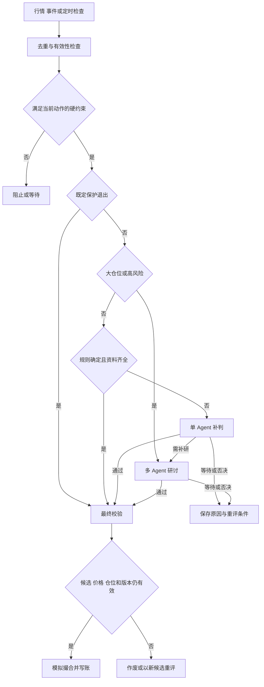

# Approved research and simulation design

Approved by the user on 2026-11-05. Source: https://chatgpt.com/space/page_f1b372fe65ec8191b439c9ade1cc4e01

Implementation note: the user subsequently instructed “可以，按照这个实施”. The original annotated proposal below is retained as the design record. The current implementation and its scope are documented in [the user guide](../../research-strategy-loop.zh-CN.md) and [validation record](../../research-strategy-loop-validation.md); wording below about awaiting approval describes the earlier proposal stage.

本方案把每日持仓和单股报告、场景化投研讨论、期间策略与 AI 模拟交易连成一条可追溯的工作流：**看到变化 → 引用报告讨论 → 修订观点 → 发布策略 → 分层决策与模拟执行 → 用结果继续研究**。

采用你提出的快慢路由：确定规则自动执行模拟交易，不确定信号由 AI 补判，高风险或大仓位交给多 Agent 研讨。每笔执行都绑定当时的报告、策略和行情版本。

状态：2026 年 11 月 5 日设计批注稿，尚未实施。以下交互和默认值均为拟议方案。以现有 `D:/stock/daily-portfolio-analysis` 的 Council、研究记忆与模拟盘为实现基线；`D:/stock/code` 是较早版本，不能假定两套实例或数据库互通。

# 01 先批注这八个决定

可以选中正文直接批注，也可在聊天里按 D1 至 D8 回复。未提出异议的内容仍属于待确认设计，不会因此自动开始实施。

| 编号 | 建议默认方案 | 需要表达的偏好 |
| --- | --- | --- |
| D1 | 保留研究报告、投研室、AI 模拟盘三个入口，用同一个研究主题串联；实施基于 daily-portfolio-analysis | 页面组织和目标项目是否合适 |
| D2 | 报告版本不可覆盖；讨论可生成修订草稿、另开假设分支，再采纳为主结论 | 是否接受明确的版本与采纳动作 |
| D3 | 月度或自定义期间策略约束每日执行计划；策略内候选自动分流执行 | 每日计划是否允许在已授权范围内自动更新 |
| D4 | 高风险升级优先于普通规则直达；预先授权的保护性退出保留快速通道 | 是否接受这一优先级 |
| D5 | 从真实盘复制完整起点，创建新模拟实验；原实验保留 | 是否需要首版同时比较多个实验 |
| D6 | 首版做多币种起点和现金账；保留原成本，但模拟收益从复制时净值开始 | 是否接受把收益对比与历史成本分开 |
| D7 | 报告关键依据被证伪时，暂停受影响的新开仓并发起补研，保留既定保护退出 | 哪些依据应标记为关键依赖 |
| D8 | 分三阶段验收：报告与讨论、策略与路由、真实盘起点与复盘；全部完成才视为本轮目标完成 | 实施顺序是否需要调整 |

# 02 产品结构与选择理由

推荐采用**统一研究主题连接现有页面**。报告负责保存一个时点的判断，聊天室负责讨论过程，策略负责约定能做什么，模拟盘负责执行和验证。用户可从任何入口发起下一步，来源始终随行。

| 方案 | 优点 | 代价 | 选择 |
| --- | --- | --- | --- |
| 统一主题连接三个页面 | 可复用现有功能，报告与交易都有明确入口，长讨论易管理 | 需要统一引用、版本和状态 | 推荐 |
| 以聊天室承载所有功能 | 对话自然，入口集中 | 报告难查、账户状态容易埋在消息里，执行边界不清 | 不作为主结构 |
| 保持模块独立，仅增加跳转 | 改动较少 | 上下文仍会丢失，无法解释交易依据和报告修订影响 | 只适合作为过渡 |

“研究主题”是持久的归档对象，例如“我的主账户”“股票 A”。主题下可以有多次日报、多个讨论和多版策略。首版不新增复杂的主题管理页面：在页面顶部用主题选择器、关联资料和返回链接表达。

三个入口的定位：

- **研究报告**：沿用分析页，增加每日组合、单股研究、期间复盘三个筛选，以及当前采用版本和待处理修订。

- **投研室**：沿用 Council，按场景组织讨论；从报告进入时自动携带精确引用。

- **AI 模拟盘**：账户概览、执行策略、决策记录、持仓订单、绩效复盘。策略区容纳日度、月度和自定义期间策略。

- **智能体搭建**：保留为研究团队和执行配置的高级入口；普通流程直接使用团队预设，避免每次讨论都先配置成员。

# 03 一条完整的用户旅程

以虚构股票 A 为例：日报认为集中度升高，但仍建议持有。你点“讨论本日持仓”，补充“核对 A 的盈利假设是否已经变化”。聊天室引用日报 v1 和 A 深报 v3，列出支持与反对证据。你从相关消息点“修订报告”，得到日报 v2 草稿，差异显示“继续加仓”改为“暂停新增，等待披露”。

采纳后点“形成策略”，选择本月有效。系统将研究结论转为可执行条目：禁止新增的条件、恢复买入所需证据、持仓上限、保护退出和复盘时间。你发布一次授权范围，模拟盘按规则运行；触发较大仓位的候选时自动建立交易研讨子讨论。结果写回当天复盘，同时保留完整来源。

# 04 研究报告如何进入讨论

## 报告列表与阅读页

列表首屏展示“今日结论是否有变化”和“哪些问题值得处理”，而不是只展示长报告标题。每条报告显示主题、覆盖期间、版本、数据截至时间、生成时间、来源 Agent、当前采用状态与关联策略数量。同一主题同时显示“最新可用 v5／当前采纳 v3／运行策略引用 v2”，点击可比较三者。报告尚未生成、部分生成、失败和已完成分别显示；缺失内容不沿用旧内容冒充今日结果。

日报阅读顺序建议固定为：

1. 组合变化：收益、交易、仓位、现金及集中度变化。

2. 今日交易复盘：发生了什么、当时依据是什么、是否符合当时有效策略。

3. 单股重点：仅突出观点或风险发生变化的标的，完整持仓折叠。

4. 待验证问题：矛盾、缺失证据、催化剂及失效条件。

5. 对当前策略的影响：无影响、建议复核、需暂停新增风险。

收益、现金流和汇率影响分别解释；事实字段来自账本计算，AI 负责解释。历史交易评价使用当时能获得的信息，另设“事后结果”区，避免用后来信息评判当时决策。

阅读页主按钮为“讨论这份报告”，辅助按钮为“讨论选中段落”“查看版本”“形成策略”。点击某只股票时可选择“讨论它对本组合的影响”或“进入单股研究”，以免把组合问题不知不觉变成个股推荐。

## 带资料发起讨论

点击“讨论”打开轻量创建面板：自动填入场景、主题、问题建议、引用报告版本、对应持仓快照和团队预设。用户只需补充问题并开始。已有同日同主题讨论时，优先展示“继续现有讨论”，仍允许另开不同假设的讨论。

正文选中一段后发起追问，消息中出现可点击引用卡：“11 月 5 日持仓日报 · v1 · 集中度分析”。卡片保存文档身份、版本和章节锚点，不只复制文字。点卡片可定位原段落，也能看到数据截至时间。

日报汇总可引用多个单股报告，但每个都固定版本。旧日报打开的深报始终是当时那一版。若有新版本，仅显示“已有新版，可加入本轮”，不会偷偷替换历史上下文。

## 跨市场日报

日报使用用户的 Asia/Shanghai 业务日期，同时为每个市场标记交易日和收盘时点。例如同一份晨报可能包含上一美股交易日和当日亚洲市场盘前信息。日期标签不代表所有市场都已完成当日交易；已收盘、交易中和上次收盘分别呈现。

# 05 投研室按场景组织 Thread

| 场景 | 默认带入的资料 | 本轮应产出的结果 |
| --- | --- | --- |
| 每日持仓复盘 | 当日组合报告、真实持仓快照、当日交易、在用策略、重点单股报告 | 需要调整的观点、交易复盘、次日行动草稿 |
| 单股深入研究 | 选中的单股报告版本、相关论点及证据、可选的组合敞口 | 新的研究结论、反证、催化剂和失效条件 |
| 期间策略研讨 | 用户指定日期范围内的报告、历次策略、模拟结果和未解决问题 | 日度、月度或自定义期间策略草稿 |
| 交易执行前复核 | 固定的候选交易、触发规则、成交前后敞口、引用报告、行情及失效时间 | 通过、否决、等待或要求补充证据 |

一个 Thread 对应一个清楚的问题或场景。单股主题可以持续数月，但每次新事件和新问题可以形成新讨论，旧结论作为引用继续使用。日报默认每天一个主讨论，月份策略引用多个日报讨论。这样既有连续研究，也能界定每轮当时知道什么。

桌面沿用三栏布局：

| 左侧导航 | 中间讨论 | 右侧成果 |
| --- | --- | --- |
| 主题、场景、历史讨论、分支 | 顶部固定问题和引用资料；中间消息；底部输入框 | 当前结论、报告版本、策略草稿、执行影响 |
| 可按日期和“待处理”筛选 | 消息支持引用追问、反驳、加入结论、从此另开讨论 | 默认显示简短结果，展开才显示证据和过程 |

移动端保留讨论主屏，资料与成果以抽屉打开。资料已带入、正在补研、需要用户信息、产生新版结论分别给出明确状态。讨论中途输入的新信息显示“已加入本轮”或“将在下一轮处理”，不让已经完成的进度无解释地消失。

“继续本讨论”继承本轮资料和未决问题；“从这里另开讨论”复制截至所选消息的资料清单与阶段结论，保存父讨论链接，不继续共享可变上下文。分支用于另一种投资假设，不自动改变主结论。首版支持分支和对比，复杂的自动合并后置。

长讨论采用阶段摘要加原文检索。接近现有消息或任务预算上限时，生成可检查的交接摘要并提供“带总结继续”。界面列出本轮实际引用材料；摘要不会取代可回溯的原始消息。

“交易执行前复核”有固定候选和有效期；“成交后复盘”分析已发生的结果，只能产出研究或新策略草稿。两者在标题和按钮上明确区分。用户看到主题和讨论两层，内部研究任务不再作为第三层会话暴露。

# 06 引用 推翻与新版报告

要分清三个概念：**讨论修订号**用于判断任务输入是否仍有效；**报告版本**代表已保存的研究成果；**策略版本**代表执行时的规则。三者不能共用一个“最新版”编号。

修订报告的交互：

1. 选择原报告或某条有价值的消息，点“据此修订报告”。

2. 选择仅修订某些章节，或根据新证据重新评估全篇。

3. AI 生成草稿，展示原结论、新结论、修改理由、引用证据，以及受影响策略。

4. 用户可批注或直接编辑，再选择“保存为另一观点”或“采纳为主结论”。

自动日报可以归档成为新的报告版本；聊天室完成一轮也可以保存自己的成果。对既有主结论的替换必须走采纳动作。采纳事件记录操作者、时间和适用主题或分支。页面同时显示“最近生成”和“当前采用”，避免让用户以为新生成就已成为交易依据。

每个版本记录父版本、来源讨论及消息、生成者、采用的持仓和证据快照、改变了哪些结论。推翻只改变结论关系，旧版本仍能查看，已执行交易仍指向原版本。两个并行修订都从 v1 出发时，不能由最后保存者静默覆盖；后提交者看到差异，选择另存分支或重新比较。

引用包含三层：报告整篇、章节、论点及其原始证据。多 Agent 引用同一条新闻只算同一个证据来源，不能因为多人复述就提高证据强度。保留异议，主持人明确说明采纳和未采纳的理由。

旧报告有两类变更后果：

- **观点更新**：提示相关策略复核；现行策略仍按固定版本运行。

- **关键事实被纠正或关键假设失效**：引用图找出受影响规则，暂停这些规则新增风险，建立补研任务；已有保护退出继续有效。不能把所有普通报告更新都当成全账户停机。

长期有效的投资论点继续进入现有研究记忆，区分候选、确认、被否定和过期。一次聊天室发言或自动摘要不会直接成为永久记忆。

# 07 从讨论结论形成可执行策略

聊天室的“形成策略”打开右侧编辑面板，保留当前讨论。先选择日度、月度或自定义期间，再选择模拟实验。AI 从已选报告和讨论提炼草稿，用户可以逐条批注。

策略由两层组成：

- **期间策略**：目标、有效区间、投资范围、资金与风险边界、关键假设、基准、允许自动调整的范围。例如本月以控制某行业敞口为目标。

- **每日执行计划**：当日可以触发的条件、目标仓位、数量计算、退出与失效规则。沿用现有日策略引擎，受期间策略约束。

月度策略不能简单把日内指令延长一个月。每日刷新行情和证据后，执行计划在已发布的范围内更新；改动投资范围、抬高仓位上限、放松保护或改变核心方向，都形成新策略草稿。用户在发布期间策略时一次选择是否允许范围内自动生成日计划。

## 策略卡的必要字段

| 字段 | 用户看到的内容 |
| --- | --- |
| 目标与周期 | 希望验证什么；开始、结束、复盘时间；对应市场时区 |
| 适用账户 | 哪个模拟实验、起点版本、基准和计价币种 |
| 可投资范围 | 标的或篮子、允许的交易方向、是否允许新增标的 |
| 仓位约束 | 单股、行业、总风险敞口上限，最低现金，单次变化限额 |
| 进入与调整 | 明确指标、阈值、观察窗口、价格限制、触发次数与冷却期 |
| 数量计算 | 目标仓位或固定数量如何转换，剩余资金和交易单位如何约束 |
| 退出与保护 | 止损、止盈、假设失效、到期后持仓如何处理 |
| 决策路由 | 哪些规则可直接执行，哪些需 AI，何时必须研讨 |
| 资料与依据 | 固定的报告版本、讨论成果、证据时间、关键依赖 |
| 运行与预算 | 检查频率、研讨上限、模型预算、超时与故障处理 |

“逢低加仓”“基本面恶化时减仓”可以作为研究意图保存，但不能直接执行。系统标成“待明确”，引导补全条件；纯语义判断必须指定资料来源、可观察证据、判定输出和失效时间。关键数据缺失不能靠 AI 猜测补齐。

示例仅演示产品结构：对虚构股票 A，若价格进入指定区间且观察条件成立，按目标仓位计算候选；若交易后敞口触及研讨阈值，交多 Agent；若已发布的止损条件触发，则走保护退出。真实阈值在策略发布前填写和校验。

## 发布与版本切换

“发布到模拟盘”先展示一张可审阅的变更单：采用哪些研究结论、允许哪些自动交易、最大敞口、预计首次检查、与当前策略冲突、到期处理和成本设置。校验通过后一次发布并启动，不要求用户逐笔确认授权范围内的交易。

状态为草稿、已发布待生效、运行中、暂停新增、已到期、已替代。不同于“暂停全部自动执行”，“暂停新增”仍保留已授权的退出保护；按钮直接写明后果。

发布新版时，旧计划停止生成新候选，未成交候选及订单作废并释放预留，已成交记录保留。继承的持仓保护需在切换时明确归属；不能因旧计划到期丢掉止损。策略到期默认停止新增、撤销普通未成交候选、保留独立的持仓保护并发起复盘，不默认清仓。若需要到期退出，发布时必须明确约定。

同一实验同一时间只运行一个有效组合策略包；其中可以包含多个单股规则和日度子计划。禁止两份相反策略同时争用现金。真正需要比较两种假设时创建两个同起点实验。

授权固定绑定模拟实验、期间策略版本、生效与失效时间、标的范围、风险额度、累计换手和路由条件。新版期间策略需要重新发布；每日计划更新仅能使用父策略事先明确授予的范围，不以“自动更新”为理由扩大权限。日期选择对用户包含结束日，系统转换成对应时区的明确起止时刻，市场指令仍按交易日和交易时段生效。

# 08 快慢路由的决策逻辑

你的方向合理，但路由需要同时看**规则是否确定**和**行动风险有多大**。如果只先判断规则是否命中，大仓位加仓就可能直接绕过研讨。

借鉴 DeepSeek Harness 原型中的事件处理、任务隔离、持久状态和受限执行思想。本方案把它转化为交易场景的分层决策；三层交易路由是本产品的设计，不是 DeepSeek 已验证的交易框架。官方也将其标为研究原型，且说明部分文章设计尚未实现。[DeepSeek 官方原型说明](https://github.com/deepseek-ai/dsh-superagent-prototype/blob/main/README.md) [原型架构](https://github.com/deepseek-ai/dsh-superagent-prototype/blob/main/docs/007-architecture.md)

## 按这个顺序决定路线

| 优先级 | 判断 | 行为 |
| --- | --- | --- |
| 0 | 实验停机、版本失效、报价不可用、不可交易、资金或可卖数量不足 | 阻止交易或等待数据；不调用模型争取放行 |
| 1 | 预先授权的保护性减仓或止损，且执行所需条件有效 | 快速执行保护，不等待多 Agent |
| 2 | 普通交易触及软风险阈值、大仓位、重大事件或关键研究分歧 | 直接送研讨室，即使规则完全确定 |
| 3 | 低风险、条件可计算、输入完整、规则在授权范围内 | 无模型调用，直接进入统一执行校验 |
| 4 | 授权范围内，但需要有限的语义判断或证据消歧 | 单 Agent 补判；不能解决则等待或升级研讨 |

硬限制按动作区分：禁买和增加风险限额只阻止相应动作；资金、可卖数量、交易状态和数据有效性仍约束保护退出。保护通道不能借机反手开仓，也不能扩大原计划仓位。触及硬上限的增加风险行为直接拒绝，Council 无权“特批”。

## 路由依据与输出

风险计算使用成交后敞口，合并现有持仓、尚未成交的预留、同一发行人相关头寸和组合集中度。还要看本次变化幅度、流动性、事件窗口和数据完整性。不能仅看订单金额，也不能仅用模型自报的置信度。

首版提供可配置的软升级阈值。拟议产品默认示例：成交后单股敞口达到该股硬上限的 80%，或单次新增风险的仓位变化达到组合净值的 3%，则进入研讨；行业敞口接近上限、重大事件窗口或关键论点冲突也升级。数字只用于本设计的模拟分流默认值，不是投资仓位建议。阈值及适用范围在发布页显式展示，缺少必要风险输入时不走直达通道。按约定滚动窗口累计增加的敞口判断，防止拆单绕过阈值。已授权的普通净减仓不因原仓位大或卖出金额大而自动升级，但流动性风险、证据冲突或复杂对冲仍需研讨。

单 Agent 只能输出通过、等待、否决、升级，以及理由、引用证据和有效期。多 Agent 由研究员、质疑者、风险经理和主持人完成有预算的研讨，保留分歧。主持人汇总后仍只能批准这个固定候选。若建议改变方向、数量或规则，必须生成新候选或策略草稿重新校验。

研讨的“通过”允许候选继续检查，不等于保证成交。所有路径进入同一个确定性执行器，重新检查当前行情、候选身份、账户余额、可卖份额、交易规则、风险限额、策略及讨论版本。模型不直接操作现金或持仓。

## 慢任务与故障

一条候选贯穿全部路线使用同一身份。等待研讨时不会由另一条快路线重复成交；待研究候选使用有期限的资金或份额预留；过期、否决或计划切换时释放，避免长研讨一直锁住账户。未成交预留也计入敞口。研究期间出现新报价可以合并为状态更新，但不能擅自扩大原审批范围。

候选过期、价格越出允许区间、仓位变化、策略替换或关键报告失效时，旧审批失效。若仍有机会，按新候选重评；保留旧研讨作为资料，不能使用旧价格补成交。拒绝或等待结果按证据和候选版本缓存，只有新的相关证据或约定时间到达才重评。

模型超时、额度耗尽或本地 Agent 离线：需 AI 的候选保持等待或过期，不降级成规则直达。规则直达和已授权保护在所需数据与服务有效时可继续。高风险也不因研讨太慢而降级。

运行看板突出异常：长时间无进展、断连、资料过期、预算耗尽和待处理冲突。正常扫描只汇总，避免每次轮询都刷消息。

# 09 从真实盘一键开始模拟

入口同时放在真实持仓页的“用当前持仓模拟”和模拟盘空状态的“导入真实盘起点”。点击后打开完整预览，数据齐全时一次确认创建并进入实验。这里的“一键”指无需手工重录持仓；有歧义的数据必须先补全。

预览包含源账户、源账本更新时间、逐股数量、可卖数量、历史成本、估值价格及时间、各币种可用、冻结及未结算现金、当日买入量、汇率、基准和目标策略。默认全部复制，也可以明确选择部分账户；部分选择会标注为子组合实验。

复制创建**独立模拟实验**，写入期初持仓和期初现金。它不是一次买入，不扣第二次现金、不产生开仓手续费，也不复制原真实订单为模拟成交。券商中的未成交委托可作为背景显示，但首版不继承为可执行模拟订单。

已存在模拟账户时，按钮为“以真实盘新建实验”。原实验保留并可暂停，不使用现有清空重置接口。真实盘之后变化只产生差异提示；不会继续覆盖模拟持仓。需要新的起点时再次创建实验。

## 起点数据的处理规则

| 情况 | 处理 |
| --- | --- |
| 现金完整、证券与价格可识别 | 展示核对后创建完整实验 |
| 未提供现金 | 提示补充；也可选择零现金实验，但明确标为假设起点，不能称完整复制 |
| 成本缺失 | 不阻塞从当前估值模拟；历史成本盈亏显示未知 |
| 价格或汇率缺失 | 可以保存待补全草稿，不启动受影响交易，也不输出完整净值 |
| 源持仓在预览后变化 | 刷新差异后重新确认，避免把两个时点拼成一个起点 |
| 不支持的资产或市场 | 明确列出；用户选择排除并标为子组合，不能静默丢弃 |
| 原币种现金与汇率 | 保留原币数量，冻结起点汇率；后续按指定口径估值 |
| 重复点击或网络重试 | 同一创建请求只产生一个实验 |

首版建议补多币种模拟现金账，因为真实持仓有多市场资产，现有模拟盘只有 USD 现金。基础币种用于展示，不代表可以凭空跨币种买入；换汇必须是明确记账的模拟资金操作，按设定汇率和费用完成。若实施时先选择折 USD 的简化版，必须标注“折算实验”，不能宣称完全复制真实账户。

每个实验记录：来源快照、创建时估值、计价币种、资金流、费用与滑点版本、策略版本轨迹和行情时间。默认只有明确选中的实验自动运行；其他实验可查看或手动启用，预算按实验分别展示。

源账户的冻结和未结算状态按实际资料带入。未成交真实委托不在模拟盘执行，其相关冻结资金仍保留原因；后续按明确的模拟解冻或结算规则处理，不自动跟随真实委托。可卖数量、冻结原因或结算时间缺失时，提示补充或采用明确的受限假设，不能默认全部可卖、全部现金可用。

# 10 模拟收益和撮合口径

复制时保留两套成本口径：历史真实成本用于查看原持仓盈亏，模拟起点市值用于衡量“从现在采用策略”的结果。已有浮盈不能算作 AI 新赚的钱。起点净值为复制持仓市值加现金减已有应计负债；若负债不受支持，不能把该账户当作完整净资产起点。

无资金流时，期间收益从起点净值计算；有后续模拟入金、出金时用资金流调整的收益率。对比至少包括：

- 同一起点按策略运行的组合。

- 同一起点保持原持仓的对照组合。

- 用户选择的市场基准，使用相同起止时间、计价币种和适用的收益口径。

真实盘后续实际收益可以另列，但资金流、交易和约束不同会影响可比性，不能把全部差额都归因于 AI。策略版本切换显示区间贡献，不重写过去曲线。

当前实现是最新报价驱动的简化成交，手续费为零，尚未模拟完整订单簿。目标首版至少把费用、滑点、交易日历、交易单位、可卖数量、停牌及行情新鲜度统一到所有执行路径。无法确认可成交条件时等待；只拿到收盘价时标明观察模式，不假装盘中即时成交。

限价、部分成交、复杂公司行动按后续扩展处理。首版对支持的分红与拆股进行一致的账本调整；不能处理的事件标记影响区间并暂停相关标的自动交易，不继续输出无缺口的超额收益。遇到止损跳空，按当时可用的成交模型执行，不能承诺按止损价成交。

模拟结果必须与成交假设一起呈现。Alpaca 的官方说明同样指出，撮合价格、流动性假设和收益算法会造成模拟差异，其模拟不覆盖市场冲击等因素；本设计据此将假设版本化。[Alpaca 模拟交易说明](https://docs.alpaca.markets/us/docs/paper-trading)

复制持仓和现金时必须核对起点。QuantConnect 的对账说明指出，起始现金和已有持仓的差异会影响绩效可比性。[QuantConnect 对账说明](https://www.quantconnect.com/docs/v2/writing-algorithms/live-trading/reconciliation)

# 11 监控结果如何回到聊天室

模拟盘首页首屏回答四件事：当前执行哪版策略、账户与数据是否正常、今天做了什么、哪些事情需要我处理。其余扫描放入可展开日志。

每条决策卡显示标的、方向、数量、来源规则、选择哪条路线及理由、引用报告版本、行情时间、审批有效期、最终成交或拒绝原因。点击“查看依据”可一路返回策略条目、研讨消息和原报告章节。

需要补研时，模拟盘自动在相关主题下创建“交易复核”讨论，并把卡片双向关联。已有同一候选的研究任务时追加事件，不重复开群。用户可以中途提问；纯粹查看不使审批失效，改变候选依据或提出反证则产生新的输入修订并触发重评。

研究型聊天与交易复核在标题处明确区分。研究报告表达积极观点不代表授权买入；交易复核的通过只针对卡片上的固定候选，在有效期和策略授权内可自动执行。

当日复盘由系统汇总成交、未成交、规则拒绝、AI 否决、多 Agent 影响、费用和最大回撤，并列出“判断错了”“执行受限”“资料不够”三类问题。月度或自定义期间复盘把这些记录汇总为策略调整建议，再进入新一轮讨论。

通知采用事件驱动：成交、重大风险、策略失效、研讨完成且影响决策、运行中断或需要用户信息时提醒；正常无变化不重复通知。站内消息作为默认渠道，外部渠道沿用用户已有设置。

本地服务或电脑关闭时，明确显示最后心跳和监控缺口。恢复后校对账本、策略、任务状态和最新行情，记录漏检时间；不把离线期间理论上应触发的订单补记为历史成交。先取消过期增险指令并释放预留，再用当前数据重评尚有效的保护条件。只有重新校验后仍有效的当前机会才可成为新候选。

# 12 现有能力和本次要补的部分

以下基于当前工作区源码检查，描述代码已具备的结构，不代表本轮已运行验证所有功能。

| 模块 | 已有能力 | 本次补齐 |
| --- | --- | --- |
| 每日分析 | 组合与单股卡片、按日期筛选、Agent 写入接口 | 不可变日报包、完整输入快照、报告日期与数据时点、精确引用 |
| 深度报告 | 多次运行历史、结构化观点、多空论证 | 统一报告身份、版本关系、修订草稿、原始来源完整保留 |
| 投研室 | 多成员、本地 Agent 和模型 API、消息、暂停继续、报告历史、工作流 | 组合与期间场景、主题与分支、结构化消息引用、报告修订与策略草稿入口 |
| 研究记忆 | 报告版本锚定、论点候选与确认、编辑历史 | 扩展日报来源、关键依赖与失效影响传播 |
| 策略 | Council 研究、规则提炼、日计划、版本校验、信号去重 | 期间授权与日计划分层、统一风险路由、从聊天显式发布 |
| 模拟盘 | 单用户模拟账户、持仓订单、风控、自动扫描与保护 | 真实盘起点复制、多实验、多币种、统一成交检查与绩效口径 |

目前的“持仓导入”是将 CSV 或截图等资料写入真实持仓账本，并不等于将真实账户复制成模拟起点。该复制流程需要新增。

日报现在会按同日同股票覆盖，聊天室工具主要读取深报和 Council 报告；这两点是闭环的第一处断点。另有一条旧执行路径按 Council 开关统一审核，新日策略除保护退出外普遍调用快速模型；它们需要收敛到同一个路由器。

代码依据：`server/modules/agent/agent.service.ts`、`server/modules/research-tools/research-tools.service.ts`、`server/modules/council/`、`server/modules/research-memory/`、`server/modules/paper-trading/strategy.service.ts`、`strategy.store.ts`、`paper-trading.service.ts`、`shared/strategy.interface.ts`。

# 13 数据关系和执行责任

这一节用于后续开发对齐，用户界面不必展示这些内部对象。

| 对象 | 负责保存什么 | 关键关联 |
| --- | --- | --- |
| 研究主题 | 账户或股票的长期研究归档 | 讨论、报告、论点 |
| 讨论 Thread | 场景、问题、消息、引用、分支、阶段总结 | 父讨论、来源消息、研究任务 |
| 报告及版本 | 稳定报告身份、不可变内容、采用状态、来源、改动理由 | 父版本、讨论、输入快照 |
| 研究输入快照 | 当时持仓、现金、交易范围、行情、汇率和证据可用时间 | 报告和研究任务 |
| 期间策略及版本 | 已发布授权范围、有效期、风险边界、来源与关键依赖 | 模拟实验、报告版本 |
| 每日执行计划 | 当日具体规则与路由设置 | 期间策略版本、市场交易日 |
| 模拟实验及起点 | 独立账本、起点估值、费用模型、基准 | 真实盘快照 |
| 决策记录 | 固定候选、路线、证据、研讨、有效期及最终结果 | 计划版本、订单及成交 |

报告与 Thread 分开建模，一个讨论可以引用多份报告，也可以产出多个报告版本。策略固定引用被采用的版本；模拟实验保存全部策略切换记录。首版可在现有 Council session 外增加轻量主题与关联字段，无需重写消息和任务引擎。

本地 Agent 负责研究和提交报告草稿；应用服务负责接收校验、保存版本、路由、风控和账本。提交内容包含报告类型、覆盖期间、数据截至时点、输入快照、生成任务、来源引用与内容摘要。持仓数字及交易盈亏由应用计算，Agent 无权凭自然语言改账。

报告上传使用有归属校验的任务授权与幂等键；只在完整保存成功后标记可引用。同一任务重试不重复创建版本。正文中返回的链接和来源作为研究材料保存，不因来自 Agent 就成为已验证财报。

时间至少保存：事件发生时间、数据首次可用时间、系统采集时间、研究截至时间、生成时间、生效时间。回看旧决策时只能使用当时已可用资料；新修订可使用后来证据，但必须标明是事后更新。

账户风险日按用户设置的业务时区计算，市场交易日按证券交易所日历计算，后台技术时间统一储存。不可混用 UTC 自然日、上海日期和美股交易日来重置日限额。

执行链路需要持久任务状态、过期租约、候选幂等身份、账户和计划版本校验。策略发布、账户起点创建和成交记账必须保证完整一致；具体事务及迁移方式依据目标项目当前数据库设施设计，不能照搬旧目录的部署约束。

实施时尤其不能把 AI 的“通过”接到现有人工审批快捷路径：当前该路径允许跳过部分机器人上限并使用回退价格。三条自动路线都应走统一的新鲜报价与风险校验，不借用人工豁免。

历史迁移只登记仍存在的原始记录为“历史导入版本”。被覆盖的旧日报无法凭空恢复，缺失的来源、时间和快照明确标未知；不拿当前持仓补造过去快照，也不把完成时间推断成原交易日。现有旧报告链接保留兼容映射。

首版以从当前起点向未来运行的模拟为主。若用户选过去的起点却使用今天生成的新报告，必须标为事后情景推演，不能宣称无前视回测。收盘后生成并发布的策略不能按已经结束的当天收盘价成交；历史回测扩展需对新闻、财报、汇率、报告、研究记忆等统一执行“信息可得时间不晚于决策时间”的检查。

# 14 边界情况的用户可见处理

| 情况 | 页面如何说明 | 系统如何处理 |
| --- | --- | --- |
| 日报晚到或本地 Agent 离线 | 今日报告尚未完成；显示上次成功时间 | 旧报告保留原日期，不伪装成今日结论 |
| 只有部分股票生成成功 | 报告显示覆盖范围与缺失标的 | 可研究已完成内容，依赖缺失资料的规则不生效 |
| 讨论中新增反证 | 提示哪些结论需要重新核验 | 更新输入修订，保留旧报告；受影响的旧交易审批失效 |
| 多人或多任务同时修订 | 展示基准版本已变化与差异 | 乐观锁或分支，不静默覆盖 |
| 报告修订时模拟盘已有交易 | 展示交易发生时的来源版本 | 历史不改写，新版本仅影响后续行为 |
| 大仓位研讨期间触发既定止损 | 显示保护退出已执行、原加仓候选失效 | 保护优先，更新持仓后取消失效候选 |
| 多个候选争用同一现金 | 显示额度占用与等待原因 | 执行前重算并预留，不能分别把全账户现金都花掉 |
| 策略已到期但仍有持仓 | 显示新增已停、保留哪些保护 | 沿用独立保护，等待续期或明确退出计划 |
| 模型或多 Agent 无共识 | 显示分歧和下次重评条件 | 等待或否决，不把超时当通过 |
| 应用重启或回调重复 | 显示恢复核验进度 | 未知执行状态先查账，避免重放付费任务或重复成交 |
| 实盘复制后原账户变化 | 显示两者差异 | 保持模拟实验独立，可另建新起点 |

# 15 实施拆分与验收标准

先批注并确认整体设计，再按三阶段实施。阶段一可以先交付体验，但不能把阶段一完成表述为整个需求完成。

## 第一阶段 报告和讨论连通

统一日报、深报、Council 报告的版本引用，新增研究输入快照；报告页携带资料进入对应场景；实现段落引用、修订差异、采纳与简单分支；补本地 Agent 提交合同。

验收：旧日报永远打开原单股版本；从报告进入讨论无需手动复制；推翻结论后原报告仍可查；并行修订不互相覆盖；本地任务重试不产生重复报告。

## 第二阶段 策略与分层决策

将期间策略与日计划分开；从讨论提炼可编辑策略草稿；发布后按统一的规则直达、AI 补判和多 Agent 研讨运行；补版本切换、过期、保护退出、预算和可追溯的决策卡。

验收：明确低风险规则不调用模型；高风险即使命中规则仍研讨；硬拒绝不能被任何 Agent 覆盖；保护退出不等候加仓研讨；慢结论返回后使用新行情重新校验；重复触发只成交一次；策略替换后旧候选无法成交。

## 第三阶段 真实盘起点与期间复盘

新增完整起点快照、多币种现金、独立模拟实验、期初账本和同起点对照；完成当日、当月、自定义期间复盘回流。

验收：复制前后股数及原币现金一致，起点净值可对账；复制不生成买入、不重复扣现金；历史浮盈不计入 AI 新收益；重复导入请求不创建重复实验；真实盘变化不覆盖模拟；暂停和到期不丢保护；离线恢复不补造历史成交。

## 全链路验收场景

用虚构数据完成一次“日报 v1 → 引用与反驳 → 日报 v2 → 月策略 v1 → 日计划 → 三种路线各一笔候选 → 模拟成交与拒绝 → 月度复盘 → 月策略 v2”。从任何一笔交易能反查原始报告章节和当时快照，从报告也能看见它影响的策略与交易。

验证覆盖服务接口、权限归属、引用和版本、日期边界、并发与重复请求、资金守恒，以及桌面和移动端主要操作。沿用现有 Council、strategy、paper-trading 的安全与竞态测试基础，并针对新增边界增加验收。

首版不纳入券商真实自动下单、复杂衍生品、完整订单簿仿真、任意策略自动合并或自动优化模型。首版交付的是可解释、可复核的研究和模拟闭环。
