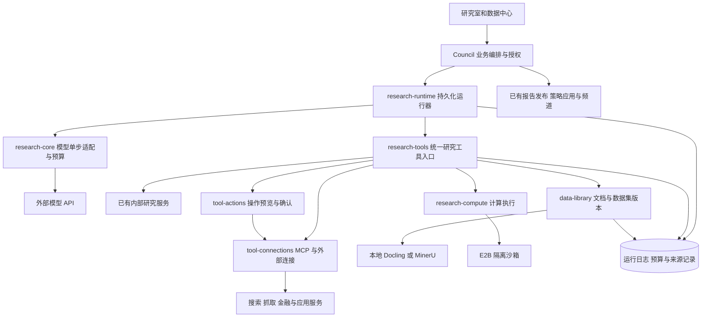
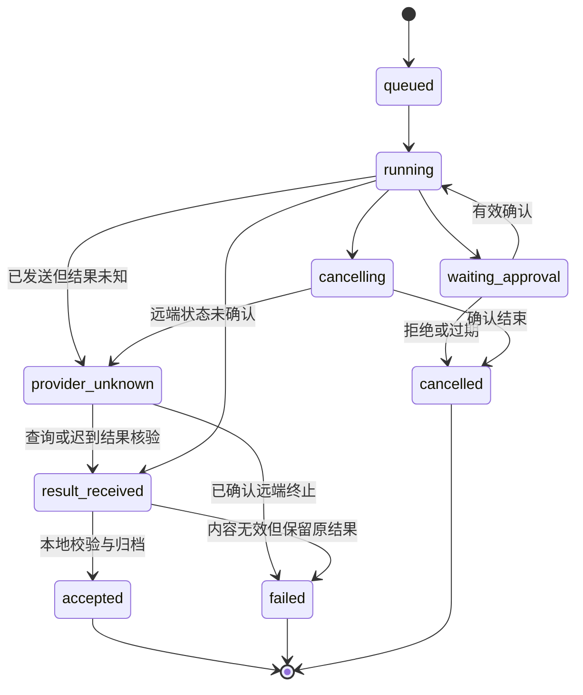

# Squabble Agent 工具体系设计审阅稿

状态：待用户审阅。日期：2026-11-11（Asia/Shanghai）。代码基线：main `f077b3ee4b719d043db53bb3f132e985ef32a12a`。

本文定义外部模型 API 驱动研究 Agent 所需的运行层、工具连接、金融数据、文档解析、计算、浏览器与外部应用能力。用户已选择**混合部署**：资料、PDF、浏览器会话尽量留在本地；搜索、计算沙箱和应用连接使用成熟云服务。完整范围包含本次讨论的所有能力，按阶段验收，避免一次切换全部研究流程。

配套文档：[开发计划](../plans/2026-11-11-agent-tooling-implementation.md)。本稿获审阅通过后才进入实现；服务采购、真实账号授权、生产切换和实盘交易不由本文代替授权。

## 1. 产品目标和完成定义

用户在研究室提出“分析这几家公司、阅读研报、比较估值、计算风险、生成报告并保存到指定笔记”后，Agent 能选择合适工具、取得有出处的数据、执行可复算计算、展示实际进度并产出可追溯报告。需要对外发送或修改内容时，先展示具体结果和目标，由用户确认。

完整交付必须具备：

1. API 模型真实调用已有研究工具与外部工具，连续多步工作；失败、停止、重启后状态清楚。
2. 金融数据覆盖现有美股路径，并补充 A 股、港股、公告、复权行情及按接口提供的宏观数据。
3. PDF、DOCX、扫描件、表格可以解析；PDF/扫描件可引用原页，DOCX可定位段落/表格，原始文件和提取版本可追溯。
4. Python 统计、图表、风险分析和明确约束下的历史回测，可通过固定数据版本复算。
5. 搜索、网页正文、整站采集和浏览器交互各有入口，能够复用登录后的已保存来源。
6. 支持用户授权的外部应用读取、内容草拟和经确认的写入；不把连接成功等同于执行成功。
7. 研究室、数据中心、设置和运行分析形成完整使用流程，含中英文、桌面和移动端。
8. 所有阶段保留已有资料生命周期、报告不可变版本、策略显式应用、模拟盘和真实账本边界。

以下为能力范围，不是要求同时启动所有供应商：

| 编号 | 能力 | 默认设计 | 同一交付范围内的备用或扩展 |
|---|---|---|---|
| R01 | API 工具调用运行层 | 持久化运行器与 AI SDK 单步模型适配 | 原有文本调用保持兼容 |
| R02 | 外部工具协议 | 官方 MCP TypeScript Client，远程 HTTP 优先 | 受部署者控制的本地 stdio 侧服务 |
| R03 | 金融数据 | 复用现有 public、SEC、Finnhub、Alpha Vantage | AKTools/AKShare 和 Tushare |
| R04 | 文档解析 | 本地 Docling HTTP 服务 | MinerU 比较适配器，用同一解析契约验收 |
| R05 | 隔离计算 | E2B Code Interpreter | pandas、NumPy、QuantStats、绘图库固定模板；受控回测复用成熟引擎 |
| R06 | 搜索发现 | 既有 DeepSeek + Tavily 可选连接 | Exa 可选连接，按任务显式选择 |
| R07 | 正文与批量抓取 | 现有读取、Tavily/Exa 正文能力 | Firecrawl scrape/crawl/map |
| R08 | 浏览器 | 现有本地 Playwright 来源采集 | 受控导航工具、Playwright MCP 适配、Browserbase 托管选项 |
| R09 | 外部应用 | Composio 用户级连接 | Drive、Notion、邮件等按连接器支持范围开放 |
| R10 | 记忆和来源 | 复用现有资料检索、研究记忆和删除契约 | 新数据、文档和计算产物接入同一来源图 |
| R11 | 运行观测 | 复用 telemetry 和预算账 | 元数据级 Langfuse 导出继续可选 |
| R12 | 深度 Agent 编排 | 默认使用受控持久化运行器 | Deep Agents 独立后端，在共同工具/预算边界内验收 |

不在范围内：真实券商交易、给 Agent 无限制宿主机 shell、公共多租户 SaaS 部署、将所有工具一次性塞进提示词、用新平台替换账户账本或已采纳策略。

## 2. 当前事实与必须补齐的缺口

下表描述代码基线，不代表任意正在运行的实例已配置相应服务。

| 当前事实 | 源码入口（均相对仓库根目录） | 设计影响 |
|---|---|---|
| LlmService 调用 Chat Completions，仅处理文本/JSON；未传递通用 tools 或处理 tool_calls | `server/modules/research-core/llm.service.ts` | 新增独立的模型单步协议，不改变所有旧调用者 |
| API Council 返回五类 researchRequests，再由后台补资料 | `server/modules/council/council.service.ts`、`council.dialogue.ts` | 将当前研究入口接入真正的多步工具循环 |
| 简化会话设 webResearch=false；组合主题跳过单股补资料路径 | `server/modules/council/simple-council.service.ts` | 引入显式能力授权与组合研究范围，不能直接把开关改成 true |
| 13 个工具已定义 schema、超时、来源和只读语义 | `server/modules/research-tools/research-tools.registry.ts` | 复用内部工具执行及来源归档，不平行复制一份业务逻辑 |
| 已有 MCP Server 和给本地 Agent 的临时 bridge | `server/modules/mcp/`、`server/local-agents/tool-bridge.ts` | 新建 MCP Client；设置界面清晰区分接入与对外开放 |
| 金融提供方的操作/市场覆盖有限，Alpha Vantage 当前是美股有限未复权日线 | `server/modules/data-library/data-financial.service.ts` | 每个接口明确市场、时间范围、字段和授权，不能用供应商名称代替能力 |
| 资料库没有 PDF/DOCX 解析，图片没有 OCR | `server/modules/data-library/data-library.extract.ts` | Docling 是直接补缺口，而非新建另一套资料库 |
| 工具结果会限制到约 24 KB，普通数组可能截为 12 项 | `server/modules/research-tools/research-tools.output.ts` | 模型摘要与完整计算数据集必须分开 |
| 金融证据元数据投影尚未覆盖所有嵌套 provider 结果 | `server/modules/research-tools/research-tools.evidence.ts`、`server/modules/research-core/financial-evidence-metadata.ts` | 加供应商时统一证据适配和时点语义 |
| 预算预留缺少模型 dispatchKey 幂等；未知状态不能简单按已失败重发 | `server/modules/llm-budget/llm-budget.service.ts` | 先做运行日志与预算唯一性，再增加多轮调用 |
| 现有 member attempt 身份不是任意 turn 的运行身份 | `server/modules/council/council-member-attempts.service.ts` | 新建 turn 级运行记录，opening 关联原 memberAttempt |
| API 未知状态没有通用供应商任务查询能力 | `server/modules/council/council.service.ts` | 普通同步 API 超时保留未知；只对有查询接口的供应商执行恢复查询 |

## 3. 用户体验

### 3.1 研究室

研究输入保留现有会话与 slash skill。新增工具配置入口，选择研究能力包和模型连接，不要求用户了解 MCP 传输协议。能力包包含“资料研究”“金融比较”“定量分析”“外部应用”；服务端仍逐工具判断权限。

一次研究依次展示：计划摘要、真实工具活动、可展开的来源、计算产物和最终结论。只展示公开行动与简短进度，不展示或伪造模型私有思考过程。每条活动包含工具名称、开始时间、当前状态、来源或产物链接、已知用量和可读失败原因。

需要确认的外部操作停在可审阅卡片：目标账号、接收者/文档位置、完整内容或修改差异、附件、费用上限。允许确认、拒绝和返回修改；修改后旧确认失效。无确认能力的客户端只能读取和生成草稿。

停止按钮中止后续步骤并请求取消在途服务；云服务尚未确认停止时显示“正在核实远端状态”。恢复优先使用已持久化结果；未知调用显示具体限制，不能显示一个会无条件重新发送的“重试”按钮。

### 3.2 数据中心与设置

保持现有八个主导航目的地，不新建顶层“工具市场”。

| 位置 | 新增内容 |
|---|---|
| `/settings/tools`（拟新增） | 外部工具连接、能力目录、凭据状态、预算、允许的数据外发类型 |
| `/settings/mcp`（现有） | 保持“让外部 Agent 使用 Squabble”的方向；链接到工具连接页 |
| `/data?tab=financial` | AKTools、Tushare 等金融连接和覆盖说明；按具体查询展示结果、时点、缺口 |
| `/data` 资料页 | PDF/DOCX/OCR 处理状态、原页定位、解析版本、表格下载 |
| `/research` | 工具配置、实际活动、待确认操作、图表/数据产物和恢复状态 |
| `/memory` | 新来源沿用现有启停、精确版本和来源可用性规则 |
| `/telemetry` | 模型 step、工具 invocation、计算 sandbox、外部 action 的关联和已知成本 |

连接状态区分：未配置、已配置、需授权、发现成功、受限、不可用、待重新确认。保存配置和打开页面不触发模型、搜索、计算或应用写入。检查连接分为不调用业务工具的发现检查，以及明确展示费用的样本运行。

桌面 1440px、移动端 390px 均需覆盖空、加载、失败、部分成功、未知和过期状态；历史返回保留滚动、筛选与草稿。

## 4. 架构与依赖方向



模块原则：

- `research-runtime` 位于 Council 下层，消费 `research-core`、`research-tools` 和中立的共享契约。不能把工具调度塞进 `research-core` 并使它反向依赖 `research-tools`；否则会扩大现有 local-agents 的依赖环。
- `tool-connections` 负责连接、认证、工具发现、catalog 快照和调用传输，不知道报告发布、策略、持仓和 Council 生命周期。
- `research-tools` 负责研究权限与结果边界；内部工具继续走已有 `ResearchToolsService`。外部结果也经此入口统一正规化、复验和归档。
- `data-library` 拥有原始资料、文档版本、数据集快照及引用；`research-compute` 只读取被授权的完整输入快照并写计算产物，不直接访问账户写接口。
- `tool-actions` 拥有外部写入预览、确认与执行回执；它通过中立 connection 执行器调用，不能反向导入 `research-tools`。
- Council 继续拥有独立判断、封存、反向核查、总结和发布顺序。运行器返回一个成员/turn 的结果，不接管整个业务状态机。
- 新模块用构造注入和窄接口连接。P0 用实际 Nest wiring 与静态依赖检查验证图，不以 TypeScript 能编译代替无循环证明。

### 4.1 AI SDK 和 Deep Agents 的分工

默认后端用 AI SDK 适配模型消息、工具 schema 和流式结果；每次只执行一个模型 step。数据库运行器控制多 step、工具执行、预算、取消和恢复，关闭 SDK 隐式重试，不开启第二个不受控自动执行循环。

Deep Agents 作为后续独立 runtime driver，使用其支持的 LangChain 模型适配。单次 run 冻结一种 driver，不能把 AI SDK 循环嵌进 Deep Agents 再套一层 Council 自动循环。其计划、子 Agent、文件上下文可复用，但每次模型调用和工具调用仍须穿过相同预算与授权入口；子 Agent 只能得到父 run 的权限子集，不能自行读取全局 MCP 或宿主机目录。

如 driver 无法在实际发送前拦截计费请求、禁用隐藏重试、限制子任务和绑定来源，则该连接显示不支持受控执行，不能仅因框架演示能运行就启用。Deep Agents 的兼容验收属于完整计划，不以默默降级代替交付。

## 5. 工具和运行契约

### 5.1 统一描述符

拟新增 `shared/agent-tooling.interface.ts`。以下为审阅用规范结构，实施时同时落地 Zod 校验与序列化测试：

```ts
export interface AgentToolDescriptor {
  id: string;
  connectionId: string | null;
  catalogVersionId: string;
  schemaHash: string;
  name: string;
  description: string;
  inputSchema: Record<string, unknown>;
  effect: 'read' | 'compute' | 'external_write';
  dataClasses: Array<'public' | 'private_material' | 'portfolio' | 'application'>;
  timeoutMs: number;
  maxOutputBytes: number;
  supportsCancellation: boolean;
  supportsStatusLookup: boolean;
  remoteIdempotency: 'supported' | 'unsupported' | 'unknown';
}
```

此 effect 来自 Squabble 维护的可信适配器规则和用户配置，不直接信任远端 readOnly 提示。模型只能给工具名和业务入参；owner、凭据、运行身份、预算、允许账号和来源访问由服务端注入。

外部连接工具用连接 ID + 原工具名形成唯一标识；给模型的短别名映射固定在 run 中。启动时冻结 catalog/schema hash、连接修订、权限与价格版本。发现工具变化时生成新版本，已运行任务继续校验原版本；旧 schema 已不可执行时暂停，不能静默采用新行为。

已有 `ResearchToolResult` 保持兼容，通过新 envelope 补充 invocationId、datasetVersionId、artifactRefs、usage、coverage 和 provenance。模型看到有界摘要，完整行集/文件保存在受控存储，不能用截断结果继续完整统计。

时间兼容须显式处理：旧`ResearchToolResult.asOf`是必填string，保持旧工具含义不批量改写；新工具用`timing.observedAt/completedAt`表示取得/完成时间，在`provenance.dataAsOf: string | null`和dataset行内保存业务适用时点。新工具的兼容外层asOf只投影已标明的结果观察时间，新金融UI、引用、估值和回测必须读取业务时点及其依据，不能将外层时间当行情/财报时间。测试未知dataAsOf仍为null，且旧native/旧工具消费者可读取结果但不能据此通过新时效校验。

### 5.2 作用域

- Run 绑定 owner、session、cycle、revision、member、turn、executionAttempt、driver 和 frozenInputHash。
- 单股研究允许自身证券及明确申请的有限同行；组合研究绑定冻结持仓清单、账户与现金范围，可逐只查询。不得因为 ticker 是 PORTFOLIO 而完全禁用行情/财报，也不得允许任意工具读取全用户账户。
- 搜索 query 允许实体名、公开主题和经批准的资料摘录；完整持仓、私密笔记和账号标识不会被默认拼入外部搜索。
- 每次工具开始及最终归档/发布前，复验 owner、来源启停/删除、精确版本、session revision、租约 token、权限修订和预算。
- 独立研究成员互不读取未解封的观点；共享公共事实缓存可复用，另一成员的判断不能作为自己的独立原始证据。

API运行结束后，服务端按run/attempt重新读取本成员工具产生的证据，与冻结共同证据合并成固定的可引用集合，再执行Council的parseContribution。相同集合写入MemberOutput.sources及独立提交记录；不能继续用调用前data.evidence校验新证据，也不能漏掉解封时的sources。恢复或本地reparse仍使用该次响应绑定的集合。两个成员可以引用各自新证据，未解封时互引必须拒绝。

### 5.3 模型兼容性

每个模型连接保存能力记录：普通文本、JSON、原生工具调用、并行工具调用、结构化输出、取消/查询支持、最近验证时间和验证方法。配置里的模型名称不构成验证。

无原生工具能力的连接可保留旧文本研究。受控 JSON-action 适配仅对经过契约测试的连接显式启用，采用同样的 schema、权限和调用上限，不能通过执行模型输出的任意文本模拟工具。

网络/认证发现不启动研究；模型工具兼容样本会消耗模型调用，必须由用户显式启动并展示预算。生产启用前至少有一次该连接的工具往返验证，离线假供应商通过不冒充真实兼容。

## 6. 持久化、预算和恢复

### 6.1 状态与记录



区分 provider 完成、结果已收到、本地接受和报告发布。模型已经回答而本地解析失败，可从已存结果重新解析，不产生新的供应商请求。

| 拟新增/扩展记录 | 关键字段及唯一性 |
|---|---|
| `agent_tool_connections` | owner、provider、transport、受控 endpoint、加密凭据引用、revision、status、允许能力与数据外发类型 |
| `agent_tool_catalog_versions` | connectionId、version、规范化 descriptors、schemaHash、发现时间；快照不可变 |
| `agent_runtime_runs` | 完整 run 身份、可空 memberAttemptId、driver、frozenInputHash、policySnapshot、state、leaseToken、heartbeat、parentRunId；完整身份唯一 |
| `agent_runtime_steps` | runId、stepIndex、dispatchKey、模型/连接修订、预算引用、有界私有请求/完整响应或存储引用、请求/结果 hash、状态、usageKnown、providerRequestId；run+step 唯一 |
| `agent_tool_invocations` | runId、stepId、toolCallId、catalogVersionId、argumentsHash、privatePayloadRef、resultRef、远端回执、状态；run+step+toolCallId 唯一 |
| `agent_tool_budget_reservations` | owner、runId、invocationId、预留额度、币种、价格版本、实际/未知状态；invocation 唯一 |
| `research_dataset_versions` | owner、唯一关联的data-library source/version、来源依赖、内容 hash、schema、完整行数、时间覆盖、存储引用；生命周期服从原来源 |
| `research_artifacts` | owner、runId、类型、MIME、大小、sha256、来源依赖、effectiveDataClasses、许可/允许用途快照、私有存储引用、保留期限 |
| `agent_action_previews` | owner、runId、目标账号、工具版本、规范化 payloadHash、预览内容、expiresAt、revision、确认回执、远端执行状态 |
| 既有模型预算表 | 增加可空 dispatchKey 和匹配范围的唯一索引，旧记录不伪造调用身份 |

所有新增记录均保存owner或经不可伪造的所属run关联检查owner，关联查询和更新必须带所属用户条件。完整证券序列和文件不塞进运行表 JSON。敏感调用参数保存在受 owner 保护的私有 payload 中，必要时使用现有密钥体系加密；日志和 Langfuse 不记录参数、提示词、持仓或凭据。

P1运行日志使用数据库内有界的私有文本/JSON保存模型请求、完整响应与小工具结果，不依赖P4文件存储才能恢复。入站/出站上限在dispatch前校验，超限不截断后声称完整；P4再为大资料与产物增加引用式存储。存储模式带版本，原receipt仍可读取。

### 6.2 预算唯一性

当前存在模型 token 预算、自动研究调用次数和会话次数限制；它们不是重复收费，但每个真实模型 HTTP 调用必须在各自约束下只计一次。新运行路径在统一 dispatch 事务中写唯一 dispatchKey、预留费用与调用额度，取消外层旧 turn 对该路径的重复计数；旧路径保持既有语义。

每一次模型 step 都是独立计费请求，不按一个成员 turn 只记一次。输入预算包括工具schema、tool-call与tool-result消息，不只统计文本content。模型输出多个只读工具请求可有界并行；工具自身再调用模型时必须建立 child dispatch 并计入总额度。

工具用量与模型 token 分开记账，支持按次数、credits、秒和资源计费。保留计费原币种，只有采用明确汇率和时点时才做展示换算；未知价格/用量显示未知，不计作零。禁止因一次请求失败自动换供应商再付费。

预算分为供应商实际强制的上限、本地按价格估算的预留和调用次数/页数/秒数等操作额度。连接没有可靠金额上界时，只能在用户明确授权的操作额度内运行并显示“金额未知”；要求严格金额上限的任务拒绝该连接。取消可能有延迟，本地停止阈值不能宣传为远端绝不超支的保证。

默认沿用用户现有模型预算，不静默提高当前 maxCallsPerTask 或输入限制。建议审阅后提供“试运行”和“标准研究”配置模板，但只有用户应用模板才改变限制。运行前计算最低调用需求：每个成员至少一轮最终输出，并保留反向核查/总结额度；不足时在第一次付费调用前说明缺口。

初始技术上限建议：每个成员最多 6 个模型 step、每 step 最多 4 个工具请求、全 run 最多 24 次工具执行、同一 owner 同时最多 2 个运行中的研究成员、同一 run 最多 2 个并发只读工具。实际上限取用户预算、部署限额和能力包限额的最小值；等待确认不占 CPU 执行槽。

SDK 隐式 retry 设为 0。已知未发送的本地校验失败可修复重试；已发送且不确定是否计费/执行的请求进入未知状态。预留额度按供应商已知事实结算，补到 usage 时写幂等修正记录，不能覆盖原未知事实或重复释放余额。

### 6.3 重启与删除

- DB 租约和 compare-and-swap 防止两个 worker 同时调度同一 step；使用已有 PostgreSQL，不新增 Redis/工作流基础设施。
- 写出 durable dispatch 意图后才调用远端。崩溃窗口无法证明未发送时归为未知，不能宣称本地幂等键保证远端 exactly-once。
- 可查询远端任务的服务使用 providerRequestId 恢复。普通 Chat Completions 无查询接口时，展示无法自动核实；同一turn不能把unknown改成失败后重试。用户明确发起独立新研究时，必须展示旧调用仍未核实，使用新的请求身份并保留旧预留/可能费用，不把它包装成原任务恢复。
- 取消、连接断开、权限撤销或来源删除阻止新的调用和最终发布。迟到结果可作受保护的结算记录，不恢复已删除来源或发布新结论。
- 当前资料库删除会移除版本内容并保留来源墓碑；新增数据集/文档/产物依赖必须同步撤销、清理可清理内容。历史不可变报告和成交快照依照现有保留契约处理，不能由外部缓存重新导入被删原文。

## 7. 金融数据设计

AKTools 提供接口发现、参数描述和获取数据，先接其现成 MCP；Squabble 在外层限制经过审查的接口与参数。禁止把“可发现所有接口”直接变成“可自动调用所有接口”。Tushare 通过官方 HTTP/SDK 接入，不再自写其抓取逻辑。

现有 provider 与新 provider 使用同一金融结果规范：

| 字段 | 必须表达的含义 |
|---|---|
| instrument | 交易所、证券代码、资产类型、原始代码和映射依据，不能仅靠六位字符串猜市场 |
| source/provider/operation | 实际提供方、具体接口、参数版本和来源 URL/记录标识 |
| observedAt / fetchedAt | 我们观察/获取的时间，与业务数据时间分开 |
| asOf / marketDate | 数据适用时点与交易所交易日；未知保留 null |
| reportPeriod / announcedAt / availableAt | 报告期、公告时间和研究者可获得时间；修订版、日期精度及可获得时间依据单独记录 |
| currency / unit / scale | 十进制字符串数值、原币种、单位、倍数；不能无来源地把万元转换成元 |
| accountingBasis / consolidation | CAS、IFRS、US-GAAP或未知；合并/母公司、actual/forecast、年/季/YTD/TTM口径，不沿用美股的固定标签 |
| adjustment / corporateActions | 不复权、前复权、后复权、分红拆股处理和使用版本 |
| coverage / missing / delayed | 完整行数、区间、缺失字段、是否延时和可用性限制 |
| license / retention | 连接的已配置使用/缓存限制及来源条款引用，不假设公开网页可无限再分发 |

工具分成“发现能力”“有界查询”“创建数据集”“读数据集概要”。大结果分页完整落盘后才发布 datasetVersionId；任一页失败保留 partial，不让模型把前 100 行当完整历史。模型可见样本有单独 sampleSize/truncated 标记。

至少验收：A 股日线与复权、港股财报、美国 SEC 财报、公告更正、交易日历、汇率、单股估值、组合多证券查询。当前内置交易日历仅核实2026年，历史研究必须提供区间完整的日历版本；缺年度覆盖时不推算成交日。未购买的 Tushare 权限显示不可用，备用提供方的来源变更记录进结果，不能静默拼成同口径数据。

应用历史记忆遵守“当时已入库/已知”的时间边界；供应商历史vintage回测是另一种口径。今天抓到的数据不能因为写了旧reportPeriod就进入过去的应用记忆，也不能默认把最新修订值作为历史可获得值。

## 8. 文档和产物

本地 Docling 作为受控侧服务。Nest 接收文件、验证类型与大小、创建现有资料处理 job，将私有文件传给本地解析器；解析器不持有用户模型、金融和应用凭据。MinerU 使用相同 extractor adapter，按中文扫描件和复杂表格样本比较，选择默认引擎后仍可按文档显式重解析。

每次提取固定 originalHash、extractor 名称/版本、模型/配置版本、语言与 OCR 选项。输出包括正文段落、物理页码（从1开始）、独立的印刷pageLabel、elementId、表格/单元格定位、原页坐标/原点方向/页面尺寸（引擎支持时）、提取质量标记、表格文件与内容 hash。新提取产生新版本，不覆盖报告已引用的版本。

页码和bbox适用于PDF/扫描件；DOCX原件没有稳定固有页码，以paragraph/table/cell的稳定elementId定位。只有用固定渲染器生成并保存派生PDF时才附页引用，同时记录渲染版本，不能凭解析结果生成虚假DOCX页码。

OCR 置信度不可用时明确标记 unknown；不制造数值置信度。财务计算使用提取表格前检查单位、年份、负数符号、合计关系和跨页延续；无法核对的关键数字在报告中保留疑问。来源是“解析所得”，不能标作经审计事实。

资料和计算产物统一通过 owner 验证的下载 API 获取，不返回宿主机路径。大型文件存本地受控 artifact 根目录，数据库记录内容 hash、大小和依赖；既有小文件存储保持兼容。路径由服务端生成，拒绝路径穿越；主动 HTML/SVG 产物下载或在隔离来源预览，不能直接以内联脚本运行在主站。

派生数据、图表、摘要与报告继承全部输入来源中最严格的数据分类和保留/外发约束：effectiveDataClasses取输入分类并集，允许用途/外发目标取交集。持仓生成的图表仍可能泄露持仓，不能因文件类型是PNG就标为public。发送到E2B、Browserbase、Composio或邮件前，基于当前来源状态、目标服务与用途重新判断；删除/脱敏/聚合不自动解除限制，需要明确规则与可审计结果。

备份增加 artifact 根目录及索引清单，与数据库和加密密钥形成匹配恢复点。磁盘配额、单文件限制、过期清理和失败 job 临时文件清理须可配置；清理不得破坏仍被合法保留报告引用的必要产物，删除权限仍服从来源撤销。

## 9. 计算和回测

E2B 负责执行隔离，QuantStats 负责现成收益/风险统计，pandas/NumPy 处理数据，绘图库生成图表；Squabble 管理输入、权限、预算和解释。现有确定性估值和已观测净值计算继续使用，不把每个简单计算都送云端。

QuantStats不是回测撮合引擎。计划以Backtrader为成熟事件回测引擎候选，在P0核对其GPL-3.0许可与当前MIT仓库的交付方式、Python兼容和数据时点控制；通过后锁定版本，只开发Squabble所需的输入、市场规则与结果适配。若不适合，先审阅引擎替换决策，不自行扩展成通用撮合平台。

提供两类入口：确定参数的统计/回测模板，以及受控的 Python 研究计算。二者都接收 datasetVersionId、代码或模板版本、参数、随机种子和资源上限。模板数据由服务端读取完整快照上传，不能由模型自行补造行情，也不从模型的截断数组重建序列。

E2B 默认允许外网，部署模板必须显式关闭外网或只允许经审查的目标。默认不向沙箱注入模型、交易、Composio 或本地数据库凭据。依赖在固定镜像/模板中安装；普通研究代码不能随意联网 pip install。上传私密资料或持仓计算前，遵守用户已配置的数据外发范围。

每次计算保存 codeHash、模板/依赖版本、完整输入 hash、参数、执行时间、stdout/stderr 摘要、结果、图表和退出状态。最终报告中的关键数字链接到这份计算记录。固定测试模板可标记为reproduced-calculation，自由Agent代码标记为exploratory；进程成功退出不等于结论正确。QuantStats的胜率表示正收益期间占比，不能显示为逐笔交易胜率。运行结束主动销毁沙箱；后台清理异常遗留资源并记录实际费用，取消超时不冒充已停止计费。

回测约束：

1. 证券池与数据版本固定；缺退市证券时披露幸存者覆盖缺口。
2. 按 availableAt 而非报告期决定数据能否在某日使用，修订数据不能穿越到历史。
3. 明确信号时点、最早可成交时点、交易日历、停牌、涨跌停、整手/碎股、费用和滑点；按市场及有效日期配置T+1等可卖数量/结算规则，缺少必要规则时拒绝validated模式。
4. 订单级回测使用可成交的不复权价格和独立公司行动处理，不用前/后复权或总回报价直接进行价格、整手、现金、涨跌停与成交量撮合；仅收益序列分析/基准比较可使用已标明口径的复权或总回报序列，且不再加计同一分红。多币种使用相应日期汇率。
5. 外部入金/出金与投资收益分开；基准、无风险利率、收益频率和年化因子显式传入。
6. 缺失日不填零收益，未知值不替换为零；实际 NAV、当前持仓历史参考与假设回测分别显示。
7. 回测不写 paper orders/fills，也不激活策略；用户可把结论保存为研究草稿，再走已有策略审阅。

只有按时间逐步提供可见数据、关闭提前成交、通过前视对抗测试的受控runner能标记validated。首版validated只允许固定、审查过的策略模板和参数，完整数据由可信引擎读取；不执行模型自定义Python策略。Backtrader的preload/runonce等配置必须固定并进入兼容和前视测试记录，事件循环本身不是隔离边界。自由代码拿到完整数据时一律是exploratory，不把Python进程内封装或沙箱隔离当作阻止前视的证明。未来若开放validated自定义策略，需要另行实现独立进程/数据代理隔离并通过对抗测试。

## 10. 搜索、抓取和浏览器

搜索服务统一提供 query、语言、域名、时间范围、条数和预算参数，保留原始 URL、标题、来源日期与获取时间。搜索结果日期不等于经核实的公告时间；搜索摘要需回到正文或原始数据核验。

DeepSeek、Tavily 和 Exa 均纳入连接目录；任务固定首选提供方，备用切换必须留下事件并重新检查预算。离线测试不能证明中文检索优劣，使用统一中英样本评价后设默认路由。研究人员可以为特定任务选择另一个已授权供应商，不自动三家并发搜索。

Firecrawl 用于已知 URL 正文、结构化提取、站点 map/crawl；最大页面数、深度、域名、超时和 credits 由运行器限制。下载的文件回到资料 job/version 路径。长 crawl 用远端 job ID 管理取消和查询。

浏览器分两种能力：

- **已保存来源读取**：沿用现有 owner/source 登录状态、公共出口限制、job/version 和 lease token。
- **研究探索会话**：新增 run 级临时浏览器，允许导航、读取、截图、翻页和展开。默认无登录态；登录必须绑定用户明确选择的来源连接。点击或表单动作可能产生外部修改时停在审批边界，不通过通用 browser.evaluate 或任意 JS 绕开工具限制。

本地 Playwright 是默认执行后端；Playwright MCP 使用相同会话隔离与网络规则，不作为新的宿主机权限入口。Browserbase 是减少浏览器运维的可选后端，浏览器状态外发单独配置；它不自动继承本地登录。当前公共 IP 固定出口、私网地址阻断、跨域凭据隔离必须保留。

云浏览器实际导航发生在远端，Nest到Browserbase API的URL校验不能证明浏览器出口受限。每个后端必须验证导航、重定向、子资源与下载的实际网络策略；Browserbase用授权测试会话做限额真实验收，无法满足相应策略时保持未验证/禁用，不继承本地Playwright的测试结论。

## 11. Composio 和外部写入

Composio 复用用户授权、连接生命周期和应用 API 工具。每个 Squabble owner 对应不可由客户端伪造的外部 user/entity 标识；选择连接时验证该账号与 owner 绑定。读取权限、写入权限和数据外发范围分别记录。

首批端到端场景：读取用户选定 Drive 文件；读取 Notion 页面；预览后创建/更新研究笔记；预览后发送指定邮件。供应商不支持某目标或授权范围不足时明确不可用，不以通用 HTTP/shell 代替应用权限。

写入必须经过：生成草稿 → 生成持久化预览 → 用户确认相同 payloadHash → 最终复验 → 单次 dispatch → 保存远端回执。默认预览有效期 15 分钟；绑定工具版本、连接修订、账号、目标资源/接收者、正文、附件 hash、费用上限和来源版本。修改正文、换收件人、连接重授权或来源失效都让确认失效。

Composio 不能保证后端对所有应用去重，执行超时后本地幂等键也不能保证邮件只发一次。状态未知时停止自动重试，展示可用的远端日志/目标资源核验；查不到时保留未知，新的发送需要用户明确选择并看见重复风险。禁用无法枚举具体写入动作的远端 workbench/bash 工具。

研究工具目录不导入 Squabble 对外 MCP 的持仓导入/模拟下单权限，也不开放真实金融交易工具。报告保存到外部应用与策略采纳是两个独立动作。

## 12. API 和存储规划

所有 owner 由已有认证上下文取得，所有变更使用 expectedRevision 与 requestKey；列表/详情 GET 不调度后台付费工作。

| 拟定 API | 行为 |
|---|---|
| `GET/POST /api/tool-connections` | 列表/创建连接，返回无密钥投影 |
| `GET/PATCH /api/tool-connections/:id` | 读取/修改配置；修改影响有效 catalog 和待确认操作 |
| `POST /api/tool-connections/:id/discover` | 显式发现工具与能力，不能调用业务工具；网络发现是否计费按供应商已知规则展示，未知不标免费 |
| `POST /api/tool-connections/:id/probe` | 指定探测模式与预算；付费样本单独确认 |
| `POST /api/tool-connections/:id/authorize` | 创建 owner 绑定 OAuth 流程；state、PKCE、固定回调和有效期 |
| `POST /api/tool-connections/:id/disconnect` | 撤销连接、停止新调用、处理在途状态；不宣称远端内容已删除 |
| `GET /api/research-conversations/:id/tool-runs` | 当前/历史运行和公开活动，仍验证会话可见性 |
| `GET /api/research-tool-runs/:id` | 单 run step、invocation、产物、预算和恢复条件 |
| `POST /api/research-tool-runs/:id/actions/:actionId/confirm` | 确认精确预览；返回同一操作回执 |
| `POST /api/research-tool-runs/:id/actions/:actionId/reject` | 拒绝并结束等待 |
| `GET /api/research-artifacts/:id` | 私有产物元数据/下载；来源撤销后遵守可见性 |

取消和恢复继续使用 Council 现有会话命令，由其向运行器传播；不新增可以绕开 Council 的第二套启动/恢复权限。恢复请求在`shared/research-execution.interface.ts`的既有类型中增添兼容字段`runtimeTarget: { runId, stepId?, expectedCursor }`，新路径必须提供目标。服务端核对owner/session/cycle/revision/member/turn及cursor，幂等请求hash包含目标；旧payload仍走legacy语义。这样opening成功后的summary或工具后模型step可以被准确恢复，不会按member误选opening。浏览器/数据 job 也沿用各自领域命令。

基于当前 migration52，计划新增 `53_agent_tool_runtime.sql`、`54_research_artifacts.sql`、`55_tool_actions.sql`。每阶段合并前重新核对注册表，若编号已被占用，统一调整文件、注册、fresh schema 和测试；不改变历史迁移。迁移均为增量，旧 run 不回填虚假的新 telemetry。

## 13. 运行、安全与成本边界

混合部署为本地 Web/Nest/PostgreSQL 加私有侧服务。AKTools、Docling/MinerU 和浏览器仅监听受控内部地址，不能把任意私网 URL 当用户自定义 MCP 目标；部署者登记的内部连接与普通公网连接采用不同明确策略。凭据仅在服务器加密保存，不进入前端、模型上下文、日志或工具 schema。

远程 HTTP MCP 默认校验 HTTPS、目标主机、解析后的地址、重定向和认证绑定，复用/扩展现有 SSRF 防护。通用 stdio 进程只能由部署者固定命令、参数和版本，普通用户不可提交任意 executable。依赖和镜像锁定，升级先生成 catalog 差异和契约测试结果。

成本包括模型 tokens、搜索/抓取 credits、E2B 资源时间、Browserbase 会话、Composio 平台及目标应用费用、Tushare 数据权限、本地磁盘/CPU/GPU。本文不承诺实时价格。UI 展示逐提供方已知用量、预留和未知费用；总额仅在口径可比时合并。外部服务价格快照在启用时配置并记录来源。

网页、文档、工具说明和结果都作为不受信内容，不能修改 system 指令、权限、预算或工具白名单。所有 API 凭据、交易写入、宿主机控制和隐式外发都由服务端能力边界限制，不能仅依赖提示词。

## 14. 验收指标

以下数值是拟定验收目标，不是当前实测结果。完整测试必须使用虚构账户和可公开使用的固定样本。

| 范围 | 必须通过的证据 |
|---|---|
| 工具闭环 | fake 模型连续提出两轮工具调用，结果回传后生成结论；未知工具/非法参数在 dispatch 前拒绝 |
| 预算和恢复 | 同一 dispatchKey 并发领取/重启不多发；模型每实际请求只计一次；未知状态不自动重试；迟到结果不双结算 |
| 权限 | 外部 owner、旧 revision、撤销连接、删除来源、过期确认全部拒绝；报告/记忆/下载不能复活来源 |
| 日报 | 多成员独立封存、反向核查、完整冻结持仓/现金不丢失；工具预算预留不能吞掉总结所需额度 |
| 数据 | A/H/US 固定样本的单位、市场、日期、复权、完整行数全部匹配；partial 明确可见 |
| 文档 | 至少 20 份中英数字/扫描/跨页 PDF 与 DOCX；关键表格字段人工金标准确率目标 ≥98%；PDF原页定位与DOCX段落/表格定位各100%；未达到的类型标记受限 |
| 计算 | 20 个固定输入统计用例与确定性参考一致；金额采用定义精度，浮点统计容差绝对/相对 1e-8（第三方库差异逐指标解释）；不依赖联网行情 |
| 回测 | 10 个合成情景覆盖公告时点、拆股分红、停牌、涨跌停、费用、FX、现金流、缺失、退市覆盖和同日信号不可提前成交 |
| 搜索 | 30 题（中文 15、英文 15），记录首批 5 条结果中的可用原始来源、时效、成本与延迟；默认路由选择有记录，不能用模型自评分代替人工判定 |
| 应用写入 | 预览前零写入；重复确认一份本地回执；远端超时进入 unknown；参数变化必须重新确认 |
| 交互 | 1440px/390px 实际浏览器验收；键盘确认与取消、历史返回、产物下载、断线恢复可用 |
| 观测 | 每次真实模型/工具调用有可关联记录；未知 cost 为 null；Langfuse 中没有持仓/提示词/凭据 |

真实服务样本运行独立于离线 CI，需要已授权测试账号和预算；不满足凭据前置条件标记“未验证”，不能统计成通过。

## 15. 交付顺序、开关与回退

P0 契约和兼容验证 → P1 持久化运行/预算 → P2 MCP 连接 → P3 当前研究入口与 UI。之后金融、文档、搜索浏览器、计算、应用连接可按依赖并行，最后加入 Deep Agents 后端和完整评测。

建议能力开关：API runtime、外部 MCP、金融扩展、文档解析、云计算、网页探索、应用写入、Deep Agents。新安装默认关闭未配置服务；已有安装保留旧行为。开关状态冻结到 run；关闭阻止新调用，在途调用进入可恢复/结算流程，不删除日志。

回退优先关闭新 driver/连接并恢复新建研究使用旧路径，保留新表和已完成资料。不得把一个已发送的新 run 作为旧 run 重跑。数据库迁移不做破坏性向下回滚；生产恢复按匹配的 DB、密钥和 artifact 备份执行，未完成远端操作先核实。

## 16. 审阅时需要确认的设计决策

1. **已确认：混合部署。** 云端计算仅上传该任务获准的数据集；本地原始文档和登录状态默认保留本地。
2. **建议采用：全部能力分阶段交付。** 每类默认一个提供方，备用连接器也实现并验收，但不默认并发调用。
3. **建议采用：现有业务编排 + AI SDK 单步适配为默认。** Deep Agents 是可选择后端，单独通过预算/恢复验收后开放。
4. **建议采用：外部写入逐次确认。** 研究与计算可在既定额度内自主执行，发送邮件/改外部文档绑定具体预览确认。
5. **实施前配置：模型与各工具的实际预算、供应商凭据、允许外发的数据类型。** 代码实施和离线验证可以先完成；真实付费探测及写入验收使用明确的测试授权。

## 17. 现有架构与知识维护影响

本次仅新增待审阅设计和开发计划及导航入口，没有修改运行行为、数据库或当前架构图。已核对 `docs/architecture.md` 的五条流程：

- 系统总览与研究报告流程：未来 P1–P3 增加 runtime、工具客户端、数据/产物依赖及真实活动；实施时同步图和源码入口。
- 策略应用与模拟执行：保留显式应用、账户范围、不可变 hash 与执行复验；新工具不直接授予下单权。
- 频道发布：新结果仍经现有来源与发布事务，不直接发频道；外部应用发送有独立回执。
- 真实账本：新增金融读取、计算和回测均不成为账本 writer。

当前 contributor skill 的已核对基线不因规划文档向前推进。实施 PR 逐阶段更新仓库地图、研究执行契约、开发测试手册、运维说明及相应中英文产品文案，再运行 context 和架构检查。

## 18. 官方资料

官方资料核对日期为 2026-11-11；具体 SDK/容器版本在 P0 做兼容验证后锁入 lockfile。以下资料证明接口能力，不证明 Squabble 已接通或真实样本已通过。

- [MCP TypeScript SDK](https://github.com/modelcontextprotocol/typescript-sdk)；[Client 文档](https://ts.sdk.modelcontextprotocol.io/client)。
- [AI SDK 工具调用](https://ai-sdk.dev/docs/ai-sdk-core/tools-and-tool-calling)；[MCP 适配](https://ai-sdk.dev/docs/ai-sdk-core/mcp-tools)。
- [Deep Agents 概览](https://docs.langchain.com/oss/javascript/deepagents/overview)；[模型适配](https://docs.langchain.com/oss/javascript/deepagents/models)。
- [AKShare 与 AKTools MCP](https://github.com/akfamily/akshare)；[Tushare HTTP](https://tushare.pro/document/2?doc_id=40)；[港股财报权限](https://tushare.pro/document/2?doc_id=389)。
- [Docling](https://docling-project.github.io/docling/)；[Docling MCP/远程解析](https://docling-project.github.io/docling/usage/mcp/)；[MinerU](https://github.com/opendatalab/MinerU)。
- [E2B](https://docs.e2b.dev/)；[QuantStats](https://github.com/ranaroussi/quantstats)。
- [E2B出站网络](https://docs.e2b.dev/network/internet-access)；[Backtrader文档](https://www.backtrader.com/docu/)与[许可证](https://github.com/mementum/backtrader)。
- [Tavily MCP](https://docs.tavily.com/documentation/mcp)；[Exa MCP](https://exa.ai/docs/get-started/exa-mcp)；[Firecrawl MCP](https://docs.firecrawl.dev/mcp-server)。
- [Playwright MCP](https://github.com/microsoft/playwright-mcp)；[Browserbase MCP](https://docs.browserbase.com/integrations/mcp/introduction)。
- [Composio 用户会话 MCP](https://docs.composio.dev/docs/sessions-via-mcp)；[生产执行与重试](https://docs.composio.dev/docs/production-readiness)；[审批边界](https://docs.composio.dev/docs/governance/approvals)。
