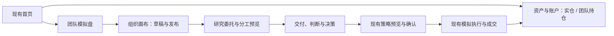

# 团队模拟盘 · 设计与开发文档审核入口

日期：2026-11-12。**Figma V6、详细设计和默认参数已获用户批准，并授权实现、验证及通过 PR 合入主干。** 本包保留批准时的目标规格；当前实现入口、模板与使用方法见 [团队模拟盘](../../team-workspace.md)，实际验证证据见 [验证记录](../../team-workspace-validation.md)。规格中的验收条件不自动表示测试已通过。

## 1. 从哪里开始审核

| 文档 | 主要回答 | 建议关注 |
|---|---|---|
| [产品与交互详细设计](2026-11-12-team-paper-product-design.zh-CN.md) | 每一页如何使用，字段如何填写，按钮何时能点，错误后怎么办 | 18 项 P01–P18；页面范围、组织编辑、发布与研究行为 |
| [技术设计与接口契约](2026-11-12-team-paper-technical-design.zh-CN.md) | 数据保存在哪里，模块如何复用，接口/版本/权限/运行如何衔接 | 数据字典、API、事务、状态、记忆隔离、历史关联与迁移 |
| [开发实施方案](../plans/2026-11-12-team-paper-implementation.zh-CN.md) | 按什么顺序开发，改哪些文件，每阶段交付什么 | 四阶段、16 项任务、依赖与需求覆盖表 |
| [验收与测试说明](2026-11-12-team-paper-acceptance.zh-CN.md) | 如何证明做对了，哪些失败必须覆盖 | 63 个场景、8 个拟新增测试契约、数据库/浏览器与 CI 验证 |

建议先读本页与产品文档，再审核技术和实施细节。反馈可以直接使用编号，例如“P08 汇报线再增加说明字段”“T12 研究预览要显示每个岗位预算”，方便精确修订。

## 2. 已锁定的产品方向

- 保留当前首页区块、原有导航与我的股友流程，只新增「团队模拟盘」一级入口。
- 首页原折线图比较实仓与团队模拟盘；“我的账户”卡进入统一「资产与账户」，展示对应账户的真实持仓数据。
- 团队配置采用可自由编辑的组织画布，包含部门、岗位、拖拽归组、汇报和协作关系。
- 允许同一成员向多个主管汇报；每一次研究单独明确唯一最终负责人。
- 内置模型与原生助手按能力承担岗位，业务职责与执行方式分开。
- 发布团队配置、发起研究、应用模拟策略分别表达；每个动作保存当时的依据与版本。

**本次没有重新设计全站。** 新增页面承载团队配置和团队工作记录；现有研究报告、策略组合、账户交易与记忆能力通过精确关联继续复用。

## 3. 已批准的默认参数

用户已统一批准以下 R01–R10。它们补足原型之外的运行行为；实际验收与限制另行记录。

| 编号 | 建议默认 | 对用户的影响 | 详细位置 |
|---|---|---|---|
| R01 | 一个模拟盘当前对应一个主责团队，一个团队当前对应一个盘；复用用复制配置 | 归属清楚；旧运行留在原团队版本；首期不引入一个团队同时调度多个盘 | P05/P12；技术绑定事务 |
| R02 | 一岗位归一个视觉部门，可有多条带责任范围的汇报线；责任汇报不成环，协作允许双向 | 支持矩阵组织；部门归组不自动赋权；连线不自动运行 | P07/P08 |
| R03 | 首期每团队最多 30 个岗位；每次最多 6 个实际执行岗位；并行默认 1、可选 2 | 大组织可按问题选择参与者；主管只读引用不占执行名额；数字是产品上限，不是性能基准 | P14/P18；技术运行边界 |
| R04 | 显式保存语义草稿，布局可自动保存；不完整组织可留草稿 | 移动节点轻量；职责/权限变化发布后才影响后续任务；冲突不覆盖 | P11/P12 |
| R05 | 可先发布未关联账户的组织版本；关联并通过运行检查后才发起账户研究 | 可以先搭组织；未配置岗位可保留为不参与运行，不伪装成可用执行器 | P09/P12 |
| R06 | 第一版由用户发起研究；分工按岗位职责生成可编辑建议，预览不调用付费 AI；资料更新/复核到期只提醒 | 执行者在确认范围内自主研究；AI 自动拟分工为后续建议；额外修订须有已确认次数和预算，默认不增加 | P13/P14 |
| R07 | 每次固定唯一最终负责人；允许单人研究，标自检而非独立复核 | 不强制三人模板；多主管共同引用交付而不重复派发 | P06/P14 |
| R08 | 团队判断与反思默认隔离；事实通过明确资料授权共享 | 同一用户的团队也不串私有记忆；同一公告不是多份独立证据 | P13/P15；技术来源授权 |
| R09 | 手机默认组织列表和关系表单，可查看图形；核心操作都有键盘等价入口 | 小屏无需精确拖线即可完成同样配置 | P10/P18 |
| R10 | 标准 A2A、自动发起研究、同条件受控实验留到后续 | 首期交付已批准的团队模拟盘闭环；现有原生助手接入仍在范围内 | 产品范围；技术非目标 |

名称长度、预览有效期、保存节流、错误码等更细参数在各详细文档列明；它们是实现默认值，不改变以上核心行为。

## 4. 一条完整的预期使用路径

以下全部为演示场景，不涉及真实持仓或收益承诺。

1. 用户在首页看到实仓、青松团队、远山团队三张账户卡和对应折线；点青松卡进入该盘持仓，返回后保留原图表区间。
2. 进入「团队模拟盘」，创建或打开青松团队。搭建研究组和风险组，将财报专家放入研究组；它可同时向研究负责人和风险负责人汇报，各自标明责任范围。
3. 保存草稿。仅调整位置不产生新研究版本；修改职责、模型或权限则作为语义草稿，经预览后发布 v2。仍在进行的 v1 任务继续记录 v1。
4. 发起“订单增长是否转化为经营现金流”的研究。选择账户、资料截止、精确来源和策略版本；本次指定研究负责人为唯一最终负责人，风险负责人负责复核。
5. 分工预览列出每项工作、执行岗位、输入、交付、依赖、预算和限制。专家只接到一份相同专项，两个主管可引用同一交付。
6. 内置/原生成员按确认任务交付证据、反证和未知项。若执行器断线且是否完成未知，界面保留未知状态，不自动重发或宣称成功。
7. 负责人形成维持、修改、等待或拒绝的判断。采纳提案进入现有策略预览与应用流程；研究完成本身不等于策略已应用或已经成交。
8. 后来点击某次模拟行动，可沿决策、论点具体版本、团队 v2、交付和原始来源查看当时依据。新版观点不会覆盖旧行动所用版本。

## 5. 原型到文档的对应关系

| 原型入口 | 设计链接 | 文档位置 |
|---|---|---|
| 首页：折线与我的账户 | [H · 首页](https://www.figma.com/design/0dw4pcW4fkotFzqL7RxHLG?node-id=249-998) | P01/P02；T03/T04 |
| 资产与账户：实仓/青松/远山 | [实仓](https://www.figma.com/design/0dw4pcW4fkotFzqL7RxHLG?node-id=249-1234)、[青松](https://www.figma.com/design/0dw4pcW4fkotFzqL7RxHLG?node-id=249-1441)、[远山](https://www.figma.com/design/0dw4pcW4fkotFzqL7RxHLG?node-id=251-2047) | P03/P04；T03 |
| 团队列表与新建 | [列表](https://www.figma.com/design/0dw4pcW4fkotFzqL7RxHLG?node-id=249-1644)、[新建](https://www.figma.com/design/0dw4pcW4fkotFzqL7RxHLG?node-id=250-8180) | P05；T05 |
| 组织画布、归组和关系 | [画布](https://www.figma.com/design/0dw4pcW4fkotFzqL7RxHLG?node-id=250-7136)、[归组](https://www.figma.com/design/0dw4pcW4fkotFzqL7RxHLG?node-id=250-7384)、[关系](https://www.figma.com/design/0dw4pcW4fkotFzqL7RxHLG?node-id=250-7635) | P06–P11；T06–T08 |
| 分工与发布 | [分工](https://www.figma.com/design/0dw4pcW4fkotFzqL7RxHLG?node-id=250-7878)、[发布](https://www.figma.com/design/0dw4pcW4fkotFzqL7RxHLG?node-id=250-8033) | P12–P16；T09–T14 |

原型共 11 个关键画板。Figma 演示的是预设交互状态，开发交付的是可任意编辑的真实画布；两者的验证方法不同。原型之外的空态、断网、版本冲突、未知执行、撤销权限、窄屏和键盘操作均在详细文档中补齐。

## 6. 源码依据与本轮交付状态

本包核对 `b9f1febea567438afd315d6dcf8000d02a64c53e` 的 React/NestJS/Drizzle 实现，实际可复用点包括：现有首页多账户比较、独立模拟盘、策略预览与应用、Council/研究 workflow、论点版本及来源、运行恢复与预算、导航返回上下文。团队版本/绑定/委托、自由画布、统一模拟持仓入口及贯穿底层的 team scope 是拟新增或增量扩展，不能把已有账户头像当成已经实现团队归属。

原设计基线为上述提交；实际开发从更新后的主干 `3a561b18bacbef8557996d18977e69b1f63380e8` 开始。实现增加10种可编辑组织模板：6种研究启发模板和4种虚构公司风格趣味模板；模板无连接、资料或交易授权。

文档保存在仓库的 `docs/superpowers/`，随实现显式纳入版本管理，不改变仓库的忽略规则。

验收可以使用 P/T/场景编号定位反馈。Figma 已批准的页面范围与交互方向保持有效。
